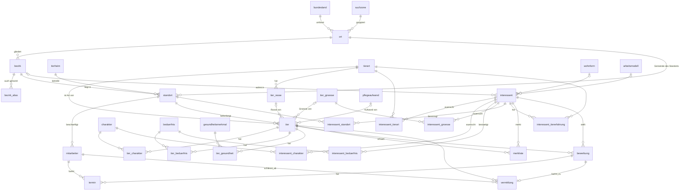
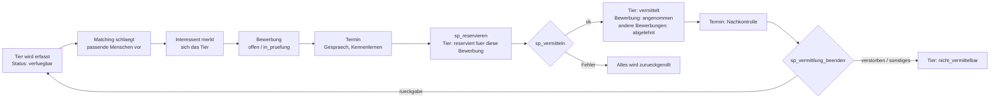
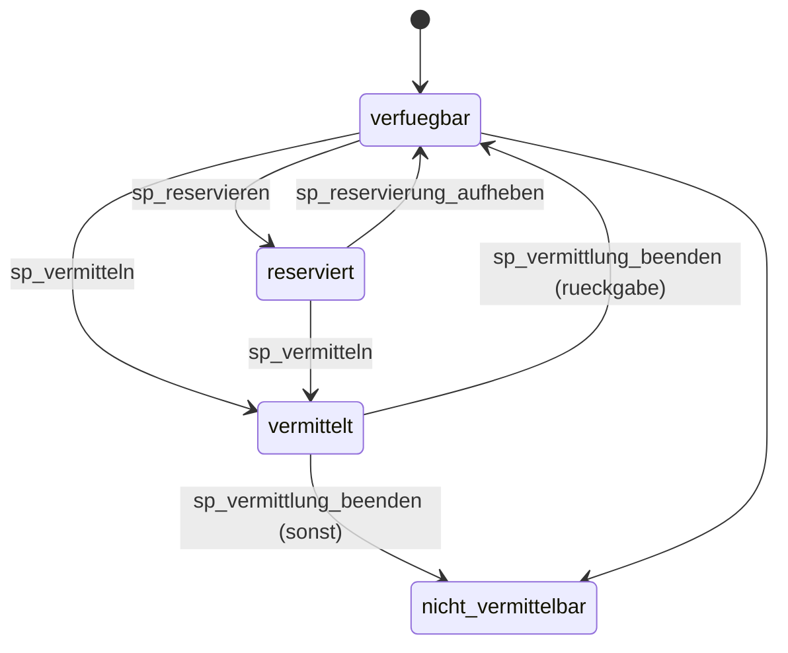
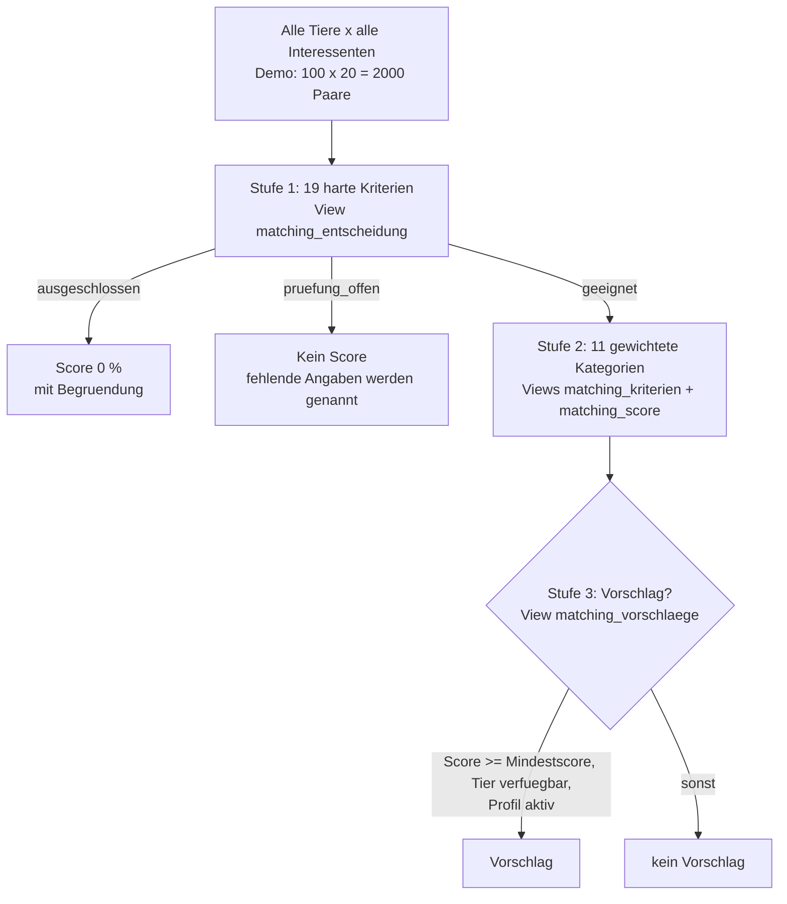

# Paws & Match: Tierheim-Datenbank mit Matching

Unser Projekt für das Modul Datenbanken: eine MySQL-Datenbank, die Tiere aus Berliner
Tierheimen mit passenden Menschen zusammenbringt. Jede Entscheidung soll nachvollziehbar
sein und eine Begründung haben.

In dieser Datei haben wir alles zusammengeschrieben, was man zum Verstehen des Projekts
braucht: Idee, Tabellen, Algorithmus, Abläufe, Demodaten, Tests und Ergebnisse. Sie ist
auch die Grundlage für unsere Präsentation (Gliederung in
[Abschnitt 13](#13-gliederung-für-die-präsentation)).

- Kurzanleitung zum Installieren: [paws_and_match/README.md](paws_and_match/README.md)
- Konventionen und Änderungsprotokoll: [context/ENTWICKLUNG.md](context/ENTWICKLUNG.md)

---

## Inhalt

1. [Die Idee in einem Satz](#1-die-idee-in-einem-satz)
2. [Das Projekt in Zahlen](#2-das-projekt-in-zahlen)
3. [Aufbau des Repositories und Installation](#3-aufbau-des-repositories-und-installation)
4. [Datenmodell: alle Tabellen](#4-datenmodell-alle-tabellen)
5. [Der Vermittlungsprozess](#5-der-vermittlungsprozess)
6. [Der Matching-Algorithmus](#6-der-matching-algorithmus)
7. [Rechenbeispiel: Bello und Profil 17](#7-rechenbeispiel-bello-und-profil-17)
8. [Views, Prozeduren und Trigger](#8-views-prozeduren-und-trigger)
9. [Datenqualität, Datenschutz und Löschkonzept](#9-datenqualität-datenschutz-und-löschkonzept)
10. [Demodaten und Ergebnisse](#10-demodaten-und-ergebnisse)
11. [Tests](#11-tests)
12. [Designentscheidungen, Grenzen und Ausblick](#12-designentscheidungen-grenzen-und-ausblick)
13. [Gliederung für die Präsentation](#13-gliederung-für-die-präsentation)
14. [Glossar](#14-glossar)
15. [Quellen](#15-quellen)
16. [Benutzungsoberfläche](#16-benutzungsoberfläche)

---

## 1. Die Idee in einem Satz

Tierheime tragen ihre Tiere ein, Interessenten ihre Lebenssituation. Die Datenbank prüft
zuerst harte Ausschlusskriterien (z. B. „Hund braucht Garten“) und berechnet dann für alle
passenden Paare einen Score von 0 bis 100 %, der zeigt, wie gut Tier und Mensch
zusammenpassen.

**Warum?** Viele Tiere kommen zurück ins Tierheim, weil die Vermittlung nicht gepasst hat
(zu wenig Zeit, falsche Wohnung, Ärger mit anderen Tieren im Haushalt). Mit einem
nachvollziehbaren Matching können die Mitarbeitenden gezielt die richtigen Leute ansprechen.

**Worauf wir geachtet haben**
- Jede Ablehnung hat einen Grund, den man sich anzeigen lassen kann.
- Fehlen Angaben, wird nicht geraten, sondern „Prüfung offen“ gemeldet.
- Matching und Vermittlungsregeln liegen in SQL; die Streamlit-Oberfläche bietet getrennte Bereiche für Interessenten, Mitarbeitende und Administration.
- Es gibt eine feste Installationsreihenfolge und selbstprüfende SQL-Tests.

---

## 2. Das Projekt in Zahlen

| Kennzahl | Wert |
|---|---|
| Tabellen | 36 |
| Views (Sichten) | 7 |
| Gespeicherte Prozeduren | 8 |
| Gespeicherte Funktionen | 5 |
| Trigger | 10 |
| Harte Kriterien | 19 |
| Gewichtete Score-Kategorien | 11 |
| Orte | Berlin + 30 vorbereitete Brandenburger Gemeinden, 42 Bezirke/Gemeindemittelpunkte und 96 Berliner Ortsteile |
| Organisations-Stammdaten | 39 recherchierte Organisationen und 33 Standorte in Berlin und Brandenburg |
| Tiere / Interessenten / Organisationen / Standorte | 100 / 20 / 39 / 33 |
| Demo: geprüfte Tier-Mensch-Paare | 2.000 (100 × 20, `matching_score`) |
| Demo: Vorschläge | 286 (`matching_vorschlaege`, verifiziert 2026-11-26 nach P5.2-Demodatenerweiterung) |
| Automatische Tests | 62 Orts- + 56 Matching- + 88 Prozedur-Tests (SQL, alle bestanden) + 107 pytest-Tests (alle bestanden), verifiziert 2026-11-26 |
| Ziel-/Testsystem | MySQL Community Server 8.4.13; Vollinstallation zweimal hintereinander (Idempotenz) am 2026-11-26 fehlerfrei verifiziert |

---

## 3. Aufbau des Repositories und Installation

```
README.md                    <- diese Datei
context/ENTWICKLUNG.md            <- Konventionen und Änderungsprotokoll
paws_and_match/
  README.md                  <- Installationsreihenfolge (Kurzfassung)
  01_grundlage/              <- Datenbank, Orte, Basistabellen mit Triggern, Stammdaten
  02_profil_ergaenzungen/    <- erweiterte Tier- und Interessentenprofile
  03_demo_daten/             <- ausgedachte Beispieldaten
  04_matching/               <- Matching: Entscheidung, Score, Vorschläge
  05_prozeduren/             <- Vorschläge, Reservierung, Vermittlung, Löschen
  06_ausgabe/                <- Beispielausgabe für einen Interessenten
  07_tests/                  <- automatische Tests
```

**Datenbankinstallation:** Die 21 SQL-Dateien in der Reihenfolge aus
[paws_and_match/README.md](paws_and_match/README.md) in einer Sitzung ausführen
(MySQL Workbench oder `mysql`-Konsole, Zeichensatz UTF-8). Man braucht MySQL 8.0.16 oder neuer.
Für die drei UI-Rollen Interessent, Mitarbeitende und Administration folgt anschließend das separate Benutzerkonten-Skript; Details stehen in Abschnitt 16.

**Achtung:** Schritt 1 löscht eine vorhandene Datenbank `paws_match` und legt sie neu an.
Dadurch kann man die Installation beliebig oft wiederholen.

| Schritt | Datei | Was passiert |
|---|---|---|
| 1 | `01_grundlage/01_datenbank_anlegen.sql` | Datenbank neu anlegen (UTF-8) |
| 2 | `01_grundlage/02_orte_anlegen.sql` | Bundesländer, Berlin, Bezirke, Ortsteile, Bezirkserkennung |
| 3 | `01_grundlage/03_tabellen_anlegen.sql` | 18 Basistabellen und 6 Trigger |
| 4 | `01_grundlage/04_stammdaten_anlegen.sql` | Tierarten, Charaktereigenschaften, Bedürfnisse |
| 5 | `02_profil_ergaenzungen/01_tierprofile_ergaenzen.sql` | Rasse, Größe, Pflegeaufwand, Gesundheit, Kleintierverträglichkeit |
| 6 | `02_profil_ergaenzungen/02_interessentenprofile_ergaenzen.sql` | Wohnform, Balkon, Arbeitsmodell, Wünsche, Erfahrung |
| 7 | `03_demo_daten/01_demo_profile.sql` | 100 Tiere (20 je Tierart), 20 Interessenten, Bewerbungen, Termine |
| 8 | `04_matching/01_matching_entscheidung.sql` | View für die harten Kriterien |
| 9 | `04_matching/02_matching_score.sql` | Kategorien, Gewichtung und Views für Kriterien und Score |
| 10 | `04_matching/03_matching_vorschlaege.sql` | Einstellungen (Mindestscore) und View mit allen Vorschlägen |
| 11 | `05_prozeduren/01_vorschlaege_fuer_interessent.sql` | passende Tiere für einen Interessenten |
| 12 | `05_prozeduren/02_vorschlaege_fuer_tier.sql` | passende Interessenten für ein Tier |
| 13 | `05_prozeduren/03_reservieren.sql` | Tier für eine Bewerbung reservieren |
| 14 | `05_prozeduren/04_reservierung_aufheben.sql` | Reservierung wieder aufheben |
| 15 | `05_prozeduren/05_vermitteln.sql` | Vermittlung abschließen |
| 16 | `05_prozeduren/06_vermittlung_beenden.sql` | Vermittlung beenden (Rückgabe) |
| 17 | `05_prozeduren/07_interessent_loeschen.sql` | Löschen oder Anonymisieren |
| 18 | `05_prozeduren/08_tier_loeschen.sql` | Tier hart löschen (ohne Historie) oder archivieren (mit Historie) |
| 19 | `06_ausgabe/01_matching_ausgabe.sql` | Ergebnisübersicht für Profil 17 |
| 20 | `07_tests/01_orts_tests.sql` | 62 Tests zu Orten und Bezirkserkennung |
| 21 | `07_tests/02_matching_tests.sql` | 56 Tests zum Matching |
| 22 | `07_tests/03_prozedur_tests.sql` | 88 Tests zu Vorschlägen, Reservierung, Vermittlung, Löschen und Standortberechtigung |

---

## 4. Datenmodell: alle Tabellen

### 4.1 Überblick (ER-Diagramm)



Die 36 Tabellen haben wir in sieben Gruppen eingeteilt:

| Gruppe | Tabellen | Anzahl |
|---|---|---|
| A. Organisation | `tierheim`, `standort`, `mitarbeiter` | 3 |
| B. Kataloge (Auswahllisten) | `tierart`, `charakter`, `beduerfnis`, `tier_rasse`, `tier_groesse`, `pflegeaufwand`, `gesundheitsmerkmal`, `wohnform`, `arbeitsmodell` | 9 |
| C. Profile | `tier`, `interessent`, `tier_anlage_token` | 3 |
| D. Zuordnungen (n:m) | `tier_charakter`, `tier_beduerfnis`, `tier_gesundheit`, `interessent_tierart`, `interessent_charakter`, `interessent_beduerfnis`, `interessent_groesse`, `interessent_standort`, `interessent_tiererfahrung` | 9 |
| E. Ablauf der Vermittlung | `merkliste`, `bewerbung`, `termin`, `vermittlung` | 4 |
| F. Einstellungen | `matching_kategorie`, `matching_gewichtung`, `matching_einstellung` | 3 |
| G. Orte | `bundesland`, `suchzone`, `ort`, `bezirk`, `bezirk_alias` | 5 |

Abkürzungen: PK = Primärschlüssel, FK = Fremdschlüssel, UQ = eindeutig.
`BOOLEAN` heißt 1 = ja, 0 = nein, `NULL` = unbekannt.

### 4.2 Gruppe A: Organisation

**`tierheim`**: ein Tierschutzverein bzw. Träger

| Spalte | Typ | Bedeutung |
|---|---|---|
| id | INT, PK | Nummer |
| name | VARCHAR | Name der Organisation |
| email | VARCHAR, nullable | veröffentlichter allgemeiner Kontakt (Format geprüft) |
| website, quelle_url | VARCHAR | offizielle Website und verwendeter Verzeichnislink |
| datenstatus, geprueft_am | ENUM, DATE | Herkunftsprüfung; Verzeichnis-Snapshot startet als `zu_pruefen` |

**`standort`**: Gebäude bzw. Filiale eines Tierheims

| Spalte | Typ | Bedeutung |
|---|---|---|
| id | INT, PK | Nummer |
| tierheim_id | FK → tierheim | Träger |
| name | VARCHAR | Name der Einrichtung oder des Vermittlungsnetzwerks |
| art | ENUM | Tierheim, Auffangstation, Katzenhaus, Pflegestellen oder Pflegeverein |
| ort_id | FK → ort | Gemeinde, in der die Einrichtung oder der Verein tätig ist |
| bezirk_id | FK → bezirk, nullable | Bezirk; bei Pflegestellennetzen nur Bezirksmittelpunkt |
| strasse, plz | nullable | veröffentlichte Anschrift; keine privaten Vorstandsadressen |
| breitengrad, laengengrad | nullable | OpenStreetMap-Koordinate, alternativ Bezirksschwerpunkt |
| kapazitaet | nullable INT > 0 | NULL, wenn keine Kapazität veröffentlicht ist |
| quelle_url, geprueft_am, datenstatus | VARCHAR/DATE/ENUM | Quelle, Abrufdatum und Prüfstatus des Standorts |

**`mitarbeiter`**: Beschäftigte eines Standorts

| Spalte | Typ | Bedeutung |
|---|---|---|
| id | INT, PK | Nummer |
| standort_id | FK → standort | Arbeitsort (darf nur Tiere dieses Standorts vermitteln) |
| name, email | VARCHAR | fiktives Demo-Team mit example.org-Adresse |

### 4.3 Gruppe B: Kataloge

| Tabelle | Spalten | Inhalt (Stammdaten) |
|---|---|---|
| `tierart` | id, name | Hund, Katze, Kaninchen, Meerschweinchen, Vogel, Reptil, Fisch |
| `charakter` | id, name | ruhig, verspielt, schüchtern, kontaktfreudig, eigenständig, aktiv, sozial |
| `beduerfnis` | id, name | 1 tägliche Medikamentengabe, 2 gesicherter Balkon, 3 Vergesellschaftung, 4 Training, 5 Spezialfutter, 6 täglicher Auslauf, 7 ruhiger Haushalt, 8 regelmäßige Pflege |
| `tier_rasse` | id, tierart_id, name | Rassen je Tierart (Rasse passt immer zur Tierart des Tieres) |
| `tier_groesse` | id, name, rang | klein (1), mittel (2), groß (3) |
| `pflegeaufwand` | id, name, rang | niedrig (1), mittel (2), hoch (3) |
| `gesundheitsmerkmal` | id, name, beschreibung, belastend | chronische Erkrankung, Allergie, Gelenkprobleme, Medikamentengabe, Behinderung (alle `belastend = 1`), geimpft, kastriert (`belastend = 0`) |
| `wohnform` | id, name | Wohnung, Haus, Reihenhaus, WG, sonstige |
| `arbeitsmodell` | id, name, anwesenheit | vor Ort (0,25), zu Hause (1,0), hybrid (0,75), wechselnde Zeiten (0,5), keine Erwerbstätigkeit (1,0) |

Über den Rang bei Größe und Pflegeaufwand kann man vergleichen, z. B. ob der Pflegeaufwand
eines Tieres höher ist als das, was jemand leisten möchte. `belastend` bei den
Gesundheitsmerkmalen trennt echten Mehraufwand (chronische Erkrankung) von reiner
Dokumentation (geimpft); `anwesenheit` sagt, welchen Anteil des Tages jemand üblicherweise
zu Hause ist. Beides geht in den Score ein.

### 4.4 Gruppe C: Profile

**`tier`**: ein Tier im Tierheim und was es von seinem neuen Zuhause braucht

| Spalte | Typ | Bedeutung |
|---|---|---|
| id | INT, PK | Nummer |
| standort_id | FK → standort | Wo das Tier lebt |
| tierart_id | FK → tierart | Hund, Katze, … |
| rasse_id | FK → tier_rasse (optional) | Rasse |
| name | VARCHAR | Name |
| geburtsdatum, geburt_geschaetzt | DATE, BOOLEAN | Alter (ggf. geschätzt) |
| geschlecht | ENUM | weiblich / männlich / unbekannt |
| gewicht_kg, beschreibung, foto_url | | Beschreibende Angaben |
| status | ENUM | verfuegbar, reserviert, vermittelt, nicht_vermittelbar |
| reserviert_fuer_bewerbung_id | FK → bewerbung | bei `reserviert` Pflicht: für welche Bewerbung (sonst NULL, per CHECK) |
| aktivitaet | 1–5 | Energielevel (1 = ruhig, 5 = sehr aktiv) |
| groesse_id | FK → tier_groesse | klein / mittel / groß |
| pflegeaufwand_id | FK → pflegeaufwand | niedrig / mittel / hoch |
| min_wohnflaeche | m² | Mindestwohnfläche |
| garten_noetig | BOOLEAN | Garten erforderlich |
| treppen_vermeiden | BOOLEAN | keine Treppen ohne Aufzug |
| kinder_ok, hund_ok, katze_ok, kleintiere_ok | BOOLEAN | verträglich mit Kindern / Hunden / Katzen / Kleintieren |
| min_zeit | Stunden/Tag | Mindestbetreuungszeit |
| max_allein | Stunden/Tag | maximal allein |
| min_erfahrung | 0–5 | nötige Erfahrung mit dieser Tierart |
| monatskosten | € | erwartete Kosten pro Monat |
| medizin_noetig | BOOLEAN | medizinische Versorgung nötig |

**`interessent`**: ein Mensch, der ein Tier aufnehmen möchte, und seine Lebenssituation

| Spalte | Typ | Bedeutung |
|---|---|---|
| id | INT, PK | Nummer |
| pseudonym | VARCHAR | Anzeigename (kein Klarname nötig) |
| email | VARCHAR, UQ | Kontakt |
| bezirk_id | FK → bezirk | Wohnbezirk aus der Auswahlliste (Nähe); Pflicht bei aktiven Profilen |
| aktiv | BOOLEAN | Profil sichtbar/aktiv |
| wohnflaeche | m² | Wohnungsgröße |
| wohnform_id | FK → wohnform | Wohnung, Haus, … |
| garten, balkon, balkon_gesichert | BOOLEAN | Außenbereiche (gesicherter Balkon nur mit Balkon, per CHECK) |
| etage, aufzug | INT, BOOLEAN | Stockwerk und Aufzug |
| haushaltsgroesse, kinder | INT, BOOLEAN | Personen im Haushalt, Kinder |
| hund_vorhanden, katze_vorhanden, kleintiere_vorhanden | BOOLEAN | vorhandene Tiere |
| zeit_stunden | Stunden/Tag | verfügbare Zeit für das Tier |
| allein_stunden | Stunden/Tag | wie lange das Tier allein wäre |
| arbeitsmodell_id | FK → arbeitsmodell | Arbeitssituation |
| erfahrung | 0–5 | allgemeine Tiererfahrung |
| budget | €/Monat | verfügbares Budget |
| medizin_bereit, tierarzt_bereit, training_bereit | BOOLEAN | Bereitschaft zu Medikamenten, Tierarzt, Training |
| max_pflegeaufwand_id | FK → pflegeaufwand | maximal akzeptierter Pflegeaufwand |
| aktivitaet | 1–5 | eigenes Aktivitätslevel |
| wunschalter_min, wunschalter_max | Jahre | gewünschtes Alter des Tieres |

### 4.5 Gruppe D: Zuordnungen (n:m-Beziehungen)

Ein Tier kann mehrere Charakterzüge haben und ein Mensch mehrere Wünsche. Dafür gibt es
Zuordnungstabellen, deren Primärschlüssel aus beiden IDs besteht.

| Tabelle | Bedeutung | Zusatzspalten |
|---|---|---|
| `tier_charakter` | Charakter des Tieres | keine |
| `tier_beduerfnis` | verbindliche Bedürfnisse des Tieres | hinweis |
| `tier_gesundheit` | Gesundheitsmerkmale | bestaetigt, geprueft_am, hinweis |
| `interessent_tierart` | gewünschte Tierarten | keine |
| `interessent_charakter` | gewünschte Charakterzüge | keine |
| `interessent_beduerfnis` | Zusage zu einem Bedürfnis | bestaetigt (1 = ja, 0 = abgelehnt) |
| `interessent_groesse` | gewünschte Größen | keine |
| `interessent_standort` | bevorzugte Standorte | keine |
| `interessent_tiererfahrung` | Erfahrung je Tierart | erfahrungslevel 0–5 |

Wird ein Tier oder Interessent gelöscht, verschwinden diese Einträge automatisch mit
(ON DELETE CASCADE).

### 4.6 Gruppe E: Ablauf der Vermittlung

| Tabelle | Bedeutung | Wichtige Spalten / Regeln |
|---|---|---|
| `merkliste` | Tier gemerkt | (interessent_id, tier_id), erstellt_am |
| `bewerbung` | Bewerbung auf ein Tier | status: offen, in_pruefung, abgelehnt, zurueckgezogen, angenommen; pro Paar nur eine Bewerbung (UQ) |
| `termin` | Gespräch, Kennenlernen, Nachkontrolle | bewerbung_id, mitarbeiter_id, zeitpunkt, art |
| `vermittlung` | abgeschlossene Vermittlung | bewerbung_id (UQ), tier_id, mitarbeiter_id, vermittelt_am, beendet_am, beendigungsgrund (rueckgabe / verstorben / sonstiges, nur zusammen mit beendet_am); die berechnete Spalte `aktives_tier` sorgt dafür, dass ein Tier nur eine aktive Vermittlung haben kann. Nach dem Beenden wird `aktives_tier` NULL, dasselbe Tier kann also erneut vermittelt werden |

Diese Tabellen sind die Historie. Sie werden nie automatisch gelöscht und verhindern, dass
Tiere oder Personen mit Vorgeschichte aus Versehen gelöscht werden.

### 4.7 Gruppe F: Einstellungen

**`matching_kategorie`**: welche Score-Kategorien es überhaupt gibt (11 Zeilen). Damit steht
die Anzahl nirgends mehr als Zahl im Code.

**`matching_gewichtung`**: wie wichtig jede Kategorie ist (eine Zeile je Kategorie,
zusammen genau 100)

| Kategorie | Gewicht |
|---|---|
| Tierart | 20 |
| Aktivität | 13 |
| Zeit | 13 |
| Wohnsituation | 13 |
| Erfahrung | 9 |
| Verträglichkeit | 9 |
| Gesundheit | 7 |
| Alltagsrhythmus | 5 |
| Budget | 4 |
| Charakter | 4 |
| Nähe | 3 |
| **Summe** | **100** |

**`matching_einstellung`**: Stellschrauben des Tierheims als Schlüssel-Wert-Paare. Im Moment
steht dort nur `mindestscore` (Standard 50), also ab wie viel Prozent ein geeignetes Paar
vorgeschlagen wird.

Gewichte und Mindestscore kann man in den Tabellen ändern, ohne an der SQL-Logik etwas
anzufassen.

### 4.8 Gruppe G: Orte und Bezirkserkennung

Ortsangaben speichern wir nicht als Freitext, sondern als Verweis auf einen Eintrag aus einer
festen Liste (Dropdown). So landen keine Tippfehler oder unterschiedlichen Schreibweisen in
der Datenbank. Aufbau von groß nach klein:

| Tabelle | Spalten | Inhalt |
|---|---|---|
| `bundesland` | id (amtlicher Länderschlüssel), name, kuerzel | alle 16 Bundesländer |
| `suchzone` | id, name, reihenfolge | Berlin, Berliner Umland, weiteres Brandenburg |
| `ort` | id, bundesland_id, name, ags, suchzone_id, aktiv | Berlin und 30 Brandenburger Gemeinden |
| `bezirk` | id, ort_id, name, schluessel, suchname, Koordinaten | 12 Berliner Bezirke sowie Gemeinde-Mittelpunkte |
| `bezirk_alias` | id, bezirk_id, name, suchname | 92 Einträge: Ortsteile und frühere Bezirke, z. B. Prenzlauer Berg gehört zu Pankow (alle 96 Ortsteile werden erkannt, gleichnamige wie „Spandau“ über den Bezirksnamen) |

**Dropdown:** Die View `bezirk_auswahl` liefert alle Bezirke der aktiven Orte in Berlin und
Brandenburg.

**Suchgebiet und Entfernung:** Interessenten können optional eine maximale Suchzone und einen
Umkreis von 5 bis 250 km in 5-km-Schritten angeben. Beide Angaben wirken als harte Matching-
Filter. Für die Entfernung verwenden wir den Mittelpunkt des Bezirks des Interessenten und die
OSM-Koordinate des Standorts (oder, falls nicht verfügbar, den Bezirksmittelpunkt). Die private
Wohnadresse wird nicht gespeichert.

**Freitext verstehen (z. B. wenn später echte Daten importiert werden):** Die Funktion
`fn_bezirk_id('Neuköln', NULL)` sucht den passenden Bezirk in drei Schritten:

1. **Vereinheitlichen** (`fn_text_normalisieren`): alles klein, ä wird ae, ö wird oe,
   ü wird ue, ß wird ss, Leerzeichen, Bindestriche und Klammern fallen weg. Ein „Bezirk“ am
   Anfang wird ignoriert. „Neukölln“, „NEUKOELLN“ und „neukölln “ werden so alle zu `neukoelln`.
2. **Exakt suchen** in Bezirksnamen und Ortsteilen, auch wenn der Ortsname davor oder
   dahinter steht („Berlin-Mitte“, „Lichtenberg (Berlin)“).
3. **Tippfehler erlauben** (`fn_levenshtein`): Der ähnlichste Name wird genommen, wenn er
   bei 4 bis 5 Buchstaben höchstens 1 Zeichen und ab 6 Buchstaben höchstens 2 Zeichen
   abweicht und es nur einen solchen Treffer gibt. Beispiele: „Neuköln“ wird Neukölln,
   „Spandua“ wird Spandau, „Neukölln“ (kaputte Umlaute) wird Neukölln.

Ist eine Angabe unbekannt oder passt sie zu mehreren Bezirken, kommt `NULL` zurück. Geraten
wird also nie. `fn_bezirk_id_pflicht('…')` gibt in so einem Fall stattdessen eine Fehlermeldung
aus, das ist für Importe gedacht. Mit dem zweiten Parameter von `fn_bezirk_id` kann man die
Suche auf einen Ort beschränken. Das wird wichtig, sobald es z. B. „Mitte“ in Berlin und
in Hamburg gibt.

**Erweiterung auf ganz Deutschland:** neue Zeilen in `ort` (mit Gemeindeschlüssel aus dem
amtlichen Gemeindeverzeichnis) und `bezirk` eintragen und `aktiv = 1` setzen. Orte ohne
Bezirke bekommen einen Bezirk mit dem Ortsnamen. Tabellen, Matching und Erkennung müssen
dafür nicht geändert werden, das haben wir in einem Test mit Hamburg ausprobiert.

---

## 5. Der Vermittlungsprozess



**Status eines Tieres**



**Schutzregeln (Trigger und Prozedur)**
- Bewerben kann man sich nur auf verfügbare Tiere und nur mit aktivem Profil.
- Der Status `reserviert` geht nur zusammen mit einer laufenden Bewerbung für genau dieses Tier:
  ein CHECK erzwingt, dass die Bewerbungsnummer gesetzt ist, ein Trigger prüft, dass sie wirklich
  zu diesem Tier gehört. Reserviert, ohne dass jemand weiß für wen, kann also nicht passieren.
- Eine Vermittlung kann nur über `sp_vermitteln` angelegt werden, direkte Einträge werden blockiert.
- `sp_vermitteln` prüft, ob die Bewerbung existiert, ob der Mitarbeiter am Standort des Tieres
  arbeitet, ob das Profil aktiv ist und ob der Status passt. Ist das Tier für eine *andere*
  Bewerbung reserviert, bricht die Prozedur ab. Alles läuft in einer Transaktion,
  geht etwas schief, wird nichts gespeichert.
- Andere offene Bewerbungen für dasselbe Tier werden automatisch abgelehnt (mit Hinweis in der Notiz).
- Beenden kann eine Vermittlung nur `sp_vermittlung_beenden`, ebenfalls per Trigger abgesichert.
  Eine einmal beendete Vermittlung lässt sich nicht wieder öffnen, die Historie bleibt ehrlich.

---

## 6. Der Matching-Algorithmus

### 6.1 Überblick: drei Stufen



Man kann es sich so vorstellen: Stufe 1 ist der Türsteher (darf das Paar überhaupt rein?),
Stufe 2 die Benotung (wie gut passt es?) und Stufe 3 die Empfehlungsliste.

### 6.2 Stufe 1: harte Kriterien (Ampel)

Jedes Kriterium bekommt eine Ampelfarbe:

| Farbe | Bedeutung |
|---|---|
| grün (erfüllt) | Anforderung erfüllt oder für dieses Tier egal |
| gelb (Prüfung offen) | Angaben fehlen oder ein Bedürfnis ist noch nicht bestätigt |
| rot (ausgeschlossen) | Anforderung ist sicher nicht erfüllt |

Ist ein Kriterium rot, ist das Paar *ausgeschlossen*. Sonst führt ein gelbes Kriterium zu
*pruefung_offen*. Nur wenn alles grün ist, ist das Paar *geeignet*. Die Gründe werden immer
als Text mitgeliefert.

| # | Kriterium | rot, wenn … |
|---|---|---|
| 1 | Tierartwunsch | die Tierart nicht zu den Wünschen gehört (gar keine Wünsche: gelb) |
| 2 | Garten | Tier braucht Garten, Mensch hat keinen |
| 3 | Treppen | Tier soll Treppen meiden, Wohnung liegt oben ohne Aufzug |
| 4 | Kinderverträglichkeit | Kinder im Haushalt, Tier nicht kinderverträglich |
| 5 | Hundeverträglichkeit | Hund vorhanden, Tier nicht hundeverträglich |
| 6 | Katzenverträglichkeit | Katze vorhanden, Tier nicht katzenverträglich |
| 7 | Kleintierverträglichkeit | Kleintiere vorhanden, Tier nicht kleintierverträglich |
| 8 | Wohnfläche | Wohnung kleiner als Mindestfläche |
| 9 | Betreuungszeit | weniger Zeit als das Tier braucht |
| 10 | Alleinzeit | Tier wäre länger allein als erlaubt |
| 11 | Tierartspezifische Erfahrung | Erfahrung mit dieser Tierart zu gering |
| 12 | Monatliches Budget | Budget kleiner als Monatskosten |
| 13 | Medizinische Versorgung | Tier braucht Medikamente, Mensch nicht bereit |
| 14 | Tierarztbereitschaft | Tier braucht Medizin, Mensch lehnt Tierarztbesuche ab |
| 15 | Pflegeaufwand | Pflegeaufwand des Tieres höher als akzeptiert |
| 16 | Bedürfnis abgelehnt | Mensch hat ein Bedürfnis des Tieres ausdrücklich abgelehnt |
| 17 | Bedürfnisse bestätigt | nie rot, nur gelb: ein Bedürfnis des Tieres ist noch nicht bestätigt |
| 18 | Suchzone | der Standort liegt außerhalb der ausgewählten Zone |
| 19 | Entfernung | der Standort liegt außerhalb des eingestellten Umkreises; bei unbekannter Entfernung gelb |

Training (Bedürfnis-ID 4) und gesicherter Balkon (ID 2) haben keine eigenen Kriterien
mehr (vormals 15/17): Sie liefen doppelt über die direkten Spalten `training_bereit`/
`balkon`+`balkon_gesichert` **und** über Kriterium 16/17 (`interessent_beduerfnis`),
das als generischer Mechanismus für beliebige Bedürfnis-IDs sowieso schon vorhanden war
und von der UI beim Speichern automatisch aus denselben Spalten abgeleitet wird
(`ui/queries.py`, `BEDUERFNIS_AUS_PROFILFELD`). Seit 2026-11-26 zählt dafür nur noch
der generische Pfad (Product-Owner-Entscheidung, siehe `team/decisions.md`).
Medikamente (ID 1) bleiben als **zwei** eigene Kriterien (13, 14) bestehen: Kriterium 13
prüft zusätzlich `tier.medizin_noetig` (unabhängig von einer `tier_beduerfnis`-Zeile), und
Kriterium 14 (Tierarztbereitschaft) hat gar keine Entsprechung im generischen Mechanismus
(kein eigener `beduerfnis`-Katalogeintrag für Tierarztbesuche) – beide wären beim Entfernen
ersatzlos weggefallen, nicht nur dedupliziert.

Für alle Kriterien gilt: Fehlt eine Angabe, die man braucht, ist das Ergebnis gelb.

### 6.3 Stufe 2: der Score (0 bis 100 %)

Für jedes geeignete Paar bekommt jede der 11 Kategorien einen Wert zwischen 0 und 1
(Teilpassung). Der Score ist die gewichtete Summe:

```
Score (%) = Σ ( Teilpassung der Kategorie × Gewicht der Kategorie )      (Gewichte = 100)
```

**Die Idee dahinter („Reserve“):** Ein harter Grenzwert sagt nur, *ob* etwas reicht. Der Score
soll zeigen, *wie gut* es passt. Wer die Mindestanforderung genau erfüllt, bekommt die halbe
Punktzahl, wer doppelt so viel bietet wie nötig, die volle.

```
Reserve(Wert, Mindestwert) = 0,5 + 0,5 × (Wert − Mindestwert) / Mindestwert   (begrenzt auf 0 … 1)
```

| Angebot im Verhältnis zur Anforderung | Teilpassung |
|---|---|
| unter dem Minimum | 0 (fliegt aber schon in Stufe 1 raus) |
| genau das Minimum (100 %) | 0,5 |
| 150 % | 0,75 |
| 200 % oder mehr | 1,0 |
| Tier hat keine Anforderung (Minimum 0) | 1,0 |

**Die 11 Kategorien** (welche es gibt, steht in `matching_kategorie`)

| Kategorie | Gewicht | So wird der Wert berechnet |
|---|---|---|
| Tierart | 20 | Durchschnitt aus: Tierart gewünscht (1/0), Größe (Wunschgröße = 1, eine Stufe daneben = 0,5, zwei = 0) und Alter (im Wunschbereich = 1, pro Jahr daneben 0,2 weniger). Wer keine Größe oder kein Alter angegeben hat, bei dem zählt das nicht mit. |
| Aktivität | 13 | 1 − \|Aktivität Tier − Aktivität Mensch\| / 4, also gleich = 1 und ganz verschieden = 0 |
| Zeit | 13 | Durchschnitt aus Betreuungszeit (Reserve) und Alleinzeit (genau am Maximum = 0,5, nie allein = 1) |
| Wohnsituation | 13 | Reserve der Wohnfläche gegenüber der Mindestfläche |
| Erfahrung | 9 | Minimum erreicht = 0,5, Höchststufe 5 = 1, dazwischen linear |
| Verträglichkeit | 9 | Durchschnitt über Kinder, Hunde, Katzen, Kleintiere: verträglich = 1, unverträglich aber nicht im Haushalt = 0,5 (das schränkt später ein) |
| Gesundheit | 7 | Hat das Tier kein bestätigtes *belastendes* Gesundheitsmerkmal, gibt es 1. Sonst zählt die Bereitschaft des Menschen: Durchschnitt aus `medizin_bereit` und `tierarzt_bereit`. Unbestätigte Merkmale (bloßer Verdacht) zählen nicht mit. |
| Alltagsrhythmus | 5 | 1 − (1 − max_allein / 8) × (1 − Anwesenheit laut Arbeitsmodell). Je kürzer ein Tier allein bleiben darf, desto wichtiger ist, dass jemand zu Hause ist; ab 8 h Alleinzeit ist das Arbeitsmodell egal. |
| Budget | 4 | Reserve des Budgets gegenüber den Monatskosten |
| Charakter | 4 | Anteil der gewünschten Charakterzüge, die das Tier hat |
| Nähe | 3 | Wunschstandort = 1, sonst sinkt der Wert mit der Entfernung bis auf 0 |

**Fehlende Angaben:** Eine Kategorie ohne Daten gibt 0 Punkte, wir bewerten also lieber
vorsichtig. Wie viel vom Gewicht wirklich auf Daten beruht, zeigt die Datenabdeckung
(z. B. 95 % heißt: 5 Gewichtspunkte fehlen).

**Gültige Gewichtung:** Einen Score gibt es nur, wenn jede Kategorie aus `matching_kategorie`
ein Gewicht hat und die Gewichte zusammen 100 ergeben. Sonst gibt es weder Score noch Vorschläge.

### 6.4 Stufe 3: Vorschläge

Ein Paar wird vorgeschlagen, wenn alles davon zutrifft:

1. Eignung = *geeignet* (alle 19 Kriterien grün)
2. das Tier ist *verfügbar*
3. das Interessentenprofil ist *aktiv*
4. die Gewichtung ist gültig
5. der Score erreicht den Mindestscore aus `matching_einstellung` (Standard 50 %)

Sortiert wird nach Score (höchster zuerst) und dann nach Datenabdeckung.
Diese Regeln stehen nur an einer Stelle, in der View `matching_vorschlaege`. Prozeduren,
Ausgabe und Tests benutzen alle diese View.

Für eine Vorschau mit einem *anderen* Mindestscore als dem gespeicherten (z. B. ein
Regler in der Oberfläche, der zeigt, wie viele Vorschläge ein anderer Wert ergäbe) gibt es
`matching_vorschlaege_alle`: dieselbe View, aber ohne Punkt 5 – wer eine andere Schwelle
braucht, filtert selbst mit `match_prozent >= <Wert>` und baut die übrigen vier Regeln
nicht noch einmal nach.

---

## 7. Rechenbeispiel: Bello und Profil 17

**Bello** (Hund, groß, ca. 6 Jahre, Standort Mitte): sehr aktiv (5), braucht 70 m² und
einen Garten, mindestens 3 h Betreuung, höchstens 4 h allein, Hundeerfahrung ab 3,
350 € im Monat, verträglich mit Kindern und Hunden, aber nicht mit Katzen und Kleintieren,
Charakter verspielt und aktiv, Bedürfnis täglicher Auslauf.

**Profil 17** (Pankow): 100 m² mit Garten, Kinder und ein Hund im Haushalt, 8 h Zeit,
3 h allein, Budget 500 €, Aktivität 4, Hundeerfahrung 4, wünscht Hund oder Kaninchen,
Größe mittel/groß, Alter 1–12 Jahre, Charakter verspielt und kontaktfreudig,
Wunschstandort Mitte, hat „täglicher Auslauf“ bestätigt.

**Stufe 1:** alle 19 Kriterien sind grün, das Paar ist also *geeignet*.

**Stufe 2:**

| Kategorie | Rechnung | Teilpassung | × Gewicht | Punkte |
|---|---|---|---|---|
| Tierart | Hund gewünscht (1), groß gewünscht (1), Alter passt (1) | 1,00 | 20 | 20,00 |
| Aktivität | 1 − \|5 − 4\| / 4 | 0,75 | 13 | 9,75 |
| Zeit | Betreuung 8 h statt 3 h = 1,0; allein 3 h von max. 4 h = 0,625; Durchschnitt | 0,81 | 13 | 10,56 |
| Wohnsituation | 0,5 + 0,5 × (100 − 70) / 70 | 0,71 | 13 | 9,29 |
| Erfahrung | 0,5 + 0,5 × (4 − 3) / (5 − 3) | 0,75 | 9 | 6,75 |
| Verträglichkeit | Kinder 1, Hund 1, Katze 0,5, Kleintiere 0,5; Durchschnitt | 0,75 | 9 | 6,75 |
| Gesundheit | Bello ist nur geimpft und kastriert, kein belastendes Merkmal | 1,00 | 7 | 7,00 |
| Alltagsrhythmus | Profil 17 ist überwiegend zu Hause (Anwesenheit 1,0) | 1,00 | 5 | 5,00 |
| Budget | 0,5 + 0,5 × (500 − 350) / 350 | 0,71 | 4 | 2,86 |
| Charakter | 1 von 2 Wünschen (verspielt) | 0,50 | 4 | 2,00 |
| Nähe | Wunschstandort Mitte | 1,00 | 3 | 3,00 |
| **Summe** | | | **100** | **≈ 83,0 %** |

**Stufe 3:** 83,0 % ist mehr als der Mindestscore von 50 %, Bello ist verfügbar und das Profil
aktiv, also gibt es einen Vorschlag.

**Gegenbeispiel Profil 19** (möchte auch einen Hund): hat eine Katze und nur
Hundeerfahrung 2. Damit sind *Katzenverträglichkeit* und *Tierartspezifische Erfahrung* rot,
das Paar ist ausgeschlossen (Score 0 %) und beide Gründe werden angezeigt.

**Weitere Werte aus den Tests**
- Profil 1 und Bruno (passt fast perfekt, Nähe aus Distanz berechnet): 95,3 %
- Profil 17 und Bello, wenn alle Werte genau auf dem Minimum liegen: 63,3 %
  (geeignet, aber knapp, und genau das soll der Score zeigen)
- Profil 17 und Bello ohne angegebene Charakterwünsche: 81,0 % bei 96 % Datenabdeckung

---

## 8. Views, Prozeduren und Trigger

### Views (Sichten = gespeicherte Abfragen)

| View | Zweck | Wichtige Spalten |
|---|---|---|
| `matching_entscheidung` | Stufe 1 für alle Paare | eignung, ausschlussgruende, offene_pruefungen |
| `matching_kriterien` | Teilpassung je Paar und Kategorie (11 Zeilen pro Paar) | kriterium, passung |
| `matching_score` | Stufe 2: Score je Paar | match_prozent, datenabdeckung_prozent, gewichtung_vollstaendig |
| `matching_vorschlaege` | Stufe 3: alle Vorschläge | tier, interessent, standort, entfernung_km, match_prozent, begruendung |
| `matching_vorschlaege_alle` | Basis von `matching_vorschlaege` ohne Mindestscore-Grenze (für eine Vorschau mit einem anderen Schwellenwert) | wie `matching_vorschlaege`, ohne `mindestscore` |
| `bezirk_auswahl` | Dropdown der wählbaren Bezirke | bezirk_id, bezirk, ort, bundesland |
| `bezirk_suchbegriff` | alle Schreibweisen je Bezirk für die Erkennung | bezirk_id, suchbegriff |

### Gespeicherte Prozeduren

| Prozedur | Aufruf | Ergebnis |
|---|---|---|
| `sp_vorschlaege_fuer_interessent` | `CALL sp_vorschlaege_fuer_interessent(17);` | passende Tiere, bester Score zuerst |
| `sp_vorschlaege_fuer_tier` | `CALL sp_vorschlaege_fuer_tier(16);` | passende Menschen für ein Tier |
| `sp_reservieren` | `CALL sp_reservieren(bewerbung_id, mitarbeiter_id);` | Tier für genau diese Bewerbung reservieren |
| `sp_reservierung_aufheben` | `CALL sp_reservierung_aufheben(tier_id, mitarbeiter_id);` | Tier wieder freigeben |
| `sp_vermitteln` | `CALL sp_vermitteln(bewerbung_id, mitarbeiter_id);` | schließt eine Vermittlung sicher ab |
| `sp_vermittlung_beenden` | `CALL sp_vermittlung_beenden(vermittlung_id, mitarbeiter_id, 'rueckgabe', 'Notiz');` | Vermittlung beenden; bei Rückgabe wird das Tier wieder verfügbar |
| `sp_interessent_loeschen` | `CALL sp_interessent_loeschen(id, @ergebnis);` | `geloescht` oder `anonymisiert` |

Die Vorschlagsprozeduren geben verständliche Fehlermeldungen aus, z. B. „Interessentenprofil
nicht gefunden“, „Tier ist aktuell nicht für neue Vorschläge verfügbar“ oder „Jede
Matching-Kategorie braucht ein Gewicht und zusammen müssen sie 100 ergeben“.

### Gespeicherte Funktionen

| Funktion | Beispiel | Ergebnis |
|---|---|---|
| `fn_text_normalisieren` | `fn_text_normalisieren('Neukölln')` | `neukoelln` |
| `fn_levenshtein` | `fn_levenshtein('spandau', 'spandua')` | `2` (Anzahl Tippfehler) |
| `fn_bezirk_id` | `fn_bezirk_id('Prenzlauer Berg', NULL)` | `3` (Pankow) oder `NULL` |
| `fn_bezirk_id_pflicht` | `fn_bezirk_id_pflicht('Atlantis')` | Fehler „Bezirk nicht erkannt …“ |

### Trigger (automatische Prüfungen)

| Trigger | Wann | Prüfung |
|---|---|---|
| `trg_bewerbung_pruefen` | vor neuer Bewerbung | Tier verfügbar, Profil aktiv |
| `trg_vermittlung_pruefen` | vor neuer Vermittlung | nur über `sp_vermitteln` möglich |
| `trg_tier_reservierung` | vor Änderung eines Tieres | Reservierung nur mit laufender Bewerbung für dieses Tier |
| `trg_vermittlung_beenden_pruefen` | vor Änderung einer Vermittlung | Beenden nur über `sp_vermittlung_beenden`, kein Wiederöffnen |
| `trg_bezirk_suchname_neu` / `_aendern` | vor Einfügen/Ändern eines Bezirks | Suchname automatisch vereinheitlichen |
| `trg_bezirk_alias_suchname_neu` / `_aendern` | vor Einfügen/Ändern eines Ortsteils | Suchname automatisch vereinheitlichen |

### Beispielausgabe

`06_ausgabe/01_matching_ausgabe.sql` zeigt für Profil 17 alle Tiere mit Status:
„Als Vorschlag anzeigen“, „Kein Vorschlag: Ausschlusskriterium“, „… Angaben prüfen“,
„… Tier nicht verfügbar“, „… Profil inaktiv“, „… Gewichtung unvollständig“ oder
„… Mindestscore nicht erreicht“, jeweils mit Begründung.

---

## 9. Datenqualität, Datenschutz und Löschkonzept

**Datenqualität (CHECK-Constraints):** Ungültige Werte werden gar nicht erst gespeichert.
- Wertebereiche: Aktivität 1 bis 5, Erfahrung 0 bis 5, Stunden 0 bis 24, Flächen und Kosten
  nicht negativ, Kapazität größer 0
- Ja/Nein-Felder nur 0 oder 1
- E-Mail-Adressen im Format `x@y.z`
- Betreuungszeit plus Alleinzeit höchstens 24 Stunden (bei Tier und Mensch)
- gewünschtes Mindestalter nicht über dem Höchstalter, gesicherter Balkon nur mit Balkon
- die Rasse muss zur Tierart passen
- Bezirke nur aus der Auswahlliste (im Moment Berlin). Derselbe Bezirk kann nicht ein
  zweites Mal in anderer Schreibweise angelegt werden (z. B. „Neukoelln“ neben „Neukölln“)

**Datenschutz**
- Interessenten tauchen nur mit Pseudonym auf, nicht mit ihrem echten Namen.
- Tiere, Interessenten und Mitarbeitende sind ausgedachte Demodaten (E-Mail-Adressen mit `example.org`). Organisations- und Standortdaten sind recherchierte öffentliche Angaben und als `zu_pruefen` markiert.

**Löschkonzept**

| Fall | Verhalten |
|---|---|
| Interessent ohne Bewerbungen | wird gelöscht, mit Wünschen, Merkliste usw. (Cascade) |
| Interessent mit Bewerbungen | wird anonymisiert: Name und E-Mail ersetzt, Profildaten geleert, offene Bewerbungen zurückgezogen. Die Historie bleibt für das Tierheim erhalten |
| Tier ohne Vorgeschichte | löschbar, Charakter/Bedürfnisse/Merkliste werden mitgelöscht |
| Tier mit Bewerbungen/Vermittlungen | nicht löschbar (Historie geschützt) |

---

## 10. Demodaten und Ergebnisse

Die Organisationsstammdaten enthalten 39 recherchierte Organisationen; 33 davon haben im Seed
einen zugeordneten Standort. Dazu gehören Tierheime, Auffangstationen und Berliner
Vermittlungsvereine. Organisationen ohne belegten eigenständigen Standort erhalten keinen
erfundenen Standortdatensatz.
Sie sind als Recherche-Stichprobe gekennzeichnet und müssen vor einer externen Nutzung
gegen die jeweilige Primärquelle verifiziert werden. Nicht veröffentlichte Kapazitäten bleiben NULL.
Die ersten 20 Tiere und 20 Interessenten (Profile 1-20) sind die ursprüngliche, komplett
ausgedachte Grunddemo (Tiere auf den ersten fünf Standorten in Mitte, Pankow, Spandau,
Neukölln und Lichtenberg; Interessenten in Berlin), darunter Hunde, Katzen, Kaninchen,
Meerschweinchen und Vögel. Nach dem Meeting-Feedback in Phase 5 kamen 80 weitere, ebenso
ausgedachte Tiere dazu (IDs 21-100, 20 je Tierart), verteilt auf deutlich mehr der oben
recherchierten Standorte in Berlin und Brandenburg (nicht mehr nur die ersten fünf), inklusive
Rassen aus dem neuen `tier_rasse`-Katalog. Wir haben absichtlich passende und unpassende Fälle
eingebaut, damit man jede Regel einmal sieht. Die Bezirke sind wie bei einem Import
unterschiedlich geschrieben (z. B. „neukolln“, „Berlin-Mitte“, „Prenzlauer Berg“, „Spandua“)
und werden automatisch zugeordnet.

**Ergebnis über alle Paare**

Mit 100 Tieren x 20 Interessenten sind das jetzt 2000 statt vormals 400 Paare. Die konkrete
Verteilung (geeignet/Prüfung offen/ausgeschlossen) muss nach der Phase-5-Erweiterung von QA neu
gemessen werden (siehe `team/tasks.md` P5.3) - hier keine Zahl zu schätzen/fortzuschreiben, um
keine falschen Werte stehen zu lassen. Dass die meisten Paare herausfallen, bleibt so gewollt:
Schon der Tierartwunsch sortiert das meiste aus (wer eine Katze sucht, bekommt keinen Hund).

**Absichtlich eingebaute Fälle**

| Profil / Tier | Ergebnis | Warum |
|---|---|---|
| 17 / Bello | geeignet, 83,0 % | Rechenbeispiel aus Abschnitt 7 |
| 4 / Pino | geeignet | braucht Training, Profil 4 ist bereit |
| 9 / Pino | ausgeschlossen | Profil 9 lehnt Training ab |
| 7 / Mila | ausgeschlossen | Balkon nicht gesichert |
| 16 / Minka | ausgeschlossen | Kleintiere im Haushalt, Katze nicht kleintierverträglich |
| 19 / Bello | ausgeschlossen | Katze im Haushalt und zu wenig Hundeerfahrung |
| 20 / Nussi | ausgeschlossen | 10 h allein, Pflegeaufwand zu hoch |
| 6 / Bruno | Prüfung offen | Bedürfnis „Medikamentengabe“ noch nicht bestätigt |
| 13 / Flocke | Prüfung offen | Kaninchen-Erfahrung nicht angegeben |
| 1 / Rex (21) | geeignet, sehr gutes Match (~97 %) | Phase-5-Demonstrationsfall: kaum Anforderungen, passender Charakter |
| 16 / Mira (37) | geeignet, mittleres Match (~67 %) | Phase-5-Demonstrationsfall: ältere Katze mit Allergie, teilweise passender Charakter |
| 18 / Keks (69) | geeignet, Grenzfall genau an der Schwelle | Phase-5-Demonstrationsfall: Alleinzeit exakt gleich `max_allein` |
| 18 / Kruemel (70) | ausgeschlossen, Grenzfall knapp dahinter | Phase-5-Demonstrationsfall: `max_allein` 0,5 h unter der Alleinzeit |
| 20 / Hoppel (53) | ausgeschlossen, nachvollziehbarer harter Ausschluss | Phase-5-Demonstrationsfall: verlangt mehr Kaninchen-Erfahrung als vorhanden |

**Vorschläge für Profil 17:** die bisherige Beispielliste (Balu/Oskar/Bello/Momo/Wolke) ist seit
der Phase-5-Demodaten-Erweiterung veraltet - mehrere der neuen Hunde/Kaninchen an
Berlin-Standorten erfüllen ebenfalls Profil 17s harte Kriterien (Profil 17 schränkt per
`max_suchzone_id` auf Berlin ein) und können die Vorschlagsliste verändern. Die tatsächliche
Liste ist nach der Erweiterung neu durch einen echten Lauf von
`CALL sp_vorschlaege_fuer_interessent(17)` zu ermitteln (siehe `team/tasks.md` P5.3/Blocker-Log) -
hier bewusst keine geschätzte Liste eingetragen.

---

## 11. Tests

Drei Testskripte prüfen alles automatisch und schreiben am Ende
„ALLE … TESTS BESTANDEN“. Die Demodaten bleiben dabei gleich: Änderungen werden
zurückgerollt oder mit eigenen Testdaten gemacht, die danach wieder gelöscht werden. Am
Ende wird über eine Prüfsumme kontrolliert, dass wirklich alles wie vorher ist.

| Datei | Bereich | Beispiele | Anzahl |
|---|---|---|---|
| 01_orts_tests | Hilfsfunktionen | Vereinheitlichung, Levenshtein-Distanz | 3 |
| 01_orts_tests | Stammdaten | 16 Länder, 42 Bezirke/Gemeinden, Auswahlliste, Zonen/Koordinaten, Entfernungsfunktion, Herkunft/Prüfdatum und Organisationszuordnung der Standorte, jeder Bezirk/Ortsteil eindeutig erkennbar | 11 |
| 01_orts_tests | Freitext | 34 Schreibweisen mit Umlauten, Tippfehlern, Ortsteilen (inkl. „OT“), Unbekanntem; Suche nur in einem Ort | 35 |
| 01_orts_tests | Demodaten | alle Bezirke richtig zugeordnet | 2 |
| 01_orts_tests | Erweiterung | Ort abschalten, Hamburg ergänzen, „Mitte“ in zwei Städten | 4 |
| 01_orts_tests | Datenqualität | doppelte Schreibweise, Profil ohne Bezirk, unbekannter Bezirk, ungültiger Gemeindeschlüssel, Importfehler | 7 |
| 02_matching_tests | Struktur | 11 Kategorien mit Gewichtssumme 100, alle Tier-x-Interessent-Paare bewertet (2000 seit der Phase-5-Demodaten-Erweiterung), Werte zwischen 0 und 1 | 8 |
| 02_matching_tests | Entscheidungen | 11 bekannte Paare mit erwarteter Eignung und Begründung | 11 |
| 02_matching_tests | Scores und Geofilter | 95,3 / 83,0 / 0 %, inklusive Zone/Umkreis | 6 |
| 02_matching_tests | Abgestufter Score | weniger Wohnfläche senkt, mehr Budget erhöht den Score, Minimum = 63,3 % | 3 |
| 02_matching_tests | Fehlende Daten | ohne Charakterwünsche 81,0 % und 96 % Abdeckung | 1 |
| 02_matching_tests | Gesundheit | unbelastende Merkmale, fehlende Bereitschaft, halbe Bereitschaft, unbestätigter Verdacht | 4 |
| 02_matching_tests | Alltagsrhythmus | lange Alleinzeit, kurze Alleinzeit, mehr Anwesenheit, kein Arbeitsmodell | 4 |
| 02_matching_tests | Mindestscore | Wert steht in der Tabelle, höherer Wert filtert, fehlender Wert = keine Vorschläge | 3 |
| 02_matching_tests | Gewichtung | Summe 105 oder fehlendes Gewicht: kein Score | 2 |
| 02_matching_tests | Datenqualität | ungültige Werte werden abgelehnt, inkl. Umkreis nur in 5-km-Schritten, max. 250 km, und eine gehärtete E-Mail-Regel (kein doppeltes @, kein Leerzeichen, Punkt im Domainteil) | 14 |
| 03_prozedur_tests | Vorschläge | Reihenfolge, Vollständigkeit, beide Prozeduren nutzen dieselbe View | 7 |
| 03_prozedur_tests | Fehlerfälle Vorschläge | falsche/unbekannte IDs, inaktiv, nicht verfügbar, falsche Gewichte, fehlender Mindestscore | 16 |
| 03_prozedur_tests | Standort-Trigger (fail-closed) | roher Insert/Update auf `tier` ohne gesetzte Session-Variablen wird blockiert | 2 |
| 03_prozedur_tests | Reservierung | reservieren, doppelt reservieren, von Hand reservieren, aufheben | 12 |
| 03_prozedur_tests | Vermittlung | falscher Mitarbeiter, Rollback, Trigger, Erfolg, andere Bewerbungen abgelehnt | 11 |
| 03_prozedur_tests | Vermittlung beenden | Rückgabe, erneute Vermittlung, verstorben, von Hand beenden, Wiederöffnen | 13 |
| 03_prozedur_tests | Löschen | Anonymisieren, Löschen, Cascade, geschützte Historie | 6 |
| 03_prozedur_tests | Stale-Reservierung | Interessent mit aktiver Reservierung gelöscht: Tier wird wieder freigegeben statt reserviert zu bleiben | 4 |
| 03_prozedur_tests | Tiere löschen (Cascade) | Historie geschützt, Cascade bei Zusatzdaten | 3 |
| 03_prozedur_tests | sp_tier_loeschen | hart löschen ohne Historie, archivieren mit Historie (auch bei vorher reserviertem Tier), Standort-/Admin-Prüfung | 13 |
| 03_prozedur_tests | Unverändert | Demodaten nach den Tests gleich | 1 |
| | **Summe** | | **206** |

---

## 12. Designentscheidungen, Grenzen und Ausblick

**Warum zwei Stufen (Ausschluss und Score)?**
Mit nur einem Score könnte ein unpassendes Paar durch viele gute Werte „schöngerechnet“
werden (z. B. viel Budget gleicht den fehlenden Garten aus). Die harten Kriterien verhindern das.

**Warum „Prüfung offen“ statt raten?**
Fehlende Angaben sollen nicht zu falschen Vorschlägen führen. So sehen die Mitarbeitenden
genau, was noch geklärt werden muss.

**Warum 0,5 für „Minimum erfüllt“?**
Damit sieht man, ob ein Paar nur knapp oder gut passt. Den Wert haben wir festgelegt, man
könnte ihn aber auch anders wählen.

**Warum stehen die Gewichte in einer Tabelle?**
Das Tierheim kann seine Prioritäten ändern (z. B. Nähe wichtiger machen), ohne dass jemand
am Code etwas ändern muss.

**Warum Bezirke als Liste und nicht als Freitext?**
Mit Freitext wären „Neukölln“, „Neukoelln“ und „Neuköln“ drei verschiedene Werte, und die
Kategorie „Nähe“ würde nicht mehr funktionieren. Mit der Liste sind Vergleiche sicher, und
die Erkennungsfunktion übersetzt Freitext aus anderen Quellen in die Liste.

**Grenzen**
- Rasse, Wohnform und Haushaltsgröße werden gespeichert, fließen aber nicht in den Score ein:
  die Rasse beschreibt ein Tier, ohne eine Anforderung zu sein, und Wohnform bzw.
  Haushaltsgröße sind über Wohnfläche, Garten und Kinder schon abgedeckt.
- Garten und Treppen sind nur Ausschlusskriterien und zählen nicht im Score.
- Bei sehr vielen Daten müsste man das Matching vorberechnen, weil im Moment jedes Tier mit
  jedem Menschen verglichen wird.
- Gebietsauswahl und Umkreis sind in Datenbank und Streamlit-Fragebogen vorhanden; der Umkreis wird derzeit als Auswahlfeld und nicht als Schieberegler angeboten.

**Ausblick**
- echte Tier- und Interessentendaten aus einer externen Quelle anbinden
  (die Bezirkserkennung ist dafür schon vorbereitet)
- Erweiterung auf weitere Bundesländer mit amtlichen Gemeindeschlüsseln und Geokoordinaten
- Termine prüfen, ob der Mitarbeiter am Standort des Tieres arbeitet
- weitere Stellschrauben in `matching_einstellung` statt im Code
- Ausbau der Weboberfläche für Interessenten, Mitarbeitende und Administration – siehe
  [Abschnitt 16](#16-benutzungsoberfläche)

---

## 13. Gliederung für die Präsentation

| Folie | Inhalt | Wo steht es hier? |
|---|---|---|
| 1 | Titel: Paws & Match | |
| 2 | Problem: Fehlvermittlungen und Rückgaben | Abschnitt 1 |
| 3 | Unsere Lösung und Prinzipien | Abschnitt 1 |
| 4 | Projekt in Zahlen | Abschnitt 2 |
| 5 | Datenmodell (ER-Diagramm, 7 Gruppen) | Abschnitt 4.1 |
| 6 | Kerntabellen Tier und Interessent | Abschnitt 4.4 |
| 7 | Orte: Dropdown, Suchzonen und Entfernung | Abschnitt 4.8 |
| 8 | Vermittlungsprozess und Schutzregeln | Abschnitt 5 |
| 9 | Algorithmus: 3 Stufen (Türsteher, Benotung, Empfehlung) | Abschnitt 6.1 |
| 10 | Harte Kriterien als Ampel | Abschnitt 6.2 |
| 11 | Score: Reserve-Idee und 11 Kategorien | Abschnitt 6.3 |
| 12 | Rechenbeispiel Bello + Profil 17 | Abschnitt 7 |
| 13 | Live-Demo: `CALL sp_vorschlaege_fuer_interessent(17);` | Abschnitt 8 |
| 14 | Datenqualität, Datenschutz, Löschkonzept | Abschnitt 9 |
| 15 | Ergebnisse der Demodaten | Abschnitt 10 |
| 16 | Qualitätssicherung: 206 automatische Tests | Abschnitt 11 |
| 17 | Entscheidungen, Grenzen, Ausblick | Abschnitt 12 |

**Live-Demo in MySQL Workbench**
```sql
USE paws_match;
CALL sp_vorschlaege_fuer_interessent(17);   -- Tiere für Profil 17
CALL sp_vorschlaege_fuer_tier(16);          -- Menschen für Bello
SELECT tiername, eignung, ausschlussgruende
FROM matching_score WHERE interessent_id = 19 AND tier_id = 16;   -- Begründung eines Ausschlusses
SELECT kriterium, passung
FROM matching_kriterien WHERE interessent_id = 17 AND tier_id = 16; -- Score-Bausteine
SELECT * FROM bezirk_auswahl ORDER BY bezirk_id;                     -- Dropdown
SELECT fn_bezirk_id('Neuköln', NULL), fn_bezirk_id('Prenzlauer Berg', NULL); -- 8, 3
```

---

## 14. Glossar

| Begriff | Erklärung |
|---|---|
| Tabelle | speichert Daten in Zeilen und Spalten |
| Primärschlüssel (PK) | eindeutige Nummer einer Zeile |
| Fremdschlüssel (FK) | Verweis auf eine Zeile einer anderen Tabelle |
| n:m-Beziehung | „viele zu viele“, z. B. ein Tier hat mehrere Charakterzüge und ein Charakterzug passt zu vielen Tieren; gelöst über Zuordnungstabellen |
| View (Sicht) | gespeicherte Abfrage, die wie eine Tabelle gelesen wird und immer aktuell ist |
| Gespeicherte Prozedur | in der Datenbank gespeichertes Programm, aufgerufen mit `CALL` |
| Trigger | läuft automatisch vor/nach einer Änderung und kann sie verhindern |
| Transaktion | mehrere Schritte, die ganz oder gar nicht ausgeführt werden |
| CHECK-Constraint | Regel, die ungültige Werte abweist |
| Cascade | beim Löschen werden abhängige Einträge automatisch mitgelöscht |
| Eignung | Ergebnis der harten Kriterien: geeignet / Prüfung offen / ausgeschlossen |
| Teilpassung | Bewertung einer Kategorie zwischen 0 und 1 |
| Match-Prozent (Score) | gewichtete Summe der Teilpassungen, 0–100 % |
| Datenabdeckung | Anteil der Gewichte, für die Daten vorliegen |
| Reserve | wie weit ein Angebot über der Mindestanforderung liegt |
| Gespeicherte Funktion | wie eine Prozedur, liefert aber einen Wert und kann in Abfragen verwendet werden |
| Normalisierung (Text) | Vereinheitlichen einer Schreibweise, z. B. „Neukölln“ → `neukoelln` |
| Levenshtein-Distanz | Anzahl der Tippfehler (Buchstaben einfügen, löschen, ersetzen) zwischen zwei Wörtern |
| Alias | alternativer Name, z. B. ein Ortsteil, der zu einem Bezirk gehört |

---

## 15. Quellen

Abrufstand der Webrecherche: 25.11.2026. Namen, Kontaktdaten und Adressen wurden aus
öffentlichen Verzeichnissen übernommen; Fotos und Tierbeschreibungen wurden nicht kopiert.
Kapazitäten ohne veröffentlichte Angabe bleiben NULL. Seiten mit Suchtreffern sind
Verzeichnisse und keine freie Datenbanklizenz.

### Tierheime und Tierschutzorganisationen

| Quelle | Verwendung / Ergebnis |
|---|---|
| [Deutscher Tierschutzbund: Berlin](https://www.tierschutzbund.de/tierheime-deutschland/berlin/) | Tierheim Berlin; 3 Einträge, mehrere davon gleiche Adresse/Organisation |
| [Deutscher Tierschutzbund: Brandenburg](https://www.tierschutzbund.de/tierheime-deutschland/brandenburg/) | Verzeichnis mit 44 Einrichtungen, geprüft für Organisationen und Kontaktdaten |
| [Brandenburg Seite 2](https://www.tierschutzbund.de/tierheime-deutschland/brandenburg/seite-2/) | Tierheime und Auffangstationen, darunter Perleberg, Pritzwalk, Rüdersdorf und Luckenwalde |
| [Brandenburg Seite 3](https://www.tierschutzbund.de/tierheime-deutschland/brandenburg/seite-3/) | Tierheime, u. a. Ladeburg, Märkisch Buchholz, Rathenow, Tornow, Cottbus und Falkensee |
| [Brandenburg Seite 4](https://www.tierschutzbund.de/tierheime-deutschland/brandenburg/seite-4/) | Vereine und Einrichtungen in Frankfurt (Oder), Fürstenwalde, Lübben, Luckenwalde und Oberhavel |
| [Brandenburg Seite 5](https://www.tierschutzbund.de/tierheime-deutschland/brandenburg/seite-5/) | Vereine und Einrichtungen u. a. in Potsdam, Perleberg, Pritzwalk, Rathenow, Seelow und Wittstock |
| [Tierheim Falkensee](https://www.tierheim-falkensee.de/) | Primärwebsite aus dem Verzeichnis; Adresse im Verzeichnis ist Dallgower Straße 104, nicht der nicht passenden Nominatim-Treffer |
| [Tierheim Ladeburg](https://www.tierheim-ladeburg.de/) | Primärwebsite des Tierheims |
| [Tierheim Märkisch Buchholz](https://www.tierheim-kw.de/) | Primärwebsite des Tierheims/TSV Königs Wusterhausen |
| [Tierschutzverein Strausberg/Rüdersdorf](https://meintierschutzverein.de/) | Primärwebsite und Abgleich zur Tierauffangstation |
| [Tierheim Cottbus](https://www.tierheim-cottbus.de/) | Primärwebsite des Tierheims |
| [Tierheim Fürstenwalde](https://www.tsv-fuewa.de/) | Primärwebsite des Tierheims |
| [Tierheim Rathenow](https://www.tierheim-rathenow.jimdo.com/) | Primärwebsite aus dem Verzeichnis |
| [Tierheim Tornow/Tierschutzverein Oberhavel](https://www.tierschutzverein-ohv.de/) | Primärwebsite aus dem Verzeichnis |
| [Tierschutzverein Bad Belzig](https://www.tierschutzverein-belzig.de/) | Primärwebsite zum Standort Verlorenwasser |
| [Tierheim Brandenburg an der Havel](https://www.tierheim-brandenburg.de/) | Primärwebsite aus dem Verzeichnis |
| [Tierheim Finsterwalde](https://www.tierschutzverein-finsterwalde.de/) | Primärwebsite des Vereins/Tierheims |
| [Nordische in Not](https://www.nordische-in-not.de/) | Primärwebsite der Tierauffangstation |
| [Tierschutzverein Ostprignitz-Ruppin](https://www.tiere-opr.de/) | Primärwebsite; Tierheimstatus/Standort noch zu prüfen |
| [Tierschutzverein Potsdam](https://www.tierschutzverein-potsdam.de/) | Primärwebsite; konkrete Tierheim-/Pflegestellenstruktur noch zu prüfen |
| [Tierschutzverein Prignitz](https://www.tierschutzverein-prignitz.de/) | Primärwebsite und Abgleich zur Tierauffangstation Perleberg |
| [Tierschutzverein Wittstock](https://www.tierschutzverein-wittstock.de/) | Primärwebsite des Vereins |
| [Katzenhilfe Prignitz](https://www.katzenhilfe-prignitz.de/) | Primärwebsite für Tierhilfe Pritzwalk; Adresse/Einrichtung noch zu prüfen |
| [Tierfreunde im Fläming](https://www.tierfreunde-flaeming.de/) | Primärwebsite; Vermittlungs- und Standortangaben noch zu prüfen |
| [Tierschutzverein Jüterbog/Niedergörsdorf](https://www.nw-tierschutz.de/) | Primärwebsite; Vermittlungs-/Pflegestellenstruktur noch zu prüfen |
| [Bad Belzig](https://www.tierschutzbund.de/tierheime-deutschland/brandenburg/bad-belzig/) | Zwei Einträge, geprüft als Verlorenwasser und Tierfreunde im Fläming; Dublettenprüfung offen |
| [Bernau bei Berlin](https://www.tierschutzbund.de/tierheime-deutschland/brandenburg/bernau-bei-berlin/) | Ladeburg/Niederbarnim, gleiche Anschrift; Dublette im Verzeichnis zusammengeführt |
| [Brandenburg an der Havel](https://www.tierschutzbund.de/tierheime-deutschland/brandenburg/brandenburg-an-der-havel/) | Tierheim-/Vereinsnamen, gleiche Caasmannstraße; Dublettenprüfung offen |
| [Brieselang](https://www.tierschutzbund.de/tierheime-deutschland/brandenburg/brieselang/) | Tierschutzverein Falkensee-Osthavelland, Bezug zum Tierheim Falkensee |
| [Cottbus](https://www.tierschutzbund.de/tierheime-deutschland/brandenburg/cottbus-chosebuz/) | Tierheim- und Vereinsname, gleiche Adresse; Dublette im Verzeichnis zusammengeführt |
| [Dallgow-Döberitz](https://www.tierschutzbund.de/tierheime-deutschland/brandenburg/dallgow-doeberitz/) | Tierheim Falkensee, gleiche Adresse; Dublette im Verzeichnis zusammengeführt |
| [Frankfurt (Oder)](https://www.tierschutzbund.de/tierheime-deutschland/brandenburg/frankfurt-oder/) | Katzenhaus des TSV Frankfurt (Oder) |
| [Fürstenberg/Havel](https://www.tierschutzbund.de/tierheime-deutschland/brandenburg/fuerstenberg-havel/) | Tierheim Tornow/Tierschutzverein Oberhavel, gleiche Adresse; Dublette im Verzeichnis zusammengeführt |
| [Fürstenwalde/Spree](https://www.tierschutzbund.de/tierheime-deutschland/brandenburg/fuerstenwalde-spree/) | Tierheim und Vereinseintrag, gleiche Adresse; Dublette im Verzeichnis zusammengeführt |
| [Groß Pankow (Prignitz)](https://www.tierschutzbund.de/tierheime-deutschland/brandenburg/gross-pankow-prignitz/) | Tierauffangstation Pritzwalk, OT Strigleben |
| [Halbe](https://www.tierschutzbund.de/tierheime-deutschland/brandenburg/halbe/) | Tierheim Märkisch Buchholz/TSV Königs Wusterhausen, gleiche Adresse; Dublette zusammengeführt |
| [Jüterbog](https://www.tierschutzbund.de/tierheime-deutschland/brandenburg/jueterbog/) | Netzwerk Tierschutz Jüterbog/Niedergörsdorf; Vermittlungstätigkeit am Standort noch zu prüfen |
| [Kleinmachnow](https://www.tierschutzbund.de/tierheime-deutschland/brandenburg/kleinmachnow/) | Eichhörnchen-Notruf (aus dem Haustier-Matching ausgeschlossen) |
| [Kremmen](https://www.tierschutzbund.de/tierheime-deutschland/brandenburg/kremmen/) | Tierauffangstation Nordische in Not und Vereins-Eintrag, gleiche Anschrift |
| [Lübben (Spreewald)](https://www.tierschutzbund.de/tierheime-deutschland/brandenburg/luebben-spreewald-lubin-blota/) | Tierschutzverein Lübben; Vermittlung/Standort noch zu prüfen |
| [Luckenwalde](https://www.tierschutzbund.de/tierheime-deutschland/brandenburg/luckenwalde/) | Tierheim Am Bürgerhof / Vereinseintrag, gleiche Anschrift; Dublette zusammengeführt |
| [Neu Zauche](https://www.tierschutzbund.de/tierheime-deutschland/brandenburg/neu-zauche-nowa-niwa/) | Schutzengel der Tiere; Vermittlung von Haustieren noch zu prüfen |
| [Neuruppin](https://www.tierschutzbund.de/tierheime-deutschland/brandenburg/neuruppin/) | Tierschutzverein Ostprignitz-Ruppin; Vereinsverzeichnis, Tierheimstatus zu prüfen |
| [Perleberg](https://www.tierschutzbund.de/tierheime-deutschland/brandenburg/perleberg/) | Tierauffangstation/Tierschutzverein Prignitz, gleiche Anschrift; Dublette zusammengeführt |
| [Potsdam](https://www.tierschutzbund.de/tierheime-deutschland/brandenburg/potsdam/) | Tierschutzverein Potsdam u. U. e.V. |
| [Prenzlau](https://www.tierschutzbund.de/tierheime-deutschland/brandenburg/prenzlau/) | Erika-Kliemann-Tierheim und Prenzlauer Tierschutzverein; Adressen unterschiedlich |
| [Pritzwalk](https://www.tierschutzbund.de/tierheime-deutschland/brandenburg/pritzwalk/) | Tierauffangstation/Verein; Anschrift der Auffangstation noch nicht zuverlässig geokodiert |
| [Rathenow](https://www.tierschutzbund.de/tierheime-deutschland/brandenburg/rathenow/) | Tierheim/Verein, gleiche Anschrift; Dublette zusammengeführt |
| [Rüdersdorf bei Berlin](https://www.tierschutzbund.de/tierheime-deutschland/brandenburg/ruedersdorf-bei-berlin/) | Tierauffangstation und Verein, gleiche Anschrift; Dublette zusammengeführt |
| [Schipkau](https://www.tierschutzbund.de/tierheime-deutschland/brandenburg/schipkau/) | Südbrandenburger Tierfreunde; Vermittlung/Standort noch zu prüfen |
| [Schönborn](https://www.tierschutzbund.de/tierheime-deutschland/brandenburg/schoenborn/) | Tierschutzverein Finsterwalde e.V.; Standortangabe im Verzeichnis |
| [Seelow](https://www.tierschutzbund.de/tierheime-deutschland/brandenburg/seelow/) | Tierschutzverein Seelow u. U. e.V.; Adresse im Verzeichnis ist Vereinskontakt |
| [Strausberg](https://www.tierschutzbund.de/tierheime-deutschland/brandenburg/strausberg/) | Tierschutzverein Strausberg/Rüdersdorf; separate Vereinsadresse, Auffangstation in Rüdersdorf |
| [Templin](https://www.tierschutzbund.de/tierheime-deutschland/brandenburg/templin/) | Templiner Tierschutzverein; Vermittlungsstandort noch zu prüfen |
| [Wittstock/Dosse](https://www.tierschutzbund.de/tierheime-deutschland/brandenburg/wittstock-dosse/) | Tierschutzverein Wittstock u. U. e.V.; Vereinskontakt, keine Privatanschrift übernommen |
| [Tierheim Berlin: Vermittlung](https://tierschutz-berlin.de/tierheim/tiervermittlung/) | Vermittlungsabläufe und Formulare; keine Tierdaten in die Demodaten übernommen |
| [Tierheim Berlin: Tiere](https://tierschutz-berlin.de/tiere/) | aktuelle Tiervermittlungsliste; nur geprüft, keine Tierprofile übernommen |
| [Tierheim Berlin: Impressum](https://tierschutz-berlin.de/impressum/) | Träger- und Kontaktangaben |
| [Berlin.de: anerkannte Tierschutzorganisationen](https://www.berlin.de/sen/verbraucherschutz/aufgaben/tierschutz/tierschutzverbandsklagegesetz/anerkannte-tierschutzorganisationen/) | amtliche Liste; Exportabfrage ergab 7 Organisationen, nicht alle vermitteln Haustiere |
| [Berlin.de Exportabfrage, 50 Treffer pro Seite](https://www.berlin.de/sen/verbraucherschutz/aufgaben/tierschutz/tierschutzverbandsklagegesetz/anerkannte-tierschutzorganisationen/index.php/index.html?q=&ipp=50) | Tabellenexport geprüft; vorwiegend Anerkennung nach Verbandsklagerecht, nicht Vermittlungsverzeichnis |
| [Tierheimstern: Berlin](https://tierheimstern.de/tierheim/berlin/berlin) | Sekundärverzeichnis für Berliner Haustier-Vermittlungsvereine; Vereine gegen Originalseiten plausibilisiert |
| [Samtpfoten Neukölln e.V.](https://tierheimstern.de/tierheim/samtpfoten-neukoelln-e-v-berlin) | Vermittlung von Katzen; zugehörige Vereinsseite in deren Profil verlinkt |
| [Samtpfoten Neukölln: Vermittlungsablauf](https://www.samtpfoten-neukoelln.com/ablauf-von-vermittlung-aufnahme/) | offizielle Vereinsseite, Vermittlungsablauf und Kontaktverweis |
| [Samtpfoten Neukölln: Startseite](https://www.samtpfoten-neukoelln.com/) | Primärwebsite; Abruf zeigte nur Consent-Screen |
| [Samtpfoten Neukölln: Impressum](https://www.samtpfoten-neukoelln.com/impressum/) | Primärquelle für Betreiberangaben |
| [Ein Freund fürs Leben e.V.](https://tierheimstern.de/tierheim/ein-freund-fuers-leben-e-v-berlin) | Hunde- und Katzenvermittlung, laut Profil über Pflegestellen |
| [Ein Freund fürs Leben: Hunde](https://www.ein-freund-fuers-leben.org/hunde) | offizielle Tiervermittlungsseite |
| [Ein Freund fürs Leben: Katzen](https://www.ein-freund-fuers-leben.org/katzen) | offizielle Tiervermittlungsseite |
| [Ein Freund fürs Leben: Kontakt](https://www.ein-freund-fuers-leben.org/kontakt) | allgemeine Kontaktadresse und Berliner Anschrift; Vereinsdaten geprüft |
| [Ein Freund fürs Leben: Impressum](https://www.ein-freund-fuers-leben.org/impressum) | rechtlicher Betreiber des Vereins |
| [Katzenhilfe Berlin e.V.](https://tierheimstern.de/tierheim/katzenhilfe-berlin-e-v-katzen-wg-nicht-oeffentlich-berlin) | Katzenvermittlung über nicht öffentliche Pflege-WG; keine private Adresse gespeichert |
| [Katzenhilfe Berlin: Vermittlung](https://www.katzen-hilfe-berlin.de/katzenvermittlung) | offizielle Vermittlungsseite |
| [Katzenhilfe Berlin: Impressum](https://www.katzen-hilfe-berlin.de/impressum) | allgemeiner Vereinskontakt und Geschäftsadresse |
| [Katzenhilfe Berlin: Datenschutz](https://www.katzen-hilfe-berlin.de/datenschutzerkl%C3%A4rung) | Vereinsbetreiber und Datenschutzangaben |
| [Katzenhilfe Berlin: Über uns](https://www.katzen-hilfe-berlin.de/) | Vereinszweck, Vermittlungshilfe, allgemeiner Kontakt; Adresse aus Impressum geprüft |
| [Notmeerschweinchen.de: Startseite](https://www.notmeerschweinchen.de/) | Primärwebsite; bestätigt Berliner Pflegestellen und bundesweite Vereinsarbeit |
| [Notmeerschweinchen.de e.V.](https://notmeerschweinchen.de/) | Primärwebsite; bestätigt mehrere Berliner Pflegestellen und bundesweite Vermittlung |
| [Auxilium Animalis e.V.](https://tierheimstern.de/tierheim/auxilium-animalis-e-v-berlin) | Hund- und Katzenvermittlung; Originalseite separat verlinkt |
| [Auxilium Animalis: Über uns](https://auxilium-animalis.de/der-verein/) | Primärseite des Vereins; allgemeiner Kontakt für Vermittlungsfragen |
| [Auxilium Animalis: Tiere](https://auxilium-animalis.de/tiere/) | Primärseite mit Informationen zur Vermittlung; keine Tierprofile übernommen |
| [Auxilium Animalis: Startseite](https://auxilium-animalis.de/) | Primärwebsite des Vereins |
| [Schmargendorfer Katzenhilfe e.V.](https://tierheimstern.de/tierheim/schmargendorfer-katzenhilfe-e-v-berlin) | Katzenhilfe; Bezirk/Standort noch gegen Primärquelle zu prüfen |
| [Tiere suchen Freunde e.V.](https://tierheimstern.de/tierheim/tiere-suchen-freunde-e-v-berlin) | Haustiervermittlung; Organisationseintrag im Verzeichnis |
| [Deutscher Katzenschutzbund gem. e.V.](https://tierheimstern.de/tierheim/deutscher-katzenschutzbund-gem-e-v-berlin) | Katzenhilfe; Vermittlungs- und Zuständigkeitsgebiet vor Nutzung prüfen |
| [Aktion Tier – Menschen für Tiere e.V.](https://tierheimstern.de/tierheim/aktion-tier-menschen-fuer-tiere-e-v-berlin) | Haustierschutz/Einrichtungen; Vermittlungskriterien vor Nutzung prüfen |
| [Hundehoffnung Berlin e.V.](https://tierheimstern.de/tierheim/hundehoffnung-berlin-e-v-gegruendet-von-andrea-lucks-berlin) | Hundevermittlung über Verein/Pflegestellen |
| [Tierschutzverein-Phelan e.V.](https://tierheimstern.de/tierheim/tierschutzverein-phelan-e-v-berlin) | Haustiervermittlung; Originalkontakt/Standort noch zu prüfen |
| [Notmeerschweinchen.de e.V.](https://tierheimstern.de/tierheim/notmeerschweinchen-de-ev-berlin) | Vermittlung von Meerschweinchen; Standort als Berliner Vereinsnetzwerk modelliert |
| [Notmeerschweinchen.de: Pflegestellen](https://notmeerschweinchen.de/verein/pflegestellen) | Verein bestätigt mehrere Pflegestellen in Berlin; bundesweite Netzstruktur |
| [Notmeerschweinchen.de: Beratungsanfrage](https://notmeerschweinchen.de/anfragen/beratungsanfrage) | Vermittlungs-/Kontaktablauf für Nottiere |
| [Aktionsgemeinschaft Tierhilfe e.V.](https://tierheimstern.de/tierheim/aktionsgemeinschaft-tierhilfe-e-v-berlin) | Vermittlung/Haustierhilfe; Leistungsumfang noch zu prüfen |
| [Hund und Katzen Hilfe Spandau und Umgebung e.V.](https://tierheimstern.de/tierheim/tierschutzverein-hund-und-katzen-hilfe-spandau-und-umgebung-e-v-berlin) | Hund- und Katzenhilfe in Spandau; Anschrift nicht übernommen |
| [Katzen in Not Berlin e.V.](https://tierheimstern.de/tierheim/katzen-in-not-berlin-e-v-berlin) | Katzenhilfe; Vermittlungsstandort noch zu prüfen |
| [SOS Hunde-Hilfe e.V.](https://tierheimstern.de/tierheim/sos-hunde-hilfe-e-v-berlin) | Hundevermittlung; Vereinskontakt noch zu prüfen |
| [SOS-Strassentiere e.V.](https://tierheimstern.de/tierheim/sos-strassentiere-e-v-berlin-koepenick) | Katzen-/Straßentierhilfe in Köpenick |
| [Tierfairliebt e.V.](https://tierheimstern.de/tierheim/tierfairliebt-e-v-berlin) | Haustiervermittlung; Primärquelle noch zu prüfen |
| [New Life 4 Spanish Animals e.V.](https://tierheimstern.de/tierheim/new-life-4-spanish-animals-e-v-berlin) | Auslandstierschutz, laut User-Wunsch über Berliner Pflegestellen berücksichtigt |
| [Cats at Andros e.V.](https://tierheimstern.de/tierheim/cats-at-andros-e-v-berlin) | Auslandskatzenvermittlung, Berliner Pflegestellen/Vereinsbezug noch zu prüfen |
| [Hunderettung e.V.](https://tierheimstern.de/tierheim/hunderettung-e-v-berlin) | Hundevermittlung; Berliner Vereinsbezug vor Nutzung prüfen |
| [Fellchenhilfe](https://tierheimstern.de/tierheim/fellchenhilfe-berlin) | Haustiervermittlung; Vereinsform und Berliner Standort noch zu prüfen |
| [Tierschutzvereine.de: Berlin](https://tierschutzvereine.de/verzeichnis/tierschutzvereine-berlin/) | ergänzendes Vereinsverzeichnis; Einträge/Adressen teils doppelt, daher nicht als alleinige Quelle genutzt |
| [Tierheim Berlin (Wikipedia)](https://de.wikipedia.org/wiki/Tierheim_Berlin) | Standort-/Historienkontext; keine Nutzdaten übernommen |
| [Tierheime in Berlin suchen](https://html.duckduckgo.com/html/?q=Tierheim+Berlin+Liste+alle+Tierheime+Tierschutzvereine) | Suchabfrage zum Auffinden von Verzeichnissen, keine Datenquelle |
| [Tierheime in Brandenburg suchen](https://html.duckduckgo.com/html/?q=Tierheime+Brandenburg+Liste+Landkreis+Adresse) | Suchabfrage zum Auffinden von Verzeichnissen, keine Datenquelle |
| [Tierschutzbund Mitglieder-Tierheime](https://www.tierschutzbund.de/ueber-uns/mitgliedsvereine/tierheime-vereine/) | Abfrage ohne auslesbaren Seiteninhalt; nicht als Datenquelle genutzt |
| [Landestierschutzverband Brandenburg](https://www.landestierschutzverband-brandenburg.de/) | Abfrage ohne auslesbaren Seiteninhalt; nicht als Datenquelle genutzt |
| [Tierschutzverband Brandenburg: Landesvereine](https://tierschutzbrandenburg.de/landesvereine-2/) | Suchtreffer zum Abgleich regionaler Vereinsnamen |

### Orte, Gemeindeschlüssel und Geokoordinaten

| Quelle | Verwendung / Ergebnis |
|---|---|
| [Berlin Open Data: Suche Tierheim](https://daten.berlin.de/datensaetze?search=tierheim) | keine Datensätze gefunden |
| [GovData: Suche Tierheim](https://www.govdata.de/suche?q=tierheim) | kein Berliner Datensatz; Treffer war ein POI-Datensatz aus dem Ruhrgebiet |
| [GovData: Amtliches Gemeindeverzeichnis/AGS](https://www.govdata.de/web/guest/suchen/-/details/amtliches-gemeindeverzeichnis-ags) | Eintrag vorhanden, Datenabruf im Recherchezeitraum nicht verfügbar; AGS ist für die vorbereiteten Brandenburg-Orte deshalb noch NULL und muss vor amtlichem Import ergänzt werden |
| [Brandenburg an der Havel: amtlicher Internetauftritt](https://www.stadt-brandenburg.de/) | offizielle Gemeindequelle für AGS-Abgleich; AGS noch nicht in die Seed-Daten übernommen |
| [Berlin: amtlicher Internetauftritt](https://www.berlin.de/) | offizielle Gemeindequelle für Berlin-Stammdaten |
| [LEP Hauptstadtregion Berlin-Brandenburg](https://gl.berlin-brandenburg.de/landesplanung/landesentwicklungsplaene/) | Referenz zur Einordnung von Berlin und Umlandzonen |
| [Nominatim Search API Dokumentation](https://nominatim.org/release-docs/latest/api/Search/) | API-Parameter für Geokodierung; Koordinaten bei Einrichtungen ohne sicheren Treffer bleiben NULL |
| [Nominatim: Tierheim Berlin, Hausvaterweg 39](https://nominatim.openstreetmap.org/search?q=Hausvaterweg%2039%2C%2013057%20Berlin%2C%20Germany&format=jsonv2&limit=1&countrycodes=de) | Tierheim-Treffer (52.575587, 13.545059) |
| [Nominatim: Berlin-Mitte](https://nominatim.openstreetmap.org/search?q=Mitte%2C%20Berlin%2C%20Germany&format=jsonv2&limit=1&countrycodes=de) | Bezirksmittelpunkt für den Umkreis, Näherungswert |
| [Nominatim: Friedrichshain-Kreuzberg](https://nominatim.openstreetmap.org/search?q=Friedrichshain-Kreuzberg%2C%20Berlin%2C%20Germany&format=jsonv2&limit=1&countrycodes=de) | Bezirksmittelpunkt, Näherungswert |
| [Nominatim: Pankow](https://nominatim.openstreetmap.org/search?q=Pankow%2C%20Berlin%2C%20Germany&format=jsonv2&limit=1&countrycodes=de) | Bezirksmittelpunkt, Näherungswert |
| [Nominatim: Charlottenburg-Wilmersdorf](https://nominatim.openstreetmap.org/search?q=Charlottenburg-Wilmersdorf%2C%20Berlin%2C%20Germany&format=jsonv2&limit=1&countrycodes=de) | Bezirksmittelpunkt, Näherungswert |
| [Nominatim: Spandau](https://nominatim.openstreetmap.org/search?q=Spandau%2C%20Berlin%2C%20Germany&format=jsonv2&limit=1&countrycodes=de) | Bezirksmittelpunkt, Näherungswert |
| [Nominatim: Steglitz-Zehlendorf](https://nominatim.openstreetmap.org/search?q=Steglitz-Zehlendorf%2C%20Berlin%2C%20Germany&format=jsonv2&limit=1&countrycodes=de) | Bezirksmittelpunkt, Näherungswert |
| [Nominatim: Tempelhof-Schöneberg](https://nominatim.openstreetmap.org/search?q=Tempelhof-Sch%C3%B6neberg%2C%20Berlin%2C%20Germany&format=jsonv2&limit=1&countrycodes=de) | Bezirksmittelpunkt, Näherungswert |
| [Nominatim: Neukölln](https://nominatim.openstreetmap.org/search?q=Neuk%C3%B6lln%2C%20Berlin%2C%20Germany&format=jsonv2&limit=1&countrycodes=de) | Bezirksmittelpunkt, Näherungswert |
| [Nominatim: Treptow-Köpenick](https://nominatim.openstreetmap.org/search?q=Treptow-K%C3%B6penick%2C%20Berlin%2C%20Germany&format=jsonv2&limit=1&countrycodes=de) | Bezirksmittelpunkt, Näherungswert |
| [Nominatim: Marzahn-Hellersdorf](https://nominatim.openstreetmap.org/search?q=Marzahn-Hellersdorf%2C%20Berlin%2C%20Germany&format=jsonv2&limit=1&countrycodes=de) | Bezirksmittelpunkt, Näherungswert |
| [Nominatim: Lichtenberg](https://nominatim.openstreetmap.org/search?q=Lichtenberg%2C%20Berlin%2C%20Germany&format=jsonv2&limit=1&countrycodes=de) | Bezirk und Tierheim-Lage, Näherungswert |
| [Nominatim: Reinickendorf](https://nominatim.openstreetmap.org/search?q=Reinickendorf%2C%20Berlin%2C%20Germany&format=jsonv2&limit=1&countrycodes=de) | Bezirksmittelpunkt, Näherungswert |
| [Nominatim: Friedrichshain-Kreuzberg](https://nominatim.openstreetmap.org/search?q=Friedrichshain-Kreuzberg%2C%20Berlin%2C%20Germany&format=jsonv2&limit=1&countrycodes=de) | Bezirksmittelpunkt für den Umkreis, Näherungswert |
| [Nominatim: Pankow](https://nominatim.openstreetmap.org/search?q=Pankow%2C%20Berlin%2C%20Germany&format=jsonv2&limit=1&countrycodes=de) | Bezirksmittelpunkt für den Umkreis, Näherungswert |
| [Nominatim: Charlottenburg-Wilmersdorf](https://nominatim.openstreetmap.org/search?q=Charlottenburg-Wilmersdorf%2C%20Berlin%2C%20Germany&format=jsonv2&limit=1&countrycodes=de) | Bezirksmittelpunkt für den Umkreis, Näherungswert |
| [Nominatim: Spandau](https://nominatim.openstreetmap.org/search?q=Spandau%2C%20Berlin%2C%20Germany&format=jsonv2&limit=1&countrycodes=de) | Bezirksmittelpunkt für den Umkreis, Näherungswert |
| [Nominatim: Steglitz-Zehlendorf](https://nominatim.openstreetmap.org/search?q=Steglitz-Zehlendorf%2C%20Berlin%2C%20Germany&format=jsonv2&limit=1&countrycodes=de) | Bezirksmittelpunkt für den Umkreis, Näherungswert |
| [Nominatim: Tempelhof-Schöneberg](https://nominatim.openstreetmap.org/search?q=Tempelhof-Sch%C3%B6neberg%2C%20Berlin%2C%20Germany&format=jsonv2&limit=1&countrycodes=de) | Bezirksmittelpunkt für den Umkreis, Näherungswert |
| [Nominatim: Neukölln](https://nominatim.openstreetmap.org/search?q=Neuk%C3%B6lln%2C%20Berlin%2C%20Germany&format=jsonv2&limit=1&countrycodes=de) | Bezirksmittelpunkt für den Umkreis, Näherungswert |
| [Nominatim: Treptow-Köpenick](https://nominatim.openstreetmap.org/search?q=Treptow-K%C3%B6penick%2C%20Berlin%2C%20Germany&format=jsonv2&limit=1&countrycodes=de) | Bezirksmittelpunkt für den Umkreis, Näherungswert |
| [Nominatim: Marzahn-Hellersdorf](https://nominatim.openstreetmap.org/search?q=Marzahn-Hellersdorf%2C%20Berlin%2C%20Germany&format=jsonv2&limit=1&countrycodes=de) | Bezirksmittelpunkt für den Umkreis, Näherungswert |
| [Nominatim: Lichtenberg](https://nominatim.openstreetmap.org/search?q=Lichtenberg%2C%20Berlin%2C%20Germany&format=jsonv2&limit=1&countrycodes=de) | Bezirksmittelpunkt und Einrichtungsnähe, Näherungswert |
| [Nominatim: Reinickendorf](https://nominatim.openstreetmap.org/search?q=Reinickendorf%2C%20Berlin%2C%20Germany&format=jsonv2&limit=1&countrycodes=de) | Bezirksmittelpunkt für den Umkreis, Näherungswert |
| [Nominatim: Falkensee, Dallgower Straße](https://nominatim.openstreetmap.org/search?q=Dallgower%20Strasse%2010%2C%2014624%20Dallgow-Doeberitz%2C%20Germany&format=jsonv2&limit=1&countrycodes=de) | kein passgenauer Einrichtungs-Treffer; Adresse nicht zur Geokodierung verwendet |
| [Nominatim: Tierheim Ladeburg, Biesenthaler Weg 23](https://nominatim.openstreetmap.org/search?q=Biesenthaler%20Weg%2023%2C%20Ladeburg%2C%20Germany&format=jsonv2&limit=1&countrycodes=de) | Tierheim-Treffer (52.714756, 13.588590) |
| [Nominatim: Suchanfrage Tierheim Berlin](https://nominatim.openstreetmap.org/search?q=Tierheim%20Berlin%20Hausvaterweg%2039&format=jsonv2&limit=1) | Anfrage ohne verwertbares Ergebnis |
| [Nominatim: Suchanfrage Tierheim Ladeburg](https://nominatim.openstreetmap.org/search?q=Tierheim%20Ladeburg%20Biesenthaler%20Weg%2023&format=jsonv2&limit=1) | Anfrage ohne verwertbares Ergebnis |
| [Nominatim: Suchanfrage Tierheim Falkensee](https://nominatim.openstreetmap.org/search?q=Tierheim%20Falkensee%20Dallgower%20Strasse%2010%2014624&format=jsonv2&limit=1) | Anfrage lieferte keinen eindeutigen Tierheim-Treffer |
| [Nominatim: fehlerhafte Suchanfrage Berlin](https://nominatim.openstreetmap.org/search?city=Berlin&county=Berlin&format=jsonv2&limit=1) | Ergebnis zeigte Berlin in Bolivien; nicht verwendet |
| [Nominatim: Ortssuche Berlin](https://nominatim.openstreetmap.org/search?q=Tierheim%20Berlin%20Mitte&format=jsonv2&limit=1) | Anfrage ohne verwertbares Ergebnis |
| [Nominatim: Dallgow-Döberitz](https://nominatim.openstreetmap.org/search?q=Dallgow-D%C3%B6beritz%2C%20Brandenburg%2C%20Germany&format=jsonv2&limit=1&countrycodes=de) | kein eindeutig verwertbarer Ortsmittelpunkt in der Abfrage; Koordinate bleibt NULL |
| [Nominatim: Bernau bei Berlin](https://nominatim.openstreetmap.org/search?q=Bernau%20bei%20Berlin%2C%20Germany&format=jsonv2&limit=1&countrycodes=de) | Suchanfrage für Ortsmittelpunkt |
| [Nominatim: Halbe](https://nominatim.openstreetmap.org/search?q=Halbe%2C%20Brandenburg%2C%20Germany&format=jsonv2&limit=1&countrycodes=de) | Suchanfrage für Ortsmittelpunkt |
| [Nominatim: Rüdersdorf bei Berlin](https://nominatim.openstreetmap.org/search?q=R%C3%BCdersdorf%20bei%20Berlin%2C%20Germany&format=jsonv2&limit=1&countrycodes=de) | Suchanfrage für Ortsmittelpunkt |
| [Nominatim: Fürstenwalde/Spree](https://nominatim.openstreetmap.org/search?q=F%C3%BCrstenwalde%2FSpree%2C%20Germany&format=jsonv2&limit=1&countrycodes=de) | Suchanfrage für Ortsmittelpunkt |
| [Nominatim: Luckenwalde](https://nominatim.openstreetmap.org/search?q=Luckenwalde%2C%20Germany&format=jsonv2&limit=1&countrycodes=de) | Suchanfrage für Ortsmittelpunkt |
| [Nominatim: Fürstenberg/Havel](https://nominatim.openstreetmap.org/search?q=F%C3%BCrstenberg%2FHavel%2C%20Germany&format=jsonv2&limit=1&countrycodes=de) | Suchanfrage für Ortsmittelpunkt |
| [Nominatim: Brandenburg an der Havel](https://nominatim.openstreetmap.org/search?q=Brandenburg%20an%20der%20Havel%2C%20Germany&format=jsonv2&limit=1&countrycodes=de) | Suchanfrage für Ortsmittelpunkt |
| [Nominatim: Rathenow](https://nominatim.openstreetmap.org/search?q=Rathenow%2C%20Germany&format=jsonv2&limit=1&countrycodes=de) | Suchanfrage für Ortsmittelpunkt |
| [Nominatim: Cottbus](https://nominatim.openstreetmap.org/search?q=Cottbus%2C%20Germany&format=jsonv2&limit=1&countrycodes=de) | Suchanfrage für Ortsmittelpunkt |
| [Nominatim: Frankfurt (Oder)](https://nominatim.openstreetmap.org/search?q=Frankfurt%20%28Oder%29%2C%20Germany&format=jsonv2&limit=1&countrycodes=de) | Suchanfrage für Ortsmittelpunkt |
| [Nominatim: Prenzlau](https://nominatim.openstreetmap.org/search?q=Prenzlau%2C%20Germany&format=jsonv2&limit=1&countrycodes=de) | Suchanfrage für Ortsmittelpunkt |
| [Nominatim: Perleberg](https://nominatim.openstreetmap.org/search?q=Perleberg%2C%20Germany&format=jsonv2&limit=1&countrycodes=de) | Suchanfrage für Ortsmittelpunkt |
| [Nominatim: Groß Pankow (Prignitz)](https://nominatim.openstreetmap.org/search?q=Gro%C3%9F%20Pankow%20%28Prignitz%29%2C%20Germany&format=jsonv2&limit=1&countrycodes=de) | Suchanfrage für Ortsmittelpunkt |
| [Nominatim: Kremmen](https://nominatim.openstreetmap.org/search?q=Kremmen%2C%20Germany&format=jsonv2&limit=1&countrycodes=de) | Suchanfrage für Ortsmittelpunkt |
| [Nominatim: Bad Belzig](https://nominatim.openstreetmap.org/search?q=Bad%20Belzig%2C%20Germany&format=jsonv2&limit=1&countrycodes=de) | Suchanfrage für Ortsmittelpunkt |
| [Nominatim: Potsdam](https://nominatim.openstreetmap.org/search?q=Potsdam%2C%20Germany&format=jsonv2&limit=1&countrycodes=de) | Suchanfrage für Ortsmittelpunkt |
| [Nominatim: Brieselang](https://nominatim.openstreetmap.org/search?q=Brieselang%2C%20Germany&format=jsonv2&limit=1&countrycodes=de) | Suchanfrage für Ortsmittelpunkt |
| [Nominatim: Templin](https://nominatim.openstreetmap.org/search?q=Templin%2C%20Germany&format=jsonv2&limit=1&countrycodes=de) | Suchanfrage für Ortsmittelpunkt |
| [Nominatim: Neuruppin](https://nominatim.openstreetmap.org/search?q=Neuruppin%2C%20Germany&format=jsonv2&limit=1&countrycodes=de) | Suchanfrage für Ortsmittelpunkt |
| [Nominatim: Schönborn](https://nominatim.openstreetmap.org/search?q=Sch%C3%B6nborn%2C%20Brandenburg%2C%20Germany&format=jsonv2&limit=1&countrycodes=de) | Suchanfrage für Ortsmittelpunkt |
| [Nominatim: Seelow](https://nominatim.openstreetmap.org/search?q=Seelow%2C%20Germany&format=jsonv2&limit=1&countrycodes=de) | Suchanfrage für Ortsmittelpunkt |
| [Nominatim: Lübben (Spreewald)](https://nominatim.openstreetmap.org/search?q=L%C3%BCbben%20%28Spreewald%29%2C%20Germany&format=jsonv2&limit=1&countrycodes=de) | Suchanfrage für Ortsmittelpunkt |
| [Nominatim: Wittstock/Dosse](https://nominatim.openstreetmap.org/search?q=Wittstock%2FDosse%2C%20Germany&format=jsonv2&limit=1&countrycodes=de) | Suchanfrage für Ortsmittelpunkt |
| [Nominatim: Schipkau](https://nominatim.openstreetmap.org/search?q=Schipkau%2C%20Germany&format=jsonv2&limit=1&countrycodes=de) | Suchanfrage für Ortsmittelpunkt |
| [Nominatim: Jüterbog](https://nominatim.openstreetmap.org/search?q=J%C3%BCterbog%2C%20Germany&format=jsonv2&limit=1&countrycodes=de) | Suchanfrage für Ortsmittelpunkt |
| [Nominatim: Neu Zauche](https://nominatim.openstreetmap.org/search?q=Neu%20Zauche%2C%20Germany&format=jsonv2&limit=1&countrycodes=de) | Suchanfrage für Ortsmittelpunkt |
| [Nominatim: Lieberose](https://nominatim.openstreetmap.org/search?q=Lieberose%2C%20Germany&format=jsonv2&limit=1&countrycodes=de) | Suchanfrage für Ortsmittelpunkt |
| [Nominatim: Strausberg](https://nominatim.openstreetmap.org/search?q=Strausberg%2C%20Germany&format=jsonv2&limit=1&countrycodes=de) | Suchanfrage für Ortsmittelpunkt |
| [Nominatim: Kleinmachnow](https://nominatim.openstreetmap.org/search?q=Kleinmachnow%2C%20Germany&format=jsonv2&limit=1&countrycodes=de) | Suchanfrage für Ortsmittelpunkt |
| [OpenStreetMap Urheberrecht und Lizenz](https://www.openstreetmap.org/copyright) | OSM-Daten unter ODbL 1.0; Namensnennung erforderlich |
| [Nominatim Usage Policy](https://operations.osmfoundation.org/policies/nominatim/) | Nutzungsregeln des Geokodierungsdienstes |

Für Kartendarstellungen oder Weitergabe der Geodaten ist „© OpenStreetMap-Mitwirkende“
anzugeben und die [ODbL 1.0](https://opendatacommons.org/licenses/odbl/1-0/) zu nennen.
| AGS | Amtlicher Gemeindeschlüssel, eindeutige Nummer jeder Gemeinde in Deutschland |

---

## 16. Benutzungsoberfläche

Seit der Erweiterung gibt es zusätzlich zur Datenbank eine Oberfläche: eine Streamlit-Anwendung
im Ordner [ui/](ui/). Die Idee dahinter ist die einer Vermittlungsplattform – wie eine
Dating-Seite, nur dass das Match ein Tier ist, das ein Zuhause für immer sucht.

Wichtig für die Bewertung des Projekts: **Die Oberfläche enthält keine Fachlogik.** Sie liest
aus den vorhandenen Views und ruft die vorhandenen Prozeduren auf. Es gibt keine zweite
Berechnung des Scores und keine zweite Stelle, an der Vermittlungsregeln stehen.

### Rollen und was sie sehen

| Rolle | Zugang | Bereiche |
|---|---|---|
| Besucher | kein Login nötig | Startseite mit dem Konzept, Tiergalerie |
| Interessent | nur E-Mail-Adresse (kein Passwort) | Fragebogen (= Profil), eigene Matches mit Begründung, Merkliste, eigene Bewerbungen |
| Mitarbeitende | E-Mail und Passwort | Übersicht des eigenen Standorts, Tiere verwalten, Bewerbungen, Termine, Reservieren, Vermitteln, Beenden |
| Administration | E-Mail und Passwort | alles, dazu Gewichte, Mindestscore, Auswertung und Benutzerkonten |

Interessenten kommen ausdrücklich **nicht** in den internen Bereich, Mitarbeitende **nicht**
in die Adminsicht. Jede geschützte Seite prüft das selbst (`auth.require`), nicht nur das Menü.

### Wo das Matching sichtbar wird

- **Meine Matches:** die Vorschläge aus `sp_vorschlaege_fuer_interessent`, jeweils mit
  Score und einem Aufklapper „Warum passt das?“ – darin die elf Teilpassungen aus
  `matching_kriterien` als Balken, zusammen mit dem Gewicht und der Datenabdeckung.
- **Alle Tiere:** jedes nicht vorgeschlagene Tier mit Ampel und Klartext – die Ausschlussgründe
  und offenen Prüfungen aus `matching_entscheidung`, also genau die Abfrage aus `06_ausgabe`.
- **Admin:** Gewichte und Mindestscore lassen sich ändern; daneben steht sofort, wie viele
  Vorschläge es mit dem neuen Wert gäbe. Eine Gewichtssumme ungleich 100 wird abgelehnt,
  weil die Datenbank dann gar keinen Score berechnet.

### Anmeldung

Die Datenbank kannte bisher keine Passwörter. Dafür gibt es ein 23. Skript,
`paws_and_match/08_oberflaeche/01_benutzerkonten.sql`: eine Tabelle `benutzerkonto`
(E-Mail, bcrypt-Hash, Rolle, Verweis auf `mitarbeiter`) und je ein Demokonto pro
Mitarbeiter plus ein Adminkonto. Es läuft **nach** den Testskripten, die Schritte 1 bis 22
bleiben also unberührt. Da Schritt 1 die Datenbank löscht, muss Schritt 23 nach jeder
Neuinstallation erneut ausgeführt werden.

Demokonten (nur für den lokalen Betrieb): `team1@example.org` bis `team10@example.org` und
`admin@example.org`, Passwort jeweils `paws2026`.

### Starten

```bash
python -m venv .venv
.venv/Scripts/python.exe -m pip install -r ui/requirements.txt
cp ui/.env.example ui/.env        # Host, Port, Benutzer, Passwort eintragen
.venv/Scripts/python.exe -m streamlit run ui/app.py
```

Zugangsdaten stehen in `ui/.env` (nicht im Repository); die Voreinstellung passt zum
lokalen Testserver auf Port 3399. Details, Aufbau und Konventionen: [ui/README.md](ui/README.md).

### Qualitätssicherung

Zusätzlich zu den SQL-Tests prüfen pytest-Tests die Oberfläche
(`.venv/Scripts/python.exe -m pytest ui/tests -q`): dass Prozedur und View dasselbe liefern,
dass der angezeigte Score die Summe der gewichteten Teilpassungen ist, dass Profile korrekt
gespeichert und gelöscht werden, dass der Vermittlungsprozess inklusive Schutzregeln
funktioniert, dass jede Seite fehlerfrei lädt und dass keine Rolle in einen fremden Bereich
kommt. Die Tests legen eigene Daten ab ID 9001 an und räumen sie wieder weg – die Demodaten
und die SQL-Tests bleiben unverändert.
