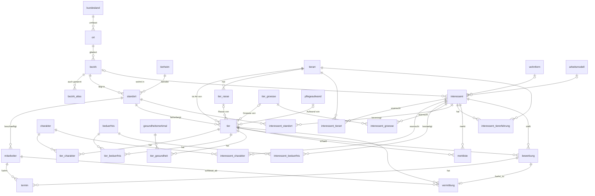
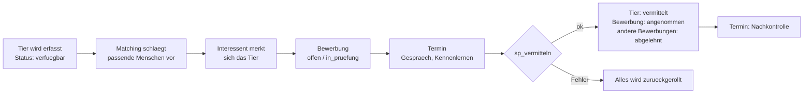
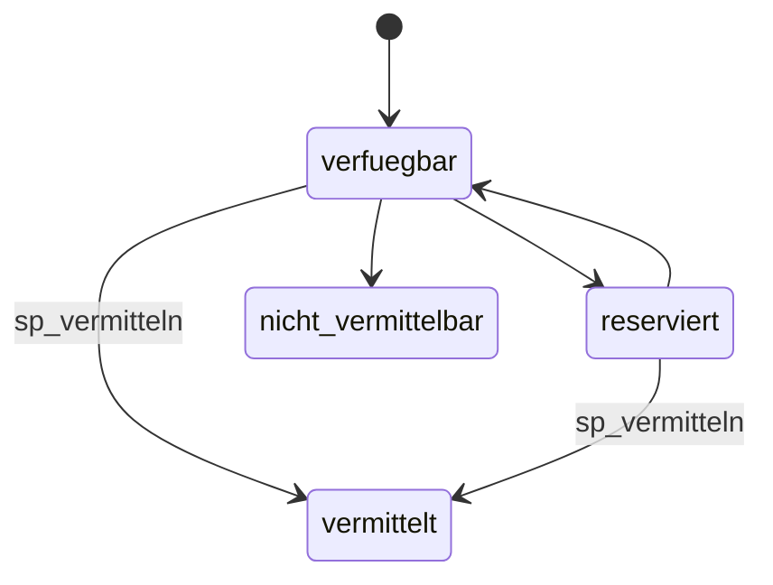
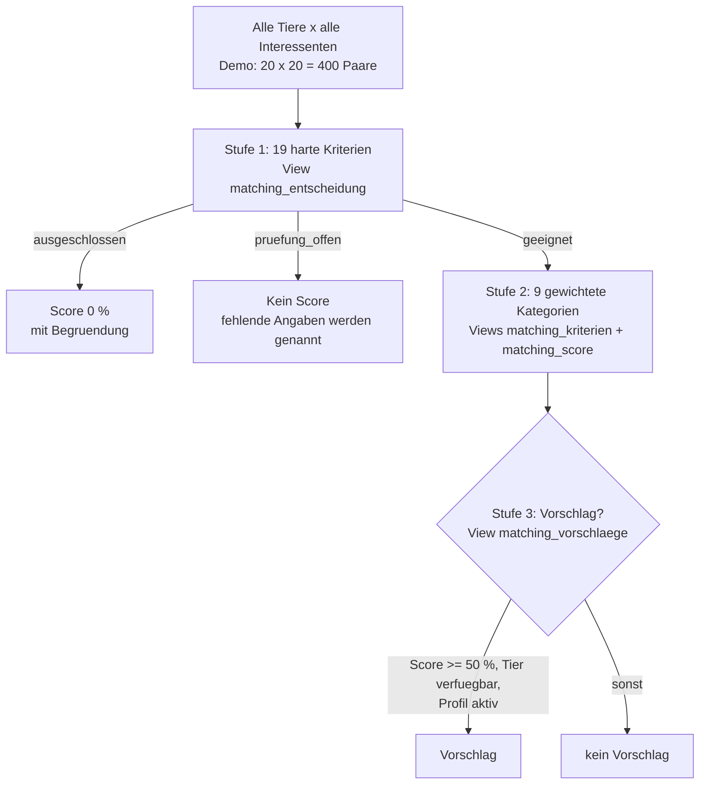

# Paws & Match: Tierheim-Datenbank mit Matching

Unser Projekt für das Modul Datenbanken: eine MySQL-Datenbank, die Tiere aus Berliner
Tierheimen mit passenden Menschen zusammenbringt. Jede Entscheidung soll nachvollziehbar
sein und eine Begründung haben.

In dieser Datei haben wir alles zusammengeschrieben, was man zum Verstehen des Projekts
braucht: Idee, Tabellen, Algorithmus, Abläufe, Demodaten, Tests und Ergebnisse. Sie ist
auch die Grundlage für unsere Präsentation (Gliederung in
[Abschnitt 13](#13-gliederung-für-die-präsentation)).

- Kurzanleitung zum Installieren: [paws_and_match/README.md](paws_and_match/README.md)
- Konventionen und Änderungsprotokoll: [context/AGENTS.md](context/AGENTS.md)

---

## Inhalt

1. [Die Idee in einem Satz](#1-die-idee-in-einem-satz)
2. [Das Projekt in Zahlen](#2-das-projekt-in-zahlen)
3. [Aufbau des Repositories und Installation](#3-aufbau-des-repositories-und-installation)
4. [Datenmodell: alle Tabellen](#4-datenmodell-alle-tabellen)
5. [Der Vermittlungsprozess](#5-der-vermittlungsprozess)
6. [Der Matching-Algorithmus](#6-der-matching-algorithmus)
7. [Rechenbeispiel: Bello und Profil 17](#7-rechenbeispiel-bello-und-profil-17)
8. [Views, Prozeduren und Trigger](#8-views-prozeduren-und-trigger)
9. [Datenqualität, Datenschutz und Löschkonzept](#9-datenqualität-datenschutz-und-löschkonzept)
10. [Demodaten und Ergebnisse](#10-demodaten-und-ergebnisse)
11. [Tests](#11-tests)
12. [Designentscheidungen, Grenzen und Ausblick](#12-designentscheidungen-grenzen-und-ausblick)
13. [Gliederung für die Präsentation](#13-gliederung-für-die-präsentation)
14. [Glossar](#14-glossar)
15. [Benutzungsoberfläche](#15-benutzungsoberfläche)

---

## 1. Die Idee in einem Satz

Tierheime tragen ihre Tiere ein, Interessenten ihre Lebenssituation. Die Datenbank prüft
zuerst harte Ausschlusskriterien (z. B. „Hund braucht Garten“) und berechnet dann für alle
passenden Paare einen Score von 0 bis 100 %, der zeigt, wie gut Tier und Mensch
zusammenpassen.

**Warum?** Viele Tiere kommen zurück ins Tierheim, weil die Vermittlung nicht gepasst hat
(zu wenig Zeit, falsche Wohnung, Ärger mit anderen Tieren im Haushalt). Mit einem
nachvollziehbaren Matching können die Mitarbeitenden gezielt die richtigen Leute ansprechen.

**Worauf wir geachtet haben**
- Jede Ablehnung hat einen Grund, den man sich anzeigen lassen kann.
- Fehlen Angaben, wird nicht geraten, sondern „Prüfung offen“ gemeldet.
- Alles läuft in SQL (Tabellen, Views, Prozeduren, Trigger), es braucht keine extra Anwendung.
- Es gibt eine feste Installationsreihenfolge und 123 automatische Tests.

---

## 2. Das Projekt in Zahlen

| Kennzahl | Wert |
|---|---|
| Tabellen | 32 |
| Views (Sichten) | 6 |
| Gespeicherte Prozeduren | 4 |
| Gespeicherte Funktionen | 4 |
| Trigger | 6 |
| Harte Kriterien | 19 |
| Gewichtete Score-Kategorien | 9 |
| Orte | Berlin mit 12 Bezirken und 96 Ortsteilen (vorbereitet für ganz Deutschland) |
| Demo: Tiere / Interessenten / Tierheime | 20 / 20 / 5 |
| Demo: geprüfte Tier-Mensch-Paare | 400 |
| Demo: Vorschläge | 42 (Score 68,3 bis 96,0 %, im Schnitt 91,4 %) |
| Automatische Tests | 123 (50 Orte, 30 Matching, 43 Prozeduren), alle bestanden |
| Getestet auf | MySQL Community Server 8.4.13 |

---

## 3. Aufbau des Repositories und Installation

```
README.md                    <- diese Datei
context/AGENTS.md            <- Konventionen und Änderungsprotokoll
paws_and_match/
  README.md                  <- Installationsreihenfolge (Kurzfassung)
  01_grundlage/              <- Datenbank, Orte, Basistabellen mit Triggern, Stammdaten
  02_profil_ergaenzungen/    <- erweiterte Tier- und Interessentenprofile
  03_demo_daten/             <- ausgedachte Beispieldaten
  04_matching/               <- Matching: Entscheidung, Score, Vorschläge
  05_prozeduren/             <- Vorschläge, Vermittlung, Löschen
  06_ausgabe/                <- Beispielausgabe für einen Interessenten
  07_tests/                  <- automatische Tests
```

**Installation:** Die 18 SQL-Dateien in der Reihenfolge aus
[paws_and_match/README.md](paws_and_match/README.md) in einer Sitzung ausführen
(MySQL Workbench oder `mysql`-Konsole, Zeichensatz UTF-8). Man braucht MySQL 8.0.16 oder neuer.

**Achtung:** Schritt 1 löscht eine vorhandene Datenbank `paws_match` und legt sie neu an.
Dadurch kann man die Installation beliebig oft wiederholen.

| Schritt | Datei | Was passiert |
|---|---|---|
| 1 | `01_grundlage/01_datenbank_anlegen.sql` | Datenbank neu anlegen (UTF-8) |
| 2 | `01_grundlage/02_orte_anlegen.sql` | Bundesländer, Berlin, Bezirke, Ortsteile, Bezirkserkennung |
| 3 | `01_grundlage/03_tabellen_anlegen.sql` | 17 Basistabellen und 2 Trigger |
| 4 | `01_grundlage/04_stammdaten_anlegen.sql` | Tierarten, Charaktereigenschaften, Bedürfnisse |
| 5 | `02_profil_ergaenzungen/01_tierprofile_ergaenzen.sql` | Rasse, Größe, Pflegeaufwand, Gesundheit, Kleintierverträglichkeit |
| 6 | `02_profil_ergaenzungen/02_interessentenprofile_ergaenzen.sql` | Wohnform, Balkon, Arbeitsmodell, Wünsche, Erfahrung |
| 7 | `03_demo_daten/01_demo_profile.sql` | 20 Tiere, 20 Interessenten, Bewerbungen, Termine |
| 8 | `04_matching/01_matching_entscheidung.sql` | View für die harten Kriterien |
| 9 | `04_matching/02_matching_score.sql` | Gewichtung und Views für Kriterien und Score |
| 10 | `04_matching/03_matching_vorschlaege.sql` | View mit allen Vorschlägen |
| 11 | `05_prozeduren/01_vorschlaege_fuer_interessent.sql` | passende Tiere für einen Interessenten |
| 12 | `05_prozeduren/02_vorschlaege_fuer_tier.sql` | passende Interessenten für ein Tier |
| 13 | `05_prozeduren/03_vermitteln.sql` | Vermittlung abschließen |
| 14 | `05_prozeduren/04_interessent_loeschen.sql` | Löschen oder Anonymisieren |
| 15 | `06_ausgabe/01_matching_ausgabe.sql` | Ergebnisübersicht für Profil 17 |
| 16 | `07_tests/01_orts_tests.sql` | 50 Tests zu Orten und Bezirkserkennung |
| 17 | `07_tests/02_matching_tests.sql` | 30 Tests zum Matching |
| 18 | `07_tests/03_prozedur_tests.sql` | 43 Tests zu Vorschlägen, Vermittlung und Löschen |

---

## 4. Datenmodell: alle Tabellen

### 4.1 Überblick (ER-Diagramm)



Die 32 Tabellen haben wir in sieben Gruppen eingeteilt:

| Gruppe | Tabellen | Anzahl |
|---|---|---|
| A. Organisation | `tierheim`, `standort`, `mitarbeiter` | 3 |
| B. Kataloge (Auswahllisten) | `tierart`, `charakter`, `beduerfnis`, `tier_rasse`, `tier_groesse`, `pflegeaufwand`, `gesundheitsmerkmal`, `wohnform`, `arbeitsmodell` | 9 |
| C. Profile | `tier`, `interessent` | 2 |
| D. Zuordnungen (n:m) | `tier_charakter`, `tier_beduerfnis`, `tier_gesundheit`, `interessent_tierart`, `interessent_charakter`, `interessent_beduerfnis`, `interessent_groesse`, `interessent_standort`, `interessent_tiererfahrung` | 9 |
| E. Ablauf der Vermittlung | `merkliste`, `bewerbung`, `termin`, `vermittlung` | 4 |
| F. Einstellungen | `matching_gewichtung` | 1 |
| G. Orte | `bundesland`, `ort`, `bezirk`, `bezirk_alias` | 4 |

Abkürzungen: PK = Primärschlüssel, FK = Fremdschlüssel, UQ = eindeutig.
`BOOLEAN` heißt 1 = ja, 0 = nein, `NULL` = unbekannt.

### 4.2 Gruppe A: Organisation

**`tierheim`**: ein Tierschutzverein bzw. Träger

| Spalte | Typ | Bedeutung |
|---|---|---|
| id | INT, PK | Nummer |
| name | VARCHAR | Name des Tierheims |
| email | VARCHAR, UQ | Kontakt (Format geprüft) |

**`standort`**: Gebäude bzw. Filiale eines Tierheims

| Spalte | Typ | Bedeutung |
|---|---|---|
| id | INT, PK | Nummer |
| tierheim_id | FK → tierheim | Träger |
| name | VARCHAR | Name des Standorts |
| bezirk_id | FK → bezirk | Bezirk aus der Auswahlliste (wichtig für „Nähe“) |
| kapazitaet | INT > 0 | Plätze für Tiere |

**`mitarbeiter`**: Beschäftigte eines Standorts

| Spalte | Typ | Bedeutung |
|---|---|---|
| id | INT, PK | Nummer |
| standort_id | FK → standort | Arbeitsort (darf nur Tiere dieses Standorts vermitteln) |
| name, email | VARCHAR | Kontakt, E-Mail eindeutig |

### 4.3 Gruppe B: Kataloge

| Tabelle | Spalten | Inhalt (Stammdaten) |
|---|---|---|
| `tierart` | id, name | Hund, Katze, Kaninchen, Meerschweinchen, Vogel, Reptil, Fisch |
| `charakter` | id, name | ruhig, verspielt, schüchtern, kontaktfreudig, eigenständig, aktiv, sozial |
| `beduerfnis` | id, name | 1 tägliche Medikamentengabe, 2 gesicherter Balkon, 3 Vergesellschaftung, 4 Training, 5 Spezialfutter, 6 täglicher Auslauf, 7 ruhiger Haushalt, 8 regelmäßige Pflege |
| `tier_rasse` | id, tierart_id, name | Rassen je Tierart (Rasse passt immer zur Tierart des Tieres) |
| `tier_groesse` | id, name, rang | klein (1), mittel (2), groß (3) |
| `pflegeaufwand` | id, name, rang | niedrig (1), mittel (2), hoch (3) |
| `gesundheitsmerkmal` | id, name, beschreibung | chronische Erkrankung, Allergie, Gelenkprobleme, Medikamentengabe, Behinderung, geimpft, kastriert |
| `wohnform` | id, name | Wohnung, Haus, Reihenhaus, WG, sonstige |
| `arbeitsmodell` | id, name | vor Ort, zu Hause, hybrid, wechselnde Zeiten, keine Erwerbstätigkeit |

Über den Rang bei Größe und Pflegeaufwand kann man vergleichen, z. B. ob der Pflegeaufwand
eines Tieres höher ist als das, was jemand leisten möchte.

### 4.4 Gruppe C: Profile

**`tier`**: ein Tier im Tierheim und was es von seinem neuen Zuhause braucht

| Spalte | Typ | Bedeutung |
|---|---|---|
| id | INT, PK | Nummer |
| standort_id | FK → standort | Wo das Tier lebt |
| tierart_id | FK → tierart | Hund, Katze, … |
| rasse_id | FK → tier_rasse (optional) | Rasse |
| name | VARCHAR | Name |
| geburtsdatum, geburt_geschaetzt | DATE, BOOLEAN | Alter (ggf. geschätzt) |
| geschlecht | ENUM | weiblich / männlich / unbekannt |
| gewicht_kg, beschreibung, foto_url | | Beschreibende Angaben |
| status | ENUM | verfuegbar, reserviert, vermittelt, nicht_vermittelbar |
| aktivitaet | 1–5 | Energielevel (1 = ruhig, 5 = sehr aktiv) |
| groesse_id | FK → tier_groesse | klein / mittel / groß |
| pflegeaufwand_id | FK → pflegeaufwand | niedrig / mittel / hoch |
| min_wohnflaeche | m² | Mindestwohnfläche |
| garten_noetig | BOOLEAN | Garten erforderlich |
| treppen_vermeiden | BOOLEAN | keine Treppen ohne Aufzug |
| kinder_ok, hund_ok, katze_ok, kleintiere_ok | BOOLEAN | verträglich mit Kindern / Hunden / Katzen / Kleintieren |
| min_zeit | Stunden/Tag | Mindestbetreuungszeit |
| max_allein | Stunden/Tag | maximal allein |
| min_erfahrung | 0–5 | nötige Erfahrung mit dieser Tierart |
| monatskosten | € | erwartete Kosten pro Monat |
| medizin_noetig | BOOLEAN | medizinische Versorgung nötig |

**`interessent`**: ein Mensch, der ein Tier aufnehmen möchte, und seine Lebenssituation

| Spalte | Typ | Bedeutung |
|---|---|---|
| id | INT, PK | Nummer |
| pseudonym | VARCHAR | Anzeigename (kein Klarname nötig) |
| email | VARCHAR, UQ | Kontakt |
| bezirk_id | FK → bezirk | Wohnbezirk aus der Auswahlliste (Nähe); Pflicht bei aktiven Profilen |
| aktiv | BOOLEAN | Profil sichtbar/aktiv |
| wohnflaeche | m² | Wohnungsgröße |
| wohnform_id | FK → wohnform | Wohnung, Haus, … |
| garten, balkon, balkon_gesichert | BOOLEAN | Außenbereiche (gesicherter Balkon nur mit Balkon, per CHECK) |
| etage, aufzug | INT, BOOLEAN | Stockwerk und Aufzug |
| haushaltsgroesse, kinder | INT, BOOLEAN | Personen im Haushalt, Kinder |
| hund_vorhanden, katze_vorhanden, kleintiere_vorhanden | BOOLEAN | vorhandene Tiere |
| zeit_stunden | Stunden/Tag | verfügbare Zeit für das Tier |
| allein_stunden | Stunden/Tag | wie lange das Tier allein wäre |
| arbeitsmodell_id | FK → arbeitsmodell | Arbeitssituation |
| erfahrung | 0–5 | allgemeine Tiererfahrung |
| budget | €/Monat | verfügbares Budget |
| medizin_bereit, tierarzt_bereit, training_bereit | BOOLEAN | Bereitschaft zu Medikamenten, Tierarzt, Training |
| max_pflegeaufwand_id | FK → pflegeaufwand | maximal akzeptierter Pflegeaufwand |
| aktivitaet | 1–5 | eigenes Aktivitätslevel |
| wunschalter_min, wunschalter_max | Jahre | gewünschtes Alter des Tieres |

### 4.5 Gruppe D: Zuordnungen (n:m-Beziehungen)

Ein Tier kann mehrere Charakterzüge haben und ein Mensch mehrere Wünsche. Dafür gibt es
Zuordnungstabellen, deren Primärschlüssel aus beiden IDs besteht.

| Tabelle | Bedeutung | Zusatzspalten |
|---|---|---|
| `tier_charakter` | Charakter des Tieres | keine |
| `tier_beduerfnis` | verbindliche Bedürfnisse des Tieres | hinweis |
| `tier_gesundheit` | Gesundheitsmerkmale | bestaetigt, geprueft_am, hinweis |
| `interessent_tierart` | gewünschte Tierarten | keine |
| `interessent_charakter` | gewünschte Charakterzüge | keine |
| `interessent_beduerfnis` | Zusage zu einem Bedürfnis | bestaetigt (1 = ja, 0 = abgelehnt) |
| `interessent_groesse` | gewünschte Größen | keine |
| `interessent_standort` | bevorzugte Standorte | keine |
| `interessent_tiererfahrung` | Erfahrung je Tierart | erfahrungslevel 0–5 |

Wird ein Tier oder Interessent gelöscht, verschwinden diese Einträge automatisch mit
(ON DELETE CASCADE).

### 4.6 Gruppe E: Ablauf der Vermittlung

| Tabelle | Bedeutung | Wichtige Spalten / Regeln |
|---|---|---|
| `merkliste` | Tier gemerkt | (interessent_id, tier_id), erstellt_am |
| `bewerbung` | Bewerbung auf ein Tier | status: offen, in_pruefung, abgelehnt, zurueckgezogen, angenommen; pro Paar nur eine Bewerbung (UQ) |
| `termin` | Gespräch, Kennenlernen, Nachkontrolle | bewerbung_id, mitarbeiter_id, zeitpunkt, art |
| `vermittlung` | abgeschlossene Vermittlung | bewerbung_id (UQ), tier_id, mitarbeiter_id, vermittelt_am, beendet_am; die berechnete Spalte `aktives_tier` sorgt dafür, dass ein Tier nur eine aktive Vermittlung haben kann |

Diese Tabellen sind die Historie. Sie werden nie automatisch gelöscht und verhindern, dass
Tiere oder Personen mit Vorgeschichte aus Versehen gelöscht werden.

### 4.7 Gruppe F: Einstellungen

**`matching_gewichtung`**: wie wichtig jede Score-Kategorie ist (zusammen genau 100)

| Kategorie | Gewicht |
|---|---|
| Tierart | 20 |
| Aktivität | 15 |
| Zeit | 15 |
| Wohnsituation | 15 |
| Erfahrung | 10 |
| Verträglichkeit | 10 |
| Budget | 5 |
| Charakter | 5 |
| Nähe | 5 |
| **Summe** | **100** |

Die Gewichte kann man in der Tabelle ändern, ohne an der SQL-Logik etwas anzufassen.

### 4.8 Gruppe G: Orte und Bezirkserkennung

Ortsangaben speichern wir nicht als Freitext, sondern als Verweis auf einen Eintrag aus einer
festen Liste (Dropdown). So landen keine Tippfehler oder unterschiedlichen Schreibweisen in
der Datenbank. Aufbau von groß nach klein:

| Tabelle | Spalten | Inhalt |
|---|---|---|
| `bundesland` | id (amtlicher Länderschlüssel), name, kuerzel | alle 16 Bundesländer |
| `ort` | id, bundesland_id, name, ags (Amtlicher Gemeindeschlüssel), aktiv | Berlin (`11000000`), freigeschaltet |
| `bezirk` | id, ort_id, name, schluessel, suchname | die 12 Berliner Bezirke (ID = Bezirksnummer) |
| `bezirk_alias` | id, bezirk_id, name, suchname | 92 Einträge: Ortsteile und frühere Bezirke, z. B. Prenzlauer Berg gehört zu Pankow (alle 96 Ortsteile werden erkannt, gleichnamige wie „Spandau“ über den Bezirksnamen) |

**Dropdown:** Die View `bezirk_auswahl` liefert alle Bezirke, die man auswählen kann
(nur Orte mit `aktiv = 1`, im Moment also Berlin).

**Freitext verstehen (z. B. wenn später echte Daten importiert werden):** Die Funktion
`fn_bezirk_id('Neuköln', NULL)` sucht den passenden Bezirk in drei Schritten:

1. **Vereinheitlichen** (`fn_text_normalisieren`): alles klein, ä wird ae, ö wird oe,
   ü wird ue, ß wird ss, Leerzeichen, Bindestriche und Klammern fallen weg. Ein „Bezirk“ am
   Anfang wird ignoriert. „Neukölln“, „NEUKOELLN“ und „neukölln “ werden so alle zu `neukoelln`.
2. **Exakt suchen** in Bezirksnamen und Ortsteilen, auch wenn der Ortsname davor oder
   dahinter steht („Berlin-Mitte“, „Lichtenberg (Berlin)“).
3. **Tippfehler erlauben** (`fn_levenshtein`): Der ähnlichste Name wird genommen, wenn er
   bei 4 bis 5 Buchstaben höchstens 1 Zeichen und ab 6 Buchstaben höchstens 2 Zeichen
   abweicht und es nur einen solchen Treffer gibt. Beispiele: „Neuköln“ wird Neukölln,
   „Spandua“ wird Spandau, „Neukölln“ (kaputte Umlaute) wird Neukölln.

Ist eine Angabe unbekannt oder passt sie zu mehreren Bezirken, kommt `NULL` zurück. Geraten
wird also nie. `fn_bezirk_id_pflicht('…')` gibt in so einem Fall stattdessen eine Fehlermeldung
aus, das ist für Importe gedacht. Mit dem zweiten Parameter von `fn_bezirk_id` kann man die
Suche auf einen Ort beschränken. Das wird wichtig, sobald es z. B. „Mitte“ in Berlin und
in Hamburg gibt.

**Erweiterung auf ganz Deutschland:** neue Zeilen in `ort` (mit Gemeindeschlüssel aus dem
amtlichen Gemeindeverzeichnis) und `bezirk` eintragen und `aktiv = 1` setzen. Orte ohne
Bezirke bekommen einen Bezirk mit dem Ortsnamen. Tabellen, Matching und Erkennung müssen
dafür nicht geändert werden, das haben wir in einem Test mit Hamburg ausprobiert.

---

## 5. Der Vermittlungsprozess



**Status eines Tieres**



**Schutzregeln (Trigger und Prozedur)**
- Bewerben kann man sich nur auf verfügbare Tiere und nur mit aktivem Profil.
- Eine Vermittlung kann nur über `sp_vermitteln` angelegt werden, direkte Einträge werden blockiert.
- `sp_vermitteln` prüft, ob die Bewerbung existiert, ob der Mitarbeiter am Standort des Tieres
  arbeitet, ob das Profil aktiv ist und ob der Status passt. Alles läuft in einer Transaktion,
  geht etwas schief, wird nichts gespeichert.
- Andere offene Bewerbungen für dasselbe Tier werden automatisch abgelehnt (mit Hinweis in der Notiz).

---

## 6. Der Matching-Algorithmus

### 6.1 Überblick: drei Stufen



Man kann es sich so vorstellen: Stufe 1 ist der Türsteher (darf das Paar überhaupt rein?),
Stufe 2 die Benotung (wie gut passt es?) und Stufe 3 die Empfehlungsliste.

### 6.2 Stufe 1: harte Kriterien (Ampel)

Jedes Kriterium bekommt eine Ampelfarbe:

| Farbe | Bedeutung |
|---|---|
| grün (erfüllt) | Anforderung erfüllt oder für dieses Tier egal |
| gelb (Prüfung offen) | Angaben fehlen oder ein Bedürfnis ist noch nicht bestätigt |
| rot (ausgeschlossen) | Anforderung ist sicher nicht erfüllt |

Ist ein Kriterium rot, ist das Paar *ausgeschlossen*. Sonst führt ein gelbes Kriterium zu
*pruefung_offen*. Nur wenn alles grün ist, ist das Paar *geeignet*. Die Gründe werden immer
als Text mitgeliefert.

| # | Kriterium | rot, wenn … |
|---|---|---|
| 1 | Tierartwunsch | die Tierart nicht zu den Wünschen gehört (gar keine Wünsche: gelb) |
| 2 | Garten | Tier braucht Garten, Mensch hat keinen |
| 3 | Treppen | Tier soll Treppen meiden, Wohnung liegt oben ohne Aufzug |
| 4 | Kinderverträglichkeit | Kinder im Haushalt, Tier nicht kinderverträglich |
| 5 | Hundeverträglichkeit | Hund vorhanden, Tier nicht hundeverträglich |
| 6 | Katzenverträglichkeit | Katze vorhanden, Tier nicht katzenverträglich |
| 7 | Kleintierverträglichkeit | Kleintiere vorhanden, Tier nicht kleintierverträglich |
| 8 | Wohnfläche | Wohnung kleiner als Mindestfläche |
| 9 | Betreuungszeit | weniger Zeit als das Tier braucht |
| 10 | Alleinzeit | Tier wäre länger allein als erlaubt |
| 11 | Tierartspezifische Erfahrung | Erfahrung mit dieser Tierart zu gering |
| 12 | Monatliches Budget | Budget kleiner als Monatskosten |
| 13 | Medizinische Versorgung | Tier braucht Medikamente, Mensch nicht bereit |
| 14 | Tierarztbereitschaft | Tier braucht Medizin, Mensch lehnt Tierarztbesuche ab |
| 15 | Notwendiges Training | Tier braucht Training, Mensch nicht bereit |
| 16 | Pflegeaufwand | Pflegeaufwand des Tieres höher als akzeptiert |
| 17 | Gesicherter Balkon | Tier braucht gesicherten Balkon, keiner vorhanden |
| 18 | Bedürfnis abgelehnt | Mensch hat ein Bedürfnis des Tieres ausdrücklich abgelehnt |
| 19 | Bedürfnisse bestätigt | nie rot, nur gelb: ein Bedürfnis des Tieres ist noch nicht bestätigt |

Für alle Kriterien gilt: Fehlt eine Angabe, die man braucht, ist das Ergebnis gelb.

### 6.3 Stufe 2: der Score (0 bis 100 %)

Für jedes geeignete Paar bekommt jede der 9 Kategorien einen Wert zwischen 0 und 1
(Teilpassung). Der Score ist die gewichtete Summe:

```
Score (%) = Σ ( Teilpassung der Kategorie × Gewicht der Kategorie )      (Gewichte = 100)
```

**Die Idee dahinter („Reserve“):** Ein harter Grenzwert sagt nur, *ob* etwas reicht. Der Score
soll zeigen, *wie gut* es passt. Wer die Mindestanforderung genau erfüllt, bekommt die halbe
Punktzahl, wer doppelt so viel bietet wie nötig, die volle.

```
Reserve(Wert, Mindestwert) = 0,5 + 0,5 × (Wert − Mindestwert) / Mindestwert   (begrenzt auf 0 … 1)
```

| Angebot im Verhältnis zur Anforderung | Teilpassung |
|---|---|
| unter dem Minimum | 0 (fliegt aber schon in Stufe 1 raus) |
| genau das Minimum (100 %) | 0,5 |
| 150 % | 0,75 |
| 200 % oder mehr | 1,0 |
| Tier hat keine Anforderung (Minimum 0) | 1,0 |

**Die 9 Kategorien**

| Kategorie | Gewicht | So wird der Wert berechnet |
|---|---|---|
| Tierart | 20 | Durchschnitt aus: Tierart gewünscht (1/0), Größe (Wunschgröße = 1, eine Stufe daneben = 0,5, zwei = 0) und Alter (im Wunschbereich = 1, pro Jahr daneben 0,2 weniger). Wer keine Größe oder kein Alter angegeben hat, bei dem zählt das nicht mit. |
| Aktivität | 15 | 1 − \|Aktivität Tier − Aktivität Mensch\| / 4, also gleich = 1 und ganz verschieden = 0 |
| Zeit | 15 | Durchschnitt aus Betreuungszeit (Reserve) und Alleinzeit (genau am Maximum = 0,5, nie allein = 1) |
| Wohnsituation | 15 | Reserve der Wohnfläche gegenüber der Mindestfläche |
| Erfahrung | 10 | Minimum erreicht = 0,5, Höchststufe 5 = 1, dazwischen linear |
| Verträglichkeit | 10 | Durchschnitt über Kinder, Hunde, Katzen, Kleintiere: verträglich = 1, unverträglich aber nicht im Haushalt = 0,5 (das schränkt später ein) |
| Budget | 5 | Reserve des Budgets gegenüber den Monatskosten |
| Charakter | 5 | Anteil der gewünschten Charakterzüge, die das Tier hat |
| Nähe | 5 | Wunschstandort oder gleicher Bezirk = 1, sonst 0 |

**Fehlende Angaben:** Eine Kategorie ohne Daten gibt 0 Punkte, wir bewerten also lieber
vorsichtig. Wie viel vom Gewicht wirklich auf Daten beruht, zeigt die Datenabdeckung
(z. B. 95 % heißt: 5 Gewichtspunkte fehlen).

**Gültige Gewichtung:** Einen Score gibt es nur, wenn genau 9 Gewichte da sind und sie
zusammen 100 ergeben. Sonst gibt es weder Score noch Vorschläge.

### 6.4 Stufe 3: Vorschläge

Ein Paar wird vorgeschlagen, wenn alles davon zutrifft:

1. Eignung = *geeignet* (alle 19 Kriterien grün)
2. das Tier ist *verfügbar*
3. das Interessentenprofil ist *aktiv*
4. die Gewichtung ist gültig
5. der Score ist mindestens 50 %

Sortiert wird nach Score (höchster zuerst) und dann nach Datenabdeckung.
Diese Regeln stehen nur an einer Stelle, in der View `matching_vorschlaege`. Prozeduren,
Ausgabe und Tests benutzen alle diese View.

---

## 7. Rechenbeispiel: Bello und Profil 17

**Bello** (Hund, groß, ca. 6 Jahre, Standort Mitte): sehr aktiv (5), braucht 70 m² und
einen Garten, mindestens 3 h Betreuung, höchstens 4 h allein, Hundeerfahrung ab 3,
350 € im Monat, verträglich mit Kindern und Hunden, aber nicht mit Katzen und Kleintieren,
Charakter verspielt und aktiv, Bedürfnis täglicher Auslauf.

**Profil 17** (Pankow): 100 m² mit Garten, Kinder und ein Hund im Haushalt, 8 h Zeit,
3 h allein, Budget 500 €, Aktivität 4, Hundeerfahrung 4, wünscht Hund oder Kaninchen,
Größe mittel/groß, Alter 1–12 Jahre, Charakter verspielt und kontaktfreudig,
Wunschstandort Mitte, hat „täglicher Auslauf“ bestätigt.

**Stufe 1:** alle 19 Kriterien sind grün, das Paar ist also *geeignet*.

**Stufe 2:**

| Kategorie | Rechnung | Teilpassung | × Gewicht | Punkte |
|---|---|---|---|---|
| Tierart | Hund gewünscht (1), groß gewünscht (1), Alter passt (1) | 1,00 | 20 | 20,00 |
| Aktivität | 1 − \|5 − 4\| / 4 | 0,75 | 15 | 11,25 |
| Zeit | Betreuung 8 h statt 3 h = 1,0; allein 3 h von max. 4 h = 0,625; Durchschnitt | 0,81 | 15 | 12,19 |
| Wohnsituation | 0,5 + 0,5 × (100 − 70) / 70 | 0,71 | 15 | 10,71 |
| Erfahrung | 0,5 + 0,5 × (4 − 3) / (5 − 3) | 0,75 | 10 | 7,50 |
| Verträglichkeit | Kinder 1, Hund 1, Katze 0,5, Kleintiere 0,5; Durchschnitt | 0,75 | 10 | 7,50 |
| Budget | 0,5 + 0,5 × (500 − 350) / 350 | 0,71 | 5 | 3,57 |
| Charakter | 1 von 2 Wünschen (verspielt) | 0,50 | 5 | 2,50 |
| Nähe | Wunschstandort Mitte | 1,00 | 5 | 5,00 |
| **Summe** | | | **100** | **≈ 80,2 %** |

**Stufe 3:** 80,2 % ist mehr als 50 %, Bello ist verfügbar und das Profil aktiv, also gibt es
einen Vorschlag.

**Gegenbeispiel Profil 19** (möchte auch einen Hund): hat eine Katze und nur
Hundeerfahrung 2. Damit sind *Katzenverträglichkeit* und *Tierartspezifische Erfahrung* rot,
das Paar ist ausgeschlossen (Score 0 %) und beide Gründe werden angezeigt.

**Weitere Werte aus den Tests**
- Profil 1 und Bruno (passt fast perfekt): 96,0 %
- Profil 17 und Bello, wenn alle Werte genau auf dem Minimum liegen: 57,5 %
  (geeignet, aber knapp, und genau das soll der Score zeigen)

---

## 8. Views, Prozeduren und Trigger

### Views (Sichten = gespeicherte Abfragen)

| View | Zweck | Wichtige Spalten |
|---|---|---|
| `matching_entscheidung` | Stufe 1 für alle Paare | eignung, ausschlussgruende, offene_pruefungen |
| `matching_kriterien` | Teilpassung je Paar und Kategorie (9 Zeilen pro Paar) | kriterium, passung |
| `matching_score` | Stufe 2: Score je Paar | match_prozent, datenabdeckung_prozent, gewichtung_vollstaendig |
| `matching_vorschlaege` | Stufe 3: alle Vorschläge | tier, interessent, standort, match_prozent, begruendung |
| `bezirk_auswahl` | Dropdown der wählbaren Bezirke | bezirk_id, bezirk, ort, bundesland |
| `bezirk_suchbegriff` | alle Schreibweisen je Bezirk für die Erkennung | bezirk_id, suchbegriff |

### Gespeicherte Prozeduren

| Prozedur | Aufruf | Ergebnis |
|---|---|---|
| `sp_vorschlaege_fuer_interessent` | `CALL sp_vorschlaege_fuer_interessent(17);` | passende Tiere, bester Score zuerst |
| `sp_vorschlaege_fuer_tier` | `CALL sp_vorschlaege_fuer_tier(16);` | passende Menschen für ein Tier |
| `sp_vermitteln` | `CALL sp_vermitteln(bewerbung_id, mitarbeiter_id);` | schließt eine Vermittlung sicher ab |
| `sp_interessent_loeschen` | `CALL sp_interessent_loeschen(id, @ergebnis);` | `geloescht` oder `anonymisiert` |

Die Vorschlagsprozeduren geben verständliche Fehlermeldungen aus, z. B. „Interessentenprofil
nicht gefunden“, „Tier ist aktuell nicht für neue Vorschläge verfügbar“ oder „Die neun
Matching-Gewichte müssen vollständig sein und 100 ergeben“.

### Gespeicherte Funktionen

| Funktion | Beispiel | Ergebnis |
|---|---|---|
| `fn_text_normalisieren` | `fn_text_normalisieren('Neukölln')` | `neukoelln` |
| `fn_levenshtein` | `fn_levenshtein('spandau', 'spandua')` | `2` (Anzahl Tippfehler) |
| `fn_bezirk_id` | `fn_bezirk_id('Prenzlauer Berg', NULL)` | `3` (Pankow) oder `NULL` |
| `fn_bezirk_id_pflicht` | `fn_bezirk_id_pflicht('Atlantis')` | Fehler „Bezirk nicht erkannt …“ |

### Trigger (automatische Prüfungen)

| Trigger | Wann | Prüfung |
|---|---|---|
| `trg_bewerbung_pruefen` | vor neuer Bewerbung | Tier verfügbar, Profil aktiv |
| `trg_vermittlung_pruefen` | vor neuer Vermittlung | nur über `sp_vermitteln` möglich |
| `trg_bezirk_suchname_neu` / `_aendern` | vor Einfügen/Ändern eines Bezirks | Suchname automatisch vereinheitlichen |
| `trg_bezirk_alias_suchname_neu` / `_aendern` | vor Einfügen/Ändern eines Ortsteils | Suchname automatisch vereinheitlichen |

### Beispielausgabe

`06_ausgabe/01_matching_ausgabe.sql` zeigt für Profil 17 alle 20 Tiere mit Status:
„Als Vorschlag anzeigen“, „Kein Vorschlag: Ausschlusskriterium“, „… Angaben prüfen“,
„… Tier nicht verfügbar“, „… Profil inaktiv“, „… Gewichtung unvollständig“ oder
„… Mindestscore nicht erreicht“, jeweils mit Begründung.

---

## 9. Datenqualität, Datenschutz und Löschkonzept

**Datenqualität (CHECK-Constraints):** Ungültige Werte werden gar nicht erst gespeichert.
- Wertebereiche: Aktivität 1 bis 5, Erfahrung 0 bis 5, Stunden 0 bis 24, Flächen und Kosten
  nicht negativ, Kapazität größer 0
- Ja/Nein-Felder nur 0 oder 1
- E-Mail-Adressen im Format `x@y.z`
- Betreuungszeit plus Alleinzeit höchstens 24 Stunden (bei Tier und Mensch)
- gewünschtes Mindestalter nicht über dem Höchstalter, gesicherter Balkon nur mit Balkon
- die Rasse muss zur Tierart passen
- Bezirke nur aus der Auswahlliste (im Moment Berlin). Derselbe Bezirk kann nicht ein
  zweites Mal in anderer Schreibweise angelegt werden (z. B. „Neukoelln“ neben „Neukölln“)

**Datenschutz**
- Interessenten tauchen nur mit Pseudonym auf, nicht mit ihrem echten Namen.
- Alle Demodaten sind ausgedacht (Adressen mit `example.org`).

**Löschkonzept**

| Fall | Verhalten |
|---|---|
| Interessent ohne Bewerbungen | wird gelöscht, mit Wünschen, Merkliste usw. (Cascade) |
| Interessent mit Bewerbungen | wird anonymisiert: Name und E-Mail ersetzt, Profildaten geleert, offene Bewerbungen zurückgezogen. Die Historie bleibt für das Tierheim erhalten |
| Tier ohne Vorgeschichte | löschbar, Charakter/Bedürfnisse/Merkliste werden mitgelöscht |
| Tier mit Bewerbungen/Vermittlungen | nicht löschbar (Historie geschützt) |

---

## 10. Demodaten und Ergebnisse

Die Demodaten sind komplett ausgedacht: 5 Tierheime mit je einem Standort in Mitte,
Pankow, Spandau, Neukölln und Lichtenberg, 20 Tiere (Hunde, Katzen, Kaninchen,
Meerschweinchen, Vögel) und 20 Interessentenprofile. Wir haben absichtlich passende und
unpassende Fälle eingebaut, damit man jede Regel einmal sieht. Die Bezirke sind wie bei einem
Import unterschiedlich geschrieben (z. B. „neukolln“, „Berlin-Mitte“, „Prenzlauer Berg“,
„Spandua“) und werden automatisch zugeordnet.

**Ergebnis über alle 400 Paare**

| Eignung | Paare | Anteil |
|---|---|---|
| geeignet | 42 | 10,5 % |
| Prüfung offen | 30 | 7,5 % |
| ausgeschlossen | 328 | 82,0 % |

Alle 42 geeigneten Paare haben mindestens 50 % und werden vorgeschlagen
(Score 68,3 bis 96,0 %, im Schnitt 91,4 %). 16 von 20 Profilen bekommen mindestens einen
Vorschlag. Dass die meisten Paare rausfallen, ist so gewollt: Schon der Tierartwunsch
sortiert das meiste aus (wer eine Katze sucht, bekommt keinen Hund).

**Absichtlich eingebaute Fälle**

| Profil / Tier | Ergebnis | Warum |
|---|---|---|
| 17 / Bello | geeignet, 80,2 % | Rechenbeispiel aus Abschnitt 7 |
| 4 / Pino | geeignet | braucht Training, Profil 4 ist bereit |
| 9 / Pino | ausgeschlossen | Profil 9 lehnt Training ab |
| 7 / Mila | ausgeschlossen | Balkon nicht gesichert |
| 16 / Minka | ausgeschlossen | Kleintiere im Haushalt, Katze nicht kleintierverträglich |
| 19 / Bello | ausgeschlossen | Katze im Haushalt und zu wenig Hundeerfahrung |
| 20 / Nussi | ausgeschlossen | 10 h allein, Pflegeaufwand zu hoch |
| 6 / Bruno | Prüfung offen | Bedürfnis „Medikamentengabe“ noch nicht bestätigt |
| 13 / Flocke | Prüfung offen | Kaninchen-Erfahrung nicht angegeben |

**Vorschläge für Profil 17** (so gibt die Prozedur sie aus): Balu 80,3 %, Oskar 80,3 %,
Bello 80,2 %, Momo 76,9 %, Wolke 76,9 %.

---

## 11. Tests

Drei Testskripte prüfen alles automatisch und schreiben am Ende
„ALLE … TESTS BESTANDEN“. Die Demodaten bleiben dabei gleich: Änderungen werden
zurückgerollt oder mit eigenen Testdaten gemacht, die danach wieder gelöscht werden. Am
Ende wird über eine Prüfsumme kontrolliert, dass wirklich alles wie vorher ist.

| Datei | Bereich | Beispiele | Anzahl |
|---|---|---|---|
| 01_orts_tests | Hilfsfunktionen | Vereinheitlichung, Levenshtein-Distanz | 3 |
| 01_orts_tests | Stammdaten | 16 Länder, 12 Bezirke, jeder Bezirk/Ortsteil eindeutig erkennbar | 3 |
| 01_orts_tests | Freitext | 32 Schreibweisen mit Umlauten, Tippfehlern, Ortsteilen, Unbekanntem; Suche nur in einem Ort | 33 |
| 01_orts_tests | Demodaten | alle Bezirke richtig zugeordnet | 2 |
| 01_orts_tests | Erweiterung | Ort abschalten, Hamburg ergänzen, „Mitte“ in zwei Städten | 4 |
| 01_orts_tests | Datenqualität | doppelte Schreibweise, Profil ohne Bezirk, unbekannter Bezirk, Importfehler | 5 |
| 02_matching_tests | Struktur | 9 Gewichte mit Summe 100, alle 400 Paare bewertet, Werte zwischen 0 und 1 | 6 |
| 02_matching_tests | Entscheidungen | 11 bekannte Paare mit erwarteter Eignung und Begründung | 11 |
| 02_matching_tests | Scores | 96,0 / 80,2 / 76,9 %, vorher von Hand ausgerechnet | 3 |
| 02_matching_tests | Abgestufter Score | weniger Wohnfläche senkt, mehr Budget erhöht den Score, Minimum = 57,5 % | 3 |
| 02_matching_tests | Fehlende Daten | ohne Charakterwünsche 77,7 % und 95 % Abdeckung | 1 |
| 02_matching_tests | Gewichtung | Summe 105 oder fehlendes Gewicht: kein Score | 2 |
| 02_matching_tests | Datenqualität | ungültige Werte werden abgelehnt | 4 |
| 03_prozedur_tests | Vorschläge | Reihenfolge, Vollständigkeit, beide Prozeduren nutzen dieselbe View | 7 |
| 03_prozedur_tests | Fehlerfälle Vorschläge | falsche/unbekannte IDs, inaktiv, nicht verfügbar, falsche Gewichte | 15 |
| 03_prozedur_tests | Vermittlung | falscher Mitarbeiter, Rollback, Trigger, Erfolg, andere Bewerbungen abgelehnt | 11 |
| 03_prozedur_tests | Löschen | Anonymisieren, Löschen, Cascade, geschützte Historie | 9 |
| 03_prozedur_tests | Unverändert | Demodaten nach den Tests gleich | 1 |
| | **Summe** | | **123** |

---

## 12. Designentscheidungen, Grenzen und Ausblick

**Warum zwei Stufen (Ausschluss und Score)?**
Mit nur einem Score könnte ein unpassendes Paar durch viele gute Werte „schöngerechnet“
werden (z. B. viel Budget gleicht den fehlenden Garten aus). Die harten Kriterien verhindern das.

**Warum „Prüfung offen“ statt raten?**
Fehlende Angaben sollen nicht zu falschen Vorschlägen führen. So sehen die Mitarbeitenden
genau, was noch geklärt werden muss.

**Warum 0,5 für „Minimum erfüllt“?**
Damit sieht man, ob ein Paar nur knapp oder gut passt. Den Wert haben wir festgelegt, man
könnte ihn aber auch anders wählen.

**Warum stehen die Gewichte in einer Tabelle?**
Das Tierheim kann seine Prioritäten ändern (z. B. Nähe wichtiger machen), ohne dass jemand
am Code etwas ändern muss.

**Warum Bezirke als Liste und nicht als Freitext?**
Mit Freitext wären „Neukölln“, „Neukoelln“ und „Neuköln“ drei verschiedene Werte, und die
Kategorie „Nähe“ würde nicht mehr funktionieren. Mit der Liste sind Vergleiche sicher, und
die Erkennungsfunktion übersetzt Freitext aus anderen Quellen in die Liste.

**Grenzen**
- Gesundheitsmerkmale, Rasse, Wohnform, Haushaltsgröße und Arbeitsmodell werden
  gespeichert, fließen aber (noch) nicht ins Matching ein.
- Garten und Treppen sind nur Ausschlusskriterien und zählen nicht im Score.
- Der Mindestscore von 50 % steht fest in der Vorschlags-View.
- Bei sehr vielen Daten müsste man das Matching vorberechnen, weil im Moment jedes Tier mit
  jedem Menschen verglichen wird.
- „Nähe“ kennt nur gleicher oder anderer Bezirk, keine Entfernung in Kilometern.

**Ausblick**
- echte Tier- und Interessentendaten aus einer externen Quelle anbinden
  (die Bezirkserkennung ist dafür schon vorbereitet)
- Erweiterung auf ganz Deutschland (amtliches Gemeindeverzeichnis, Postleitzahlen)
- Nähe über die Entfernung (Geokoordinaten) statt nur über den Bezirk
- Gesundheitsmerkmale und Arbeitsmodell in den Score aufnehmen
- Rückgabe eines Tieres (Vermittlung beenden, Tier wieder verfügbar)
- Reservierung an eine bestimmte Bewerbung binden
- eine Weboberfläche für Interessenten und Mitarbeitende – inzwischen gebaut, siehe
  [Abschnitt 15](#15-benutzungsoberfläche)

---

## 13. Gliederung für die Präsentation

| Folie | Inhalt | Wo steht es hier? |
|---|---|---|
| 1 | Titel: Paws & Match | |
| 2 | Problem: Fehlvermittlungen und Rückgaben | Abschnitt 1 |
| 3 | Unsere Lösung und Prinzipien | Abschnitt 1 |
| 4 | Projekt in Zahlen | Abschnitt 2 |
| 5 | Datenmodell (ER-Diagramm, 7 Gruppen) | Abschnitt 4.1 |
| 6 | Kerntabellen Tier und Interessent | Abschnitt 4.4 |
| 7 | Orte: Dropdown und Erkennung von Tippfehlern/Umlauten | Abschnitt 4.8 |
| 8 | Vermittlungsprozess und Schutzregeln | Abschnitt 5 |
| 9 | Algorithmus: 3 Stufen (Türsteher, Benotung, Empfehlung) | Abschnitt 6.1 |
| 10 | Harte Kriterien als Ampel | Abschnitt 6.2 |
| 11 | Score: Reserve-Idee und 9 Kategorien | Abschnitt 6.3 |
| 12 | Rechenbeispiel Bello + Profil 17 | Abschnitt 7 |
| 13 | Live-Demo: `CALL sp_vorschlaege_fuer_interessent(17);` | Abschnitt 8 |
| 14 | Datenqualität, Datenschutz, Löschkonzept | Abschnitt 9 |
| 15 | Ergebnisse der Demodaten | Abschnitt 10 |
| 16 | Qualitätssicherung: 123 automatische Tests | Abschnitt 11 |
| 17 | Entscheidungen, Grenzen, Ausblick | Abschnitt 12 |

**Live-Demo in MySQL Workbench**
```sql
USE paws_match;
CALL sp_vorschlaege_fuer_interessent(17);   -- Tiere für Profil 17
CALL sp_vorschlaege_fuer_tier(16);          -- Menschen für Bello
SELECT tiername, eignung, ausschlussgruende
FROM matching_score WHERE interessent_id = 19 AND tier_id = 16;   -- Begründung eines Ausschlusses
SELECT kriterium, passung
FROM matching_kriterien WHERE interessent_id = 17 AND tier_id = 16; -- Score-Bausteine
SELECT * FROM bezirk_auswahl ORDER BY bezirk_id;                     -- Dropdown
SELECT fn_bezirk_id('Neuköln', NULL), fn_bezirk_id('Prenzlauer Berg', NULL); -- 8, 3
```

---

## 14. Glossar

| Begriff | Erklärung |
|---|---|
| Tabelle | speichert Daten in Zeilen und Spalten |
| Primärschlüssel (PK) | eindeutige Nummer einer Zeile |
| Fremdschlüssel (FK) | Verweis auf eine Zeile einer anderen Tabelle |
| n:m-Beziehung | „viele zu viele“, z. B. ein Tier hat mehrere Charakterzüge und ein Charakterzug passt zu vielen Tieren; gelöst über Zuordnungstabellen |
| View (Sicht) | gespeicherte Abfrage, die wie eine Tabelle gelesen wird und immer aktuell ist |
| Gespeicherte Prozedur | in der Datenbank gespeichertes Programm, aufgerufen mit `CALL` |
| Trigger | läuft automatisch vor/nach einer Änderung und kann sie verhindern |
| Transaktion | mehrere Schritte, die ganz oder gar nicht ausgeführt werden |
| CHECK-Constraint | Regel, die ungültige Werte abweist |
| Cascade | beim Löschen werden abhängige Einträge automatisch mitgelöscht |
| Eignung | Ergebnis der harten Kriterien: geeignet / Prüfung offen / ausgeschlossen |
| Teilpassung | Bewertung einer Kategorie zwischen 0 und 1 |
| Match-Prozent (Score) | gewichtete Summe der Teilpassungen, 0–100 % |
| Datenabdeckung | Anteil der Gewichte, für die Daten vorliegen |
| Reserve | wie weit ein Angebot über der Mindestanforderung liegt |
| Gespeicherte Funktion | wie eine Prozedur, liefert aber einen Wert und kann in Abfragen verwendet werden |
| Normalisierung (Text) | Vereinheitlichen einer Schreibweise, z. B. „Neukölln“ → `neukoelln` |
| Levenshtein-Distanz | Anzahl der Tippfehler (Buchstaben einfügen, löschen, ersetzen) zwischen zwei Wörtern |
| Alias | alternativer Name, z. B. ein Ortsteil, der zu einem Bezirk gehört |
| AGS | Amtlicher Gemeindeschlüssel, eindeutige Nummer jeder Gemeinde in Deutschland |

---

## 15. Benutzungsoberfläche

Seit der Erweiterung gibt es zusätzlich zur Datenbank eine Oberfläche: eine Streamlit-Anwendung
im Ordner [ui/](ui/). Die Idee dahinter ist die einer Vermittlungsplattform – wie eine
Dating-Seite, nur dass das Match ein Tier ist, das ein Zuhause für immer sucht.

Wichtig für die Bewertung des Projekts: **Die Oberfläche enthält keine Fachlogik.** Sie liest
aus den vorhandenen Views und ruft die vorhandenen Prozeduren auf. Es gibt keine zweite
Berechnung des Scores und keine zweite Stelle, an der Vermittlungsregeln stehen.

### Rollen und was sie sehen

| Rolle | Zugang | Bereiche |
|---|---|---|
| Besucher | kein Login nötig | Startseite mit dem Konzept, Tiergalerie |
| Interessent | nur E-Mail-Adresse (kein Passwort) | Fragebogen (= Profil), eigene Matches mit Begründung, Merkliste, eigene Bewerbungen |
| Mitarbeitende | E-Mail und Passwort | Übersicht des eigenen Standorts, Tiere verwalten, Bewerbungen, Termine, Reservieren, Vermitteln, Beenden |
| Administration | E-Mail und Passwort | alles, dazu Gewichte, Mindestscore, Auswertung und Benutzerkonten |

Interessenten kommen ausdrücklich **nicht** in den internen Bereich, Mitarbeitende **nicht**
in die Adminsicht. Jede geschützte Seite prüft das selbst (`auth.require`), nicht nur das Menü.

### Wo das Matching sichtbar wird

- **Meine Matches:** die Vorschläge aus `sp_vorschlaege_fuer_interessent`, jeweils mit
  Score und einem Aufklapper „Warum passt das?“ – darin die elf Teilpassungen aus
  `matching_kriterien` als Balken, zusammen mit dem Gewicht und der Datenabdeckung.
- **Alle Tiere:** jedes nicht vorgeschlagene Tier mit Ampel und Klartext – die Ausschlussgründe
  und offenen Prüfungen aus `matching_entscheidung`, also genau die Abfrage aus `06_ausgabe`.
- **Admin:** Gewichte und Mindestscore lassen sich ändern; daneben steht sofort, wie viele
  Vorschläge es mit dem neuen Wert gäbe. Eine Gewichtssumme ungleich 100 wird abgelehnt,
  weil die Datenbank dann gar keinen Score berechnet.

### Anmeldung

Die Datenbank kannte bisher keine Passwörter. Dafür gibt es ein zusätzliches Skript,
`paws_and_match/08_oberflaeche/01_benutzerkonten.sql`: eine Tabelle `benutzerkonto`
(E-Mail, bcrypt-Hash, Rolle, Verweis auf `mitarbeiter`) und je ein Demokonto pro
Mitarbeiter plus ein Adminkonto. Es läuft **nach** den Testskripten aus
[paws_and_match/README.md](paws_and_match/README.md), die bisherige Installationsreihenfolge
bleibt also unberührt. Da Schritt 1 die Datenbank löscht, muss dieses Skript nach jeder
Neuinstallation erneut ausgeführt werden.

Demokonten (nur für den lokalen Betrieb): `team1@example.org` bis `team5@example.org` und
`admin@example.org`, Passwort jeweils `paws2026`.

### Starten

```bash
python -m venv .venv
.venv/Scripts/python.exe -m pip install -r ui/requirements.txt
cp ui/.env.example ui/.env        # Host, Port, Benutzer, Passwort eintragen
.venv/Scripts/python.exe -m streamlit run ui/app.py
```

Zugangsdaten stehen in `ui/.env` (nicht im Repository); die Voreinstellung passt zum
lokalen Testserver auf Port 3399. Details, Aufbau und Konventionen: [ui/README.md](ui/README.md).

### Qualitätssicherung

Zusätzlich zu den SQL-Tests prüfen pytest-Tests die Oberfläche
(`.venv/Scripts/python.exe -m pytest ui/tests -q`): dass Prozedur und View dasselbe liefern,
dass der angezeigte Score die Summe der gewichteten Teilpassungen ist, dass Profile korrekt
gespeichert und gelöscht werden, dass der Vermittlungsprozess inklusive Schutzregeln
funktioniert, dass jede Seite fehlerfrei lädt und dass keine Rolle in einen fremden Bereich
kommt. Die Tests legen eigene Daten ab ID 9001 an und räumen sie wieder weg – die Demodaten
und die SQL-Tests bleiben unverändert.
