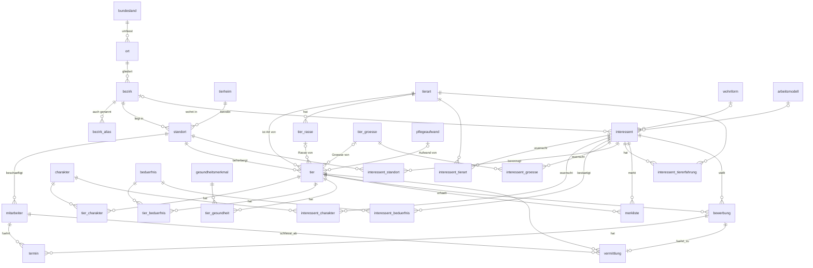
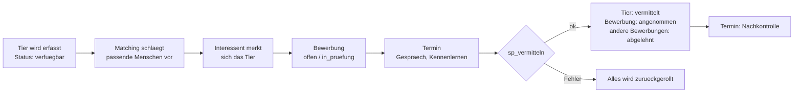
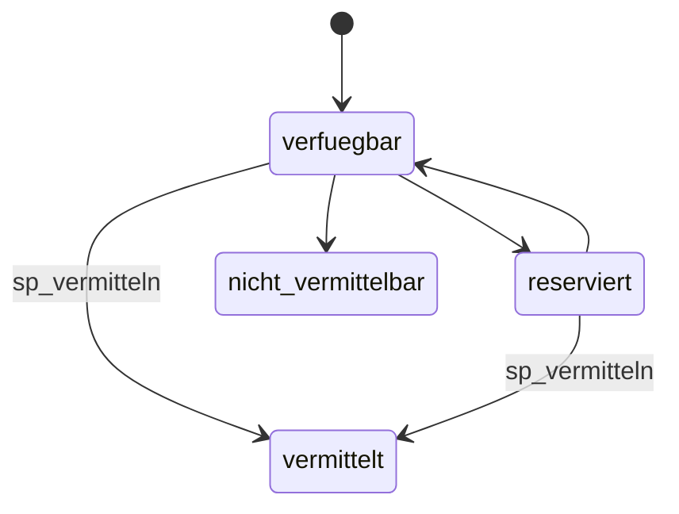
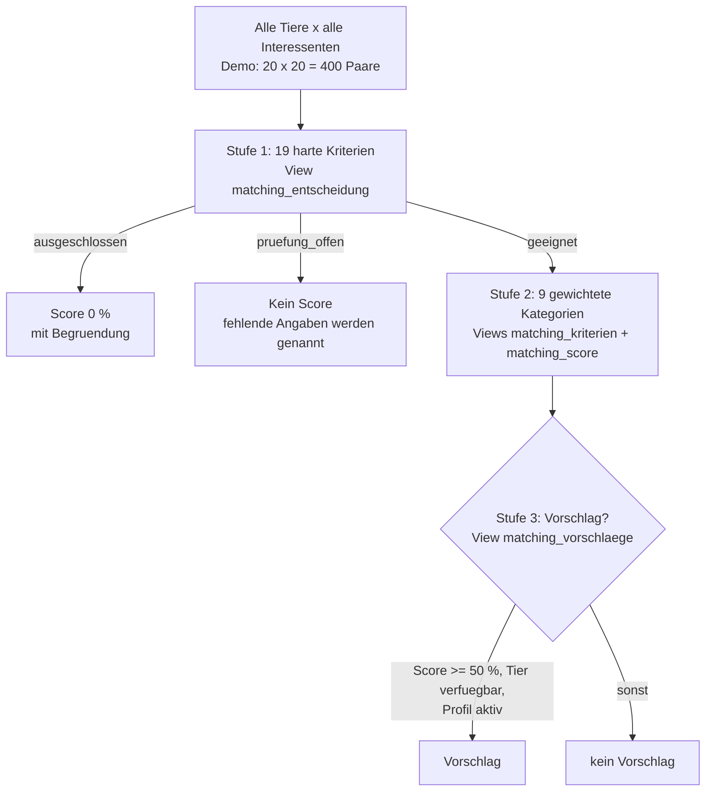

# Paws & Match – Tierheim-Datenbank mit Matching

> Eine MySQL-Datenbank, die Tiere aus Berliner Tierheimen mit passenden Menschen
> zusammenbringt – nachvollziehbar, fair und mit Begründung.

Dieses Dokument erklärt **alles** im Repository: Idee, Tabellen, Algorithmus, Abläufe,
Demodaten, Tests und Ergebnisse. Es ist zugleich die Grundlage für unsere Präsentation
(Gliederungsvorschlag in [Abschnitt 13](#13-vorschlag-für-die-präsentation)).

Technische Kurzanleitung: [paws_and_match/README.md](paws_and_match/README.md) ·
Entwicklungshinweise und Änderungsprotokoll: [context/AGENTS.md](context/AGENTS.md)

---

## Inhalt

1. [Die Idee in einem Satz](#1-die-idee-in-einem-satz)
2. [Das Projekt in Zahlen](#2-das-projekt-in-zahlen)
3. [Aufbau des Repositories und Installation](#3-aufbau-des-repositories-und-installation)
4. [Datenmodell – alle Tabellen](#4-datenmodell--alle-tabellen)
5. [Der Vermittlungsprozess](#5-der-vermittlungsprozess)
6. [Der Matching-Algorithmus](#6-der-matching-algorithmus)
7. [Rechenbeispiel: Bello und Profil 17](#7-rechenbeispiel-bello-und-profil-17)
8. [Views, Prozeduren und Trigger](#8-views-prozeduren-und-trigger)
9. [Datenqualität, Datenschutz und Löschkonzept](#9-datenqualität-datenschutz-und-löschkonzept)
10. [Demodaten und Ergebnisse](#10-demodaten-und-ergebnisse)
11. [Tests](#11-tests)
12. [Designentscheidungen, Grenzen und Ausblick](#12-designentscheidungen-grenzen-und-ausblick)
13. [Vorschlag für die Präsentation](#13-vorschlag-für-die-präsentation)
14. [Glossar](#14-glossar)

---

## 1. Die Idee in einem Satz

Tierheime erfassen ihre Tiere, Interessenten erfassen ihre Lebenssituation – die Datenbank
prüft **zuerst harte Ausschlusskriterien** (z. B. „Hund braucht Garten“) und berechnet für
alle passenden Paare **einen Score von 0 bis 100 %**, der zeigt, *wie gut* Tier und Mensch
zusammenpassen.

**Warum?** Rückgaben ins Tierheim entstehen oft durch unpassende Vermittlungen
(zu wenig Zeit, falsche Wohnsituation, Unverträglichkeit mit anderen Tieren). Ein
transparentes Matching hilft Mitarbeitenden, gezielt die richtigen Menschen anzusprechen.

**Prinzipien**
- **Erklärbar:** Jede Ablehnung nennt ihren Grund.
- **Sicher vor Fehlentscheidungen:** Fehlen Angaben, wird nicht geraten, sondern „Prüfung offen“ gemeldet.
- **Alles in SQL:** Tabellen, Views, Prozeduren und Trigger – keine zusätzliche Anwendung nötig.
- **Reproduzierbar und getestet:** Eine Installationsreihenfolge, 123 automatische Tests.

---

## 2. Das Projekt in Zahlen

| Kennzahl | Wert |
|---|---|
| Tabellen | **32** |
| Views (Sichten) | **6** |
| Gespeicherte Prozeduren | **4** |
| Gespeicherte Funktionen | **4** |
| Trigger | **6** |
| Harte Kriterien | **19** |
| Gewichtete Score-Kategorien | **9** |
| Orte | Berlin mit 12 Bezirken und 96 Ortsteilen (vorbereitet für ganz Deutschland) |
| Demo: Tiere / Interessenten / Tierheime | 20 / 20 / 5 |
| Demo: geprüfte Tier-Mensch-Paare | 400 |
| Demo: Vorschläge | 42 (Score 68,3 – 96,0 %, Ø 91,4 %) |
| Automatische Tests | 123 (30 Matching + 43 Prozesse + 50 Orte), alle bestanden |
| Getestet auf | MySQL Community Server 8.4.13 |

---

## 3. Aufbau des Repositories und Installation

```
README.md                    <- dieses Dokument
context/AGENTS.md            <- Entwicklungshinweise (Konventionen, Änderungsprotokoll)
paws_and_match/
  README.md                  <- Installationsreihenfolge (Kurzfassung)
  01_grundlage/              <- Datenbank, Orte, Basistabellen, Trigger, Vermittlung, Stammdaten
  02_profil_ergaenzungen/    <- erweiterte Tier- und Interessentenprofile
  03_demo_daten/             <- fiktive Beispieldaten
  04_matching/               <- Matching: Entscheidung, Score, Vorschläge
  05_prozeduren/             <- Vorschlags- und Löschprozeduren
  06_ausgabe/                <- Beispielausgabe für einen Interessenten
  07_tests/                  <- automatische Tests
```

**Installation:** Die 17 SQL-Dateien in der Reihenfolge aus
[paws_and_match/README.md](paws_and_match/README.md) in *einer* Sitzung ausführen
(MySQL Workbench oder `mysql`-Konsole, Zeichensatz UTF-8). Voraussetzung: MySQL 8.0.16 oder neuer.

> ⚠️ Schritt 1 löscht eine vorhandene Datenbank `paws_match` und legt sie neu an.
> So ist die Installation jederzeit wiederholbar.

| Schritt | Datei | Was passiert |
|---|---|---|
| 1 | `01_grundlage/01_datenbank_anlegen.sql` | Datenbank neu anlegen (UTF-8) |
| 2 | `01_grundlage/02_orte_anlegen.sql` | Bundesländer, Berlin, Bezirke, Ortsteile, Bezirkserkennung |
| 3 | `01_grundlage/03_tabellen_anlegen.sql` | 17 Basistabellen, 2 Trigger, `sp_vermitteln` |
| 4 | `01_grundlage/04_stammdaten_anlegen.sql` | Tierarten, Charaktereigenschaften, Bedürfnisse |
| 5 | `02_profil_ergaenzungen/01_tierprofile_ergaenzen.sql` | Rasse, Größe, Pflegeaufwand, Gesundheit, Kleintierverträglichkeit |
| 6 | `02_profil_ergaenzungen/02_interessentenprofile_ergaenzen.sql` | Wohnform, Balkon, Arbeitsmodell, Wünsche, Erfahrung |
| 7 | `03_demo_daten/01_demo_profile.sql` | 20 Tiere, 20 Interessenten, Bewerbungen, Termine |
| 8 | `04_matching/01_matching_entscheidung.sql` | View: harte Kriterien |
| 9 | `04_matching/02_matching_score.sql` | Gewichtung + Views: Kriterien und Score |
| 10 | `04_matching/03_matching_vorschlaege.sql` | View: Vorschlagsliste |
| 11 | `05_prozeduren/01_tier_vorschlaege.sql` | Tiervorschläge für einen Interessenten |
| 12 | `05_prozeduren/02_interessenten_vorschlaege.sql` | Interessentenvorschläge für ein Tier |
| 13 | `05_prozeduren/03_interessent_loeschen.sql` | Löschen bzw. Anonymisieren |
| 14 | `06_ausgabe/01_matching_ausgabe.sql` | Ergebnisübersicht für Profil 17 |
| 15 | `07_tests/01_matching_tests.sql` | 30 Tests zum Matching |
| 16 | `07_tests/02_prozedur_tests.sql` | 43 Tests zu Prozeduren und Prozessen |
| 17 | `07_tests/03_orts_tests.sql` | 50 Tests zu Orten und Bezirkserkennung |

---

## 4. Datenmodell – alle Tabellen

### 4.1 Überblick (ER-Diagramm)



Die 32 Tabellen lassen sich in **sieben Gruppen** einteilen:

| Gruppe | Tabellen | Anzahl |
|---|---|---|
| A. Organisation | `tierheim`, `standort`, `mitarbeiter` | 3 |
| B. Kataloge (Auswahllisten) | `tierart`, `charakter`, `beduerfnis`, `tier_rasse`, `tier_groesse`, `pflegeaufwand`, `gesundheitsmerkmal`, `wohnform`, `arbeitsmodell` | 9 |
| C. Profile | `tier`, `interessent` | 2 |
| D. Zuordnungen (n:m) | `tier_charakter`, `tier_beduerfnis`, `tier_gesundheit`, `interessent_tierart`, `interessent_charakter`, `interessent_beduerfnis`, `interessent_groesse`, `interessent_standort`, `interessent_tiererfahrung` | 9 |
| E. Prozess | `merkliste`, `bewerbung`, `termin`, `vermittlung` | 4 |
| F. Konfiguration | `matching_gewichtung` | 1 |
| G. Orte | `bundesland`, `ort`, `bezirk`, `bezirk_alias` | 4 |

Abkürzungen: **PK** = Primärschlüssel, **FK** = Fremdschlüssel, **UQ** = eindeutig.
`BOOLEAN` bedeutet 1 = ja, 0 = nein, `NULL` = unbekannt.

### 4.2 Gruppe A – Organisation

**`tierheim`** – ein Tierschutzverein bzw. Träger

| Spalte | Typ | Bedeutung |
|---|---|---|
| id | INT, PK | Nummer |
| name | VARCHAR | Name des Tierheims |
| email | VARCHAR, UQ | Kontakt (Format geprüft) |

**`standort`** – Gebäude/Filiale eines Tierheims

| Spalte | Typ | Bedeutung |
|---|---|---|
| id | INT, PK | Nummer |
| tierheim_id | FK → tierheim | Träger |
| name | VARCHAR | Name des Standorts |
| bezirk_id | FK → bezirk | Bezirk aus der Auswahlliste (wichtig für „Nähe“) |
| kapazitaet | INT > 0 | Plätze für Tiere |

**`mitarbeiter`** – Beschäftigte eines Standorts

| Spalte | Typ | Bedeutung |
|---|---|---|
| id | INT, PK | Nummer |
| standort_id | FK → standort | Arbeitsort (darf nur Tiere dieses Standorts vermitteln) |
| name, email | VARCHAR | Kontakt, E-Mail eindeutig |

### 4.3 Gruppe B – Kataloge

| Tabelle | Spalten | Inhalt (Stammdaten) |
|---|---|---|
| `tierart` | id, name | Hund, Katze, Kaninchen, Meerschweinchen, Vogel, Reptil, Fisch |
| `charakter` | id, name | ruhig, verspielt, schüchtern, kontaktfreudig, eigenständig, aktiv, sozial |
| `beduerfnis` | id, name | 1 tägliche Medikamentengabe, 2 gesicherter Balkon, 3 Vergesellschaftung, 4 Training, 5 Spezialfutter, 6 täglicher Auslauf, 7 ruhiger Haushalt, 8 regelmäßige Pflege |
| `tier_rasse` | id, tierart_id, name | Rassen je Tierart (Rasse passt immer zur Tierart des Tieres) |
| `tier_groesse` | id, name, rang | klein (1), mittel (2), groß (3) |
| `pflegeaufwand` | id, name, rang | niedrig (1), mittel (2), hoch (3) |
| `gesundheitsmerkmal` | id, name, beschreibung | chronische Erkrankung, Allergie, Gelenkprobleme, Medikamentengabe, Behinderung, geimpft, kastriert |
| `wohnform` | id, name | Wohnung, Haus, Reihenhaus, WG, sonstige |
| `arbeitsmodell` | id, name | vor Ort, zu Hause, hybrid, wechselnde Zeiten, keine Erwerbstätigkeit |

Der **Rang** bei Größe und Pflegeaufwand erlaubt Vergleiche („Pflegeaufwand des Tieres
höher als die Bereitschaft des Menschen?“).

### 4.4 Gruppe C – Profile

**`tier`** – ein Tier im Tierheim (Anforderungen des Tieres an sein neues Zuhause)

| Spalte | Typ | Bedeutung |
|---|---|---|
| id | INT, PK | Nummer |
| standort_id | FK → standort | Wo das Tier lebt |
| tierart_id | FK → tierart | Hund, Katze, … |
| rasse_id | FK → tier_rasse (optional) | Rasse |
| name | VARCHAR | Name |
| geburtsdatum, geburt_geschaetzt | DATE, BOOLEAN | Alter (ggf. geschätzt) |
| geschlecht | ENUM | weiblich / männlich / unbekannt |
| gewicht_kg, beschreibung, foto_url | | Beschreibende Angaben |
| status | ENUM | **verfuegbar**, reserviert, vermittelt, nicht_vermittelbar |
| aktivitaet | 1–5 | Energielevel (1 = ruhig, 5 = sehr aktiv) |
| groesse_id | FK → tier_groesse | klein / mittel / groß |
| pflegeaufwand_id | FK → pflegeaufwand | niedrig / mittel / hoch |
| min_wohnflaeche | m² | Mindestwohnfläche |
| garten_noetig | BOOLEAN | Garten erforderlich |
| treppen_vermeiden | BOOLEAN | keine Treppen ohne Aufzug |
| kinder_ok, hund_ok, katze_ok, kleintiere_ok | BOOLEAN | verträglich mit Kindern / Hunden / Katzen / Kleintieren |
| min_zeit | Stunden/Tag | Mindestbetreuungszeit |
| max_allein | Stunden/Tag | maximal allein |
| min_erfahrung | 0–5 | nötige Erfahrung mit dieser Tierart |
| monatskosten | € | erwartete Kosten pro Monat |
| medizin_noetig | BOOLEAN | medizinische Versorgung nötig |

**`interessent`** – ein Mensch, der ein Tier aufnehmen möchte (seine Lebenssituation)

| Spalte | Typ | Bedeutung |
|---|---|---|
| id | INT, PK | Nummer |
| pseudonym | VARCHAR | Anzeigename (kein Klarname nötig) |
| email | VARCHAR, UQ | Kontakt |
| bezirk_id | FK → bezirk | Wohnbezirk aus der Auswahlliste (Nähe); Pflicht bei aktiven Profilen |
| aktiv | BOOLEAN | Profil sichtbar/aktiv |
| wohnflaeche | m² | Wohnungsgröße |
| wohnform_id | FK → wohnform | Wohnung, Haus, … |
| garten, balkon, balkon_gesichert | BOOLEAN | Außenbereiche (gesicherter Balkon nur mit Balkon, per CHECK) |
| etage, aufzug | INT, BOOLEAN | Stockwerk und Aufzug |
| haushaltsgroesse, kinder | INT, BOOLEAN | Personen im Haushalt, Kinder |
| hund_vorhanden, katze_vorhanden, kleintiere_vorhanden | BOOLEAN | vorhandene Tiere |
| zeit_stunden | Stunden/Tag | verfügbare Zeit für das Tier |
| allein_stunden | Stunden/Tag | wie lange das Tier allein wäre |
| arbeitsmodell_id | FK → arbeitsmodell | Arbeitssituation |
| erfahrung | 0–5 | allgemeine Tiererfahrung |
| budget | €/Monat | verfügbares Budget |
| medizin_bereit, tierarzt_bereit, training_bereit | BOOLEAN | Bereitschaft zu Medikamenten, Tierarzt, Training |
| max_pflegeaufwand_id | FK → pflegeaufwand | maximal akzeptierter Pflegeaufwand |
| aktivitaet | 1–5 | eigenes Aktivitätslevel |
| wunschalter_min, wunschalter_max | Jahre | gewünschtes Alter des Tieres |

### 4.5 Gruppe D – Zuordnungen (n:m-Beziehungen)

Ein Tier kann mehrere Charakterzüge haben, ein Mensch mehrere Wünsche – dafür gibt es
Zuordnungstabellen. Der Primärschlüssel ist jeweils die Kombination beider IDs.

| Tabelle | Bedeutung | Zusatzspalten |
|---|---|---|
| `tier_charakter` | Charakter des Tieres | – |
| `tier_beduerfnis` | verbindliche Bedürfnisse des Tieres | hinweis |
| `tier_gesundheit` | Gesundheitsmerkmale | bestaetigt, geprueft_am, hinweis |
| `interessent_tierart` | gewünschte Tierarten | – |
| `interessent_charakter` | gewünschte Charakterzüge | – |
| `interessent_beduerfnis` | Zusage zu einem Bedürfnis | bestaetigt (1 = ja, 0 = abgelehnt) |
| `interessent_groesse` | gewünschte Größen | – |
| `interessent_standort` | bevorzugte Standorte | – |
| `interessent_tiererfahrung` | Erfahrung je Tierart | erfahrungslevel 0–5 |

Wird ein Tier oder Interessent gelöscht, werden diese abhängigen Einträge automatisch
mitgelöscht (**ON DELETE CASCADE**).

### 4.6 Gruppe E – Prozess

| Tabelle | Bedeutung | Wichtige Spalten / Regeln |
|---|---|---|
| `merkliste` | Tier gemerkt | (interessent_id, tier_id), erstellt_am |
| `bewerbung` | Bewerbung auf ein Tier | status: offen, in_pruefung, abgelehnt, zurueckgezogen, angenommen; pro Paar nur eine Bewerbung (UQ) |
| `termin` | Gespräch, Kennenlernen, Nachkontrolle | bewerbung_id, mitarbeiter_id, zeitpunkt, art |
| `vermittlung` | abgeschlossene Vermittlung | bewerbung_id (UQ), tier_id, mitarbeiter_id, vermittelt_am, beendet_am; berechnete Spalte `aktives_tier` sorgt dafür, dass ein Tier nur **eine aktive** Vermittlung haben kann |

Diese Tabellen sind **Historie**: Sie werden nicht automatisch gelöscht und verhindern,
dass Tiere oder Personen mit Vorgeschichte versehentlich gelöscht werden.

### 4.7 Gruppe F – Konfiguration

**`matching_gewichtung`** – wie wichtig jede Score-Kategorie ist (Summe muss 100 sein)

| Kategorie | Gewicht |
|---|---|
| Tierart | 20 |
| Aktivität | 15 |
| Zeit | 15 |
| Wohnsituation | 15 |
| Erfahrung | 10 |
| Verträglichkeit | 10 |
| Budget | 5 |
| Charakter | 5 |
| Nähe | 5 |
| **Summe** | **100** |

Die Gewichte können geändert werden, ohne SQL-Logik anzufassen.

### 4.8 Gruppe G – Orte und Bezirkserkennung

Ortsangaben werden nicht als Freitext gespeichert, sondern als Verweis auf einen Eintrag
einer festen Liste (**Dropdown**). So gibt es keine Tippfehler oder unterschiedlichen
Schreibweisen in der Datenbank. Aufbau von groß nach klein:

| Tabelle | Spalten | Inhalt |
|---|---|---|
| `bundesland` | id (amtlicher Länderschlüssel), name, kuerzel | alle 16 Bundesländer |
| `ort` | id, bundesland_id, name, ags (Amtlicher Gemeindeschlüssel), aktiv | Berlin (`11000000`), freigeschaltet |
| `bezirk` | id, ort_id, name, schluessel, suchname | die 12 Berliner Bezirke (ID = Bezirksnummer) |
| `bezirk_alias` | id, bezirk_id, name, suchname | 92 Einträge: Ortsteile und frühere Bezirke, z. B. Prenzlauer Berg → Pankow (alle 96 Ortsteile sind erkennbar; gleichnamige wie „Spandau“ über den Bezirksnamen) |

**Dropdown:** Die View `bezirk_auswahl` liefert alle wählbaren Bezirke
(nur Orte mit `aktiv = 1`, aktuell Berlin).

**Freitext verstehen (z. B. beim Import echter Daten):** Die Funktion
`fn_bezirk_id('Neuköln', NULL)` findet den passenden Bezirk in drei Schritten:

1. **Vereinheitlichen** (`fn_text_normalisieren`): Kleinbuchstaben, ä → ae, ö → oe,
   ü → ue, ß → ss, Leerzeichen/Bindestriche/Klammern entfernen. Ein vorangestelltes
   „Bezirk“ wird ignoriert. „Neukölln“, „NEUKOELLN“, „neukölln “ werden alle zu `neukoelln`.
2. **Exakt suchen:** in Bezirksnamen und Ortsteilen, auch mit Ortsnamen davor oder dahinter
   („Berlin-Mitte“, „Lichtenberg (Berlin)“).
3. **Tippfehler tolerieren** (`fn_levenshtein`): Der ähnlichste Name wird genommen, wenn er
   höchstens 1 Zeichen (bei 4–5 Buchstaben) bzw. 2 Zeichen (ab 6 Buchstaben) abweicht und
   eindeutig ist. Beispiele: „Neuköln“ → Neukölln, „Spandua“ → Spandau,
   „Neukölln“ (kaputte Umlaute) → Neukölln.

Unbekannte oder mehrdeutige Angaben ergeben `NULL` – es wird nie geraten.
`fn_bezirk_id_pflicht('…')` bricht stattdessen mit einer verständlichen Meldung ab
(für Importe). Der zweite Parameter von `fn_bezirk_id` schränkt die Suche auf einen Ort ein
– wichtig, sobald es z. B. „Mitte“ in Berlin und Hamburg gibt.

**Erweiterung auf ganz Deutschland:** neue Zeilen in `ort` (mit Gemeindeschlüssel aus dem
amtlichen Gemeindeverzeichnis) und `bezirk` anlegen und `aktiv = 1` setzen. Für Orte ohne
Bezirke wird ein Bezirk mit dem Ortsnamen angelegt. Tabellen, Matching und Erkennung
bleiben unverändert (per Test mit Hamburg geprüft).

---

## 5. Der Vermittlungsprozess



**Status eines Tieres**



**Schutzregeln (Trigger und Prozedur)**
- Bewerben kann man sich nur auf **verfügbare** Tiere und nur mit **aktivem** Profil.
- Eine Vermittlung kann **nur über `sp_vermitteln`** angelegt werden (direkte Einträge werden blockiert).
- `sp_vermitteln` prüft: Bewerbung existiert, Mitarbeiter arbeitet am Standort des Tieres,
  Profil ist aktiv, Status passt. Alles passiert in **einer Transaktion** – bei einem
  Fehler wird nichts gespeichert.
- Konkurrierende offene Bewerbungen werden automatisch abgelehnt (mit Hinweis in der Notiz).

---

## 6. Der Matching-Algorithmus

### 6.1 Überblick: drei Stufen



**Bildlich:** Stufe 1 ist der **Türsteher** (darf das Paar überhaupt rein?), Stufe 2 die
**Benotung** (wie gut passt es?), Stufe 3 die **Empfehlungsliste**.

### 6.2 Stufe 1 – Harte Kriterien (Ampel)

Jedes Kriterium ergibt eine von drei Ampelfarben:

| Ergebnis | Bedeutung |
|---|---|
| 🟢 erfüllt | Anforderung erfüllt oder für dieses Tier nicht relevant |
| 🟡 Prüfung offen | Angaben fehlen oder ein Bedürfnis wurde noch nicht bestätigt |
| 🔴 ausgeschlossen | Anforderung sicher nicht erfüllt |

**Gesamtergebnis:** Ein 🔴 → *ausgeschlossen*. Sonst ein 🟡 → *pruefung_offen*.
Nur alles 🟢 → *geeignet*. Alle Gründe werden als Text mitgeliefert.

| # | Kriterium | 🔴 Ausschluss, wenn … |
|---|---|---|
| 1 | Tierartwunsch | die Tierart nicht zu den Wünschen gehört (keine Wünsche → 🟡) |
| 2 | Garten | Tier braucht Garten, Mensch hat keinen |
| 3 | Treppen | Tier soll Treppen meiden, Wohnung liegt oben ohne Aufzug |
| 4 | Kinderverträglichkeit | Kinder im Haushalt, Tier nicht kinderverträglich |
| 5 | Hundeverträglichkeit | Hund vorhanden, Tier nicht hundeverträglich |
| 6 | Katzenverträglichkeit | Katze vorhanden, Tier nicht katzenverträglich |
| 7 | Kleintierverträglichkeit | Kleintiere vorhanden, Tier nicht kleintierverträglich |
| 8 | Wohnfläche | Wohnung kleiner als Mindestfläche |
| 9 | Betreuungszeit | weniger Zeit als das Tier braucht |
| 10 | Alleinzeit | Tier wäre länger allein als erlaubt |
| 11 | Tierartspezifische Erfahrung | Erfahrung mit dieser Tierart zu gering |
| 12 | Monatliches Budget | Budget kleiner als Monatskosten |
| 13 | Medizinische Versorgung | Tier braucht Medikamente, Mensch nicht bereit |
| 14 | Tierarztbereitschaft | Tier braucht Medizin, Mensch lehnt Tierarztbesuche ab |
| 15 | Notwendiges Training | Tier braucht Training, Mensch nicht bereit |
| 16 | Pflegeaufwand | Pflegeaufwand des Tieres höher als akzeptiert |
| 17 | Gesicherter Balkon | Tier braucht gesicherten Balkon, keiner vorhanden |
| 18 | Bedürfnis abgelehnt | Mensch hat ein Bedürfnis des Tieres ausdrücklich abgelehnt |
| 19 | Bedürfnisse bestätigt | (nur 🟡) ein Bedürfnis des Tieres ist noch unbestätigt |

Bei jedem Kriterium gilt: Fehlt eine nötige Angabe, ist das Ergebnis 🟡 statt geraten.

### 6.3 Stufe 2 – Der Score (0–100 %)

Für jedes **geeignete** Paar wird jede der 9 Kategorien mit einer **Teilpassung zwischen
0 und 1** bewertet. Der Score ist die gewichtete Summe:

```
Score (%) = Σ ( Teilpassung der Kategorie × Gewicht der Kategorie )      (Gewichte = 100)
```

**Die Grundidee – „Reserve“:** Ein harter Grenzwert sagt nur *ob*, der Score sagt *wie gut*.
Wer die Mindestanforderung genau erfüllt, bekommt die halbe Punktzahl; wer doppelt so
viel bietet wie nötig, bekommt die volle.

```
Reserve(Wert, Mindestwert) = 0,5 + 0,5 × (Wert − Mindestwert) / Mindestwert   (begrenzt auf 0 … 1)
```

| Angebot im Verhältnis zur Anforderung | Teilpassung |
|---|---|
| unter dem Minimum | 0 (wird aber schon in Stufe 1 ausgeschlossen) |
| genau das Minimum (100 %) | 0,5 |
| 150 % | 0,75 |
| 200 % oder mehr | 1,0 |
| Tier hat keine Anforderung (Minimum 0) | 1,0 |

**Die 9 Kategorien im Detail**

| Kategorie | Gewicht | Berechnung der Teilpassung |
|---|---|---|
| **Tierart** | 20 | Durchschnitt aus: Tierart gewünscht (1/0), Größe (Wunschgröße = 1, eine Stufe daneben = 0,5, zwei = 0) und Alter (im Wunschbereich = 1, je Jahr Abweichung −0,2). Nicht angegebene Wünsche zählen nicht mit. |
| **Aktivität** | 15 | 1 − \|Aktivität Tier − Aktivität Mensch\| / 4 → gleich = 1, maximal verschieden = 0 |
| **Zeit** | 15 | Durchschnitt aus Betreuungszeit (Reserve) und Alleinzeit (genau am Maximum = 0,5, nie allein = 1) |
| **Wohnsituation** | 15 | Reserve der Wohnfläche gegenüber der Mindestfläche |
| **Erfahrung** | 10 | Minimum erreicht = 0,5, Höchststufe 5 = 1, linear dazwischen |
| **Verträglichkeit** | 10 | Durchschnitt über Kinder, Hunde, Katzen, Kleintiere: verträglich = 1; unverträglich, aber nicht im Haushalt = 0,5 (schränkt die Zukunft ein) |
| **Budget** | 5 | Reserve des Budgets gegenüber den Monatskosten |
| **Charakter** | 5 | Anteil der Wunsch-Charakterzüge, die das Tier hat |
| **Nähe** | 5 | Wunschstandort oder gleicher Bezirk = 1, sonst 0 |

**Fehlende Angaben:** Eine Kategorie ohne Daten bringt **0 Punkte** (vorsichtige
Bewertung). Zusätzlich zeigt die **Datenabdeckung**, welcher Anteil des Gewichts auf echten
Daten beruht (z. B. 95 % = 5 Gewichtspunkte fehlen).

**Gültige Gewichtung:** Der Score wird nur berechnet, wenn genau 9 Gewichte vorhanden
sind und ihre Summe 100 ist – sonst gibt es keinen Score und keine Vorschläge.

### 6.4 Stufe 3 – Vorschläge

Ein Paar wird vorgeschlagen, wenn **alle** Bedingungen gelten:

1. Eignung = *geeignet* (alle 19 Kriterien 🟢)
2. Tier ist *verfügbar*
3. Interessentenprofil ist *aktiv*
4. Gewichtung gültig
5. **Score ≥ 50 %**

Sortiert wird nach Score (absteigend), dann nach Datenabdeckung.
Diese Regeln stehen **an genau einer Stelle** (View `matching_vorschlaege`) – Prozeduren,
Ausgabe und Tests verwenden alle dieselbe Quelle.

---

## 7. Rechenbeispiel: Bello und Profil 17

**Bello** (Hund, groß, ca. 6 Jahre, Standort Mitte): sehr aktiv (5), braucht 70 m² und
einen Garten, mindestens 3 h Betreuung, höchstens 4 h allein, Hundeerfahrung ≥ 3,
350 €/Monat, verträglich mit Kindern und Hunden, **nicht** mit Katzen und Kleintieren,
Charakter: verspielt und aktiv, Bedürfnis: täglicher Auslauf.

**Profil 17** (Pankow): 100 m² mit Garten, Kinder und ein Hund im Haushalt, 8 h Zeit,
3 h allein, Budget 500 €, Aktivität 4, Hundeerfahrung 4, wünscht Hund oder Kaninchen,
Größe mittel/groß, Alter 1–12 Jahre, Charakter verspielt und kontaktfreudig,
Wunschstandort Mitte, hat „täglicher Auslauf“ bestätigt.

**Stufe 1:** alle 19 Kriterien 🟢 → *geeignet*.

**Stufe 2:**

| Kategorie | Rechnung | Teilpassung | × Gewicht | Punkte |
|---|---|---|---|---|
| Tierart | Hund gewünscht (1), groß gewünscht (1), Alter passt (1) | 1,00 | 20 | 20,00 |
| Aktivität | 1 − \|5 − 4\| / 4 | 0,75 | 15 | 11,25 |
| Zeit | Betreuung 8 h vs. 3 h → 1,0; allein 3 h von max. 4 h → 0,625; Ø | 0,81 | 15 | 12,19 |
| Wohnsituation | 0,5 + 0,5 × (100 − 70) / 70 | 0,71 | 15 | 10,71 |
| Erfahrung | 0,5 + 0,5 × (4 − 3) / (5 − 3) | 0,75 | 10 | 7,50 |
| Verträglichkeit | Kinder 1, Hund 1, Katze 0,5, Kleintiere 0,5 → Ø | 0,75 | 10 | 7,50 |
| Budget | 0,5 + 0,5 × (500 − 350) / 350 | 0,71 | 5 | 3,57 |
| Charakter | 1 von 2 Wünschen (verspielt) | 0,50 | 5 | 2,50 |
| Nähe | Wunschstandort Mitte | 1,00 | 5 | 5,00 |
| **Summe** | | | **100** | **≈ 80,2 %** |

**Stufe 3:** 80,2 % ≥ 50 %, Bello verfügbar, Profil aktiv → **Vorschlag**.

**Gegenbeispiel Profil 19** (wünscht ebenfalls Hund): hat eine Katze und nur
Hundeerfahrung 2 → 🔴 *Katzenverträglichkeit* und 🔴 *Tierartspezifische Erfahrung* →
ausgeschlossen, Score 0 %, beide Gründe werden angezeigt.

**Weitere Vergleichswerte aus den Tests**
- Profil 1 und Bruno (fast ideale Passung): **96,0 %**
- Profil 17 und Bello, wenn alle Werte genau auf dem Minimum liegen: **57,5 %**
  (geeignet, aber knapp – genau das soll der Score zeigen)

---

## 8. Views, Prozeduren und Trigger

### Views (Sichten = gespeicherte Abfragen)

| View | Zweck | Wichtige Spalten |
|---|---|---|
| `matching_entscheidung` | Stufe 1 für alle Paare | eignung, ausschlussgruende, offene_pruefungen |
| `matching_kriterien` | Teilpassung je Paar und Kategorie (9 Zeilen pro Paar) | kriterium, passung |
| `matching_score` | Stufe 2: Score je Paar | match_prozent, datenabdeckung_prozent, gewichtung_vollstaendig |
| `matching_vorschlaege` | Stufe 3: alle Vorschläge | tier, interessent, standort, match_prozent, begruendung |
| `bezirk_auswahl` | Dropdown der wählbaren Bezirke | bezirk_id, bezirk, ort, bundesland |
| `bezirk_suchbegriff` | alle Schreibweisen je Bezirk für die Erkennung | bezirk_id, suchbegriff |

### Gespeicherte Prozeduren

| Prozedur | Aufruf | Ergebnis |
|---|---|---|
| `sp_vorschlaege_fuer_interessent` | `CALL sp_vorschlaege_fuer_interessent(17);` | passende Tiere, bester Score zuerst |
| `sp_vorschlaege_fuer_tier` | `CALL sp_vorschlaege_fuer_tier(16);` | passende Menschen für ein Tier |
| `sp_vermitteln` | `CALL sp_vermitteln(bewerbung_id, mitarbeiter_id);` | schließt eine Vermittlung sicher ab |
| `sp_interessent_loeschen` | `CALL sp_interessent_loeschen(id, @ergebnis);` | `geloescht` oder `anonymisiert` |

Die Vorschlagsprozeduren melden verständliche Fehler, z. B. „Interessentenprofil nicht
gefunden“, „Tier ist aktuell nicht für neue Vorschläge verfügbar“ oder „Die neun
Matching-Gewichte müssen vollständig sein und 100 ergeben“.

### Gespeicherte Funktionen

| Funktion | Beispiel | Ergebnis |
|---|---|---|
| `fn_text_normalisieren` | `fn_text_normalisieren('Neukölln')` | `neukoelln` |
| `fn_levenshtein` | `fn_levenshtein('spandau', 'spandua')` | `2` (Anzahl Tippfehler) |
| `fn_bezirk_id` | `fn_bezirk_id('Prenzlauer Berg', NULL)` | `3` (Pankow) oder `NULL` |
| `fn_bezirk_id_pflicht` | `fn_bezirk_id_pflicht('Atlantis')` | Fehler „Bezirk nicht erkannt …“ |

### Trigger (automatische Prüfungen)

| Trigger | Wann | Prüfung |
|---|---|---|
| `trg_bewerbung_pruefen` | vor neuer Bewerbung | Tier verfügbar, Profil aktiv |
| `trg_vermittlung_pruefen` | vor neuer Vermittlung | nur über `sp_vermitteln` möglich |
| `trg_bezirk_suchname_neu` / `_aendern` | vor Einfügen/Ändern eines Bezirks | Suchname automatisch vereinheitlichen |
| `trg_bezirk_alias_suchname_neu` / `_aendern` | vor Einfügen/Ändern eines Ortsteils | Suchname automatisch vereinheitlichen |

### Beispielausgabe

`06_ausgabe/01_matching_ausgabe.sql` zeigt für Profil 17 **alle** 20 Tiere mit Status:
„Als Vorschlag anzeigen“, „Kein Vorschlag: Ausschlusskriterium“, „… Angaben prüfen“,
„… Tier nicht verfügbar“, „… Profil inaktiv“, „… Gewichtung unvollständig“ oder
„… Mindestscore nicht erreicht“ – jeweils mit Begründung.

---

## 9. Datenqualität, Datenschutz und Löschkonzept

**Datenqualität (CHECK-Constraints)** – ungültige Werte werden direkt abgewiesen:
- Wertebereiche: Aktivität 1–5, Erfahrung 0–5, Stunden 0–24, Flächen/Kosten ≥ 0, Kapazität > 0
- Ja/Nein-Felder nur 0 oder 1
- E-Mail-Adressen im Format `x@y.z`
- Betreuungszeit + Alleinzeit ≤ 24 Stunden (Tier und Mensch)
- Gewünschtes Mindestalter ≤ Höchstalter; gesicherter Balkon nur mit Balkon
- Rasse muss zur Tierart passen
- Bezirke nur aus der Auswahlliste (aktuell Berlin); derselbe Bezirk kann nicht in zweiter
  Schreibweise angelegt werden (z. B. „Neukoelln“ neben „Neukölln“)

**Datenschutz**
- Interessenten erscheinen mit **Pseudonym**, nicht mit Klarnamen.
- Alle Demodaten sind fiktiv (`example.org`-Adressen).

**Löschkonzept**

| Fall | Verhalten |
|---|---|
| Interessent **ohne** Bewerbungen | wird gelöscht, inklusive Wünschen, Merkliste usw. (Cascade) |
| Interessent **mit** Bewerbungen | wird **anonymisiert**: Name/E-Mail ersetzt, Profildaten geleert, offene Bewerbungen zurückgezogen, Historie bleibt für das Tierheim erhalten |
| Tier ohne Vorgeschichte | löschbar, Charakter/Bedürfnisse/Merkliste werden mitgelöscht |
| Tier mit Bewerbungen/Vermittlungen | nicht löschbar (Historie geschützt) |

---

## 10. Demodaten und Ergebnisse

Die Demodaten (alle fiktiv) bestehen aus 5 Tierheimen mit je einem Standort in Mitte,
Pankow, Spandau, Neukölln und Lichtenberg, 20 Tieren (Hunde, Katzen, Kaninchen,
Meerschweinchen, Vögel) und 20 Interessentenprofilen. Sie enthalten absichtlich
**positive und negative Fälle**, damit jede Regel sichtbar wird. Die Bezirke der Demodaten
sind wie bei einem Import in unterschiedlichen Schreibweisen angegeben (z. B. „neukolln“,
„Berlin-Mitte“, „Prenzlauer Berg“, „Spandua“) und werden automatisch zugeordnet.

**Ergebnis über alle 400 Paare**

| Eignung | Paare | Anteil |
|---|---|---|
| 🟢 geeignet | 42 | 10,5 % |
| 🟡 Prüfung offen | 30 | 7,5 % |
| 🔴 ausgeschlossen | 328 | 82,0 % |

Alle 42 geeigneten Paare erreichen mindestens 50 % und werden vorgeschlagen
(Score 68,3 – 96,0 %, Durchschnitt 91,4 %). **16 von 20** Profilen erhalten mindestens
einen Vorschlag. Dass die meisten Paare ausgeschlossen sind, ist gewollt: Schon der
Tierartwunsch filtert den Großteil heraus (wer eine Katze sucht, bekommt keinen Hund).

**Bewusst eingebaute Fälle**

| Profil / Tier | Ergebnis | Warum |
|---|---|---|
| 17 / Bello | geeignet, 80,2 % | Rechenbeispiel aus Abschnitt 7 |
| 4 / Pino | geeignet | braucht Training, Profil 4 ist bereit |
| 9 / Pino | ausgeschlossen | Profil 9 lehnt Training ab |
| 7 / Mila | ausgeschlossen | Balkon nicht gesichert |
| 16 / Minka | ausgeschlossen | Kleintiere im Haushalt, Katze nicht kleintierverträglich |
| 19 / Bello | ausgeschlossen | Katze im Haushalt und zu wenig Hundeerfahrung |
| 20 / Nussi | ausgeschlossen | 10 h allein, Pflegeaufwand zu hoch |
| 6 / Bruno | Prüfung offen | Bedürfnis „Medikamentengabe“ noch nicht bestätigt |
| 13 / Flocke | Prüfung offen | Kaninchen-Erfahrung nicht angegeben |

**Vorschläge für Profil 17** (Ausgabe der Prozedur): Balu 80,3 % · Oskar 80,3 % ·
Bello 80,2 % · Momo 76,9 % · Wolke 76,9 %.

---

## 11. Tests

Drei Testskripte prüfen alles **automatisch** und enden mit
„ALLE … TESTS BESTANDEN“. Sie verändern die Demodaten nicht (Änderungen werden
zurückgerollt bzw. mit eigenen Testdaten gemacht und danach entfernt – das wird per
Prüfsumme kontrolliert).

| Bereich | Beispiele | Anzahl |
|---|---|---|
| Struktur | 9 Gewichte mit Summe 100, alle 400 Paare bewertet, Teilpassungen 0–1 | 6 |
| Entscheidungen | 11 bekannte Paare mit erwarteter Eignung und Begründung | 11 |
| Scores | 96,0 / 80,2 / 76,9 % von Hand nachgerechnet | 3 |
| Abgestufter Score | weniger Wohnfläche senkt, mehr Budget erhöht den Score; Minimum = 57,5 % | 3 |
| Fehlende Daten | ohne Charakterwünsche 77,7 % und 95 % Abdeckung | 1 |
| Gewichtung | Summe 105 oder fehlendes Gewicht → kein Score | 2 |
| Datenqualität | ungültige Werte werden abgewiesen | 4 |
| Vorschläge | Rangfolge, Vollständigkeit, Prozeduren nutzen dieselbe View | 7 |
| Fehlerfälle Vorschläge | ungültige/unbekannte IDs, inaktiv, nicht verfügbar, falsche Gewichte | 15 |
| Vermittlung | falscher Mitarbeiter, Rollback, Trigger, Erfolg, Ablehnung der Konkurrenz | 11 |
| Löschen | Anonymisieren, Löschen, Cascade, geschützte Historie | 9 |
| Unverändert | Demodaten nach den Tests identisch | 1 |
| Orte: Hilfsfunktionen | Vereinheitlichung, Levenshtein-Distanz | 3 |
| Orte: Stammdaten | 16 Länder, 12 Bezirke, jeder Bezirk/Ortsteil eindeutig erkennbar | 3 |
| Orte: Freitext | 32 Schreibweisen mit Umlauten, Tippfehlern, Ortsteilen, Unbekanntem; Ortseinschränkung | 33 |
| Orte: Demodaten | alle Bezirke korrekt zugeordnet | 2 |
| Orte: Erweiterung | Ort abschalten, Hamburg ergänzen, mehrdeutiges „Mitte“ | 4 |
| Orte: Datenqualität | doppelte Schreibweise, Profil ohne Bezirk, unbekannter Bezirk, Import-Fehler | 5 |
| **Summe** | | **123** |

---

## 12. Designentscheidungen, Grenzen und Ausblick

**Warum zwei Stufen (Ausschluss + Score)?**
Ein reiner Score könnte ein ungeeignetes Paar durch viele gute Werte „schönrechnen“
(z. B. viel Budget gleicht fehlenden Garten aus). Harte Kriterien verhindern das.

**Warum „Prüfung offen“ statt raten?**
Fehlende Angaben sollen nicht zu falschen Vorschlägen führen – Mitarbeitende sehen
genau, was noch geklärt werden muss.

**Warum 0,5 für „Minimum erfüllt“?**
So wird sichtbar, ob ein Paar *knapp* oder *komfortabel* passt. Das ist eine fachliche
Festlegung und kann angepasst werden.

**Warum Gewichte in einer Tabelle?**
Das Tierheim kann Prioritäten ändern (z. B. Nähe wichtiger machen), ohne Programmcode
zu ändern.

**Warum Bezirke als Liste statt Freitext?**
Freitext führt zu „Neukölln“, „Neukoelln“ und „Neuköln“ als drei verschiedenen Werten –
die Kategorie „Nähe“ würde dann nicht mehr funktionieren. Die Liste macht Vergleiche
sicher; die Erkennungsfunktion übersetzt Freitext aus externen Quellen in die Liste.

**Grenzen**
- Gesundheitsmerkmale, Rasse, Wohnform, Haushaltsgröße und Arbeitsmodell werden
  gespeichert, fließen aber (noch) nicht in das Matching ein.
- Garten und Treppen sind nur Ausschlusskriterien, keine Score-Kategorien.
- Der Mindestscore (50 %) ist fest in der Vorschlags-View hinterlegt.
- Für sehr große Datenmengen müsste das Matching vorberechnet werden
  (aktuell wird jedes Tier mit jedem Menschen verglichen).
- „Nähe“ unterscheidet nur gleicher/anderer Bezirk, keine Entfernung in Kilometern.

**Ausblick**
- Anbindung einer externen Datenquelle für echte Tier- und Interessentendaten
  (Bezirkserkennung ist dafür vorbereitet)
- Erweiterung auf ganz Deutschland (amtliches Gemeindeverzeichnis, Postleitzahlen)
- Nähe über Entfernung (Geokoordinaten) statt nur Bezirksgleichheit
- Gesundheitsmerkmale und Arbeitsmodell in den Score aufnehmen
- Rückgabe eines Tieres (Vermittlung beenden, Tier wieder verfügbar)
- Reservierung an eine konkrete Bewerbung binden
- Weboberfläche für Interessenten und Mitarbeitende

---

## 13. Vorschlag für die Präsentation

| Folie | Inhalt | Quelle in diesem Dokument |
|---|---|---|
| 1 | Titel: Paws & Match | – |
| 2 | Problem: Fehlvermittlungen und Rückgaben | Abschnitt 1 |
| 3 | Unsere Lösung und Prinzipien | Abschnitt 1 |
| 4 | Projekt in Zahlen | Abschnitt 2 |
| 5 | Datenmodell (ER-Diagramm, 7 Gruppen) | Abschnitt 4.1 |
| 6 | Kerntabellen Tier und Interessent | Abschnitt 4.4 |
| 7 | Orte: Dropdown und Erkennung von Tippfehlern/Umlauten | Abschnitt 4.8 |
| 8 | Vermittlungsprozess und Schutzregeln | Abschnitt 5 |
| 9 | Algorithmus: 3 Stufen (Türsteher, Benotung, Empfehlung) | Abschnitt 6.1 |
| 10 | Harte Kriterien als Ampel | Abschnitt 6.2 |
| 11 | Score: Reserve-Idee und 9 Kategorien | Abschnitt 6.3 |
| 12 | Rechenbeispiel Bello + Profil 17 | Abschnitt 7 |
| 13 | Live-Demo: `CALL sp_vorschlaege_fuer_interessent(17);` | Abschnitt 8 |
| 14 | Datenqualität, Datenschutz, Löschkonzept | Abschnitt 9 |
| 15 | Ergebnisse der Demodaten | Abschnitt 10 |
| 16 | Qualitätssicherung: 123 automatische Tests | Abschnitt 11 |
| 17 | Entscheidungen, Grenzen, Ausblick | Abschnitt 12 |

**Live-Demo in MySQL Workbench**
```sql
USE paws_match;
CALL sp_vorschlaege_fuer_interessent(17);   -- Tiere für Profil 17
CALL sp_vorschlaege_fuer_tier(16);          -- Menschen für Bello
SELECT tiername, eignung, ausschlussgruende
FROM matching_score WHERE interessent_id = 19 AND tier_id = 16;   -- Begründung eines Ausschlusses
SELECT kriterium, passung
FROM matching_kriterien WHERE interessent_id = 17 AND tier_id = 16; -- Score-Bausteine
SELECT * FROM bezirk_auswahl ORDER BY bezirk_id;                     -- Dropdown
SELECT fn_bezirk_id('Neuköln', NULL), fn_bezirk_id('Prenzlauer Berg', NULL); -- 8, 3
```

---

## 14. Glossar

| Begriff | Erklärung |
|---|---|
| Tabelle | speichert Daten in Zeilen und Spalten |
| Primärschlüssel (PK) | eindeutige Nummer einer Zeile |
| Fremdschlüssel (FK) | Verweis auf eine Zeile einer anderen Tabelle |
| n:m-Beziehung | „viele zu viele“, z. B. ein Tier hat mehrere Charakterzüge, ein Charakterzug viele Tiere – gelöst über Zuordnungstabellen |
| View (Sicht) | gespeicherte Abfrage, die wie eine Tabelle gelesen wird und immer aktuell ist |
| Gespeicherte Prozedur | in der Datenbank gespeichertes Programm, aufgerufen mit `CALL` |
| Trigger | läuft automatisch vor/nach einer Änderung und kann sie verhindern |
| Transaktion | mehrere Schritte, die ganz oder gar nicht ausgeführt werden |
| CHECK-Constraint | Regel, die ungültige Werte abweist |
| Cascade | beim Löschen werden abhängige Einträge automatisch mitgelöscht |
| Eignung | Ergebnis der harten Kriterien: geeignet / Prüfung offen / ausgeschlossen |
| Teilpassung | Bewertung einer Kategorie zwischen 0 und 1 |
| Match-Prozent (Score) | gewichtete Summe der Teilpassungen, 0–100 % |
| Datenabdeckung | Anteil der Gewichte, für die Daten vorliegen |
| Reserve | wie weit ein Angebot über der Mindestanforderung liegt |
| Gespeicherte Funktion | wie eine Prozedur, liefert aber einen Wert und kann in Abfragen verwendet werden |
| Normalisierung (Text) | Vereinheitlichen einer Schreibweise, z. B. „Neukölln“ → `neukoelln` |
| Levenshtein-Distanz | Anzahl der Tippfehler (Buchstaben einfügen, löschen, ersetzen) zwischen zwei Wörtern |
| Alias | alternativer Name, z. B. ein Ortsteil, der zu einem Bezirk gehört |
| AGS | Amtlicher Gemeindeschlüssel, eindeutige Nummer jeder Gemeinde in Deutschland |
